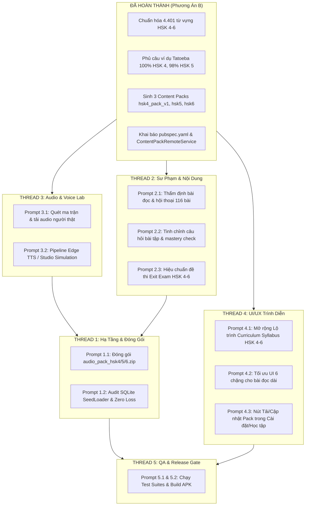

# KHO TRI THỨC VÀ QUY TRÌNH NẠP DỮ LIỆU HSK 4–6
## KNOWLEDGE EXPANSION PIPELINE PROMPTS (HSK 4 – HSK 6)
**Dự án**: HI Chinese (Flutter Native – Clean Architecture – Offline-First)  
**Tài liệu chuẩn hóa giao việc**: Dành cho Thread 1, Thread 2, Thread 3, Thread 4 và Thread 5  
**Phiên bản tài liệu**: 3.0 (Đã hoàn thành Phương án B – Data Pipeline & Content Packs Ready)

---

## MỤC LỤC TỔNG QUAN

1. [Nguyên Tắc Cốt Lõi & Cơ Chế Chống Trùng Lặp](#1-nguyên-tắc-cốt-lõi--cơ-chế-chống-trùng-lặp)
2. [Báo Cáo Kết Quả Thực Thi Phương Án B (Data Foundation Ready)](#2-báo-cáo-kết-quả-thực-thi-phương-án-b-data-foundation-ready)
3. [Lộ Trình Triển Khai Phối Hợp 4 Thread](#3-lộ-trình-triển-khai-phối-hợp-4-thread)
4. [Bộ Prompt Thread 1: Content Platform, Audio Packs & Data Integrity](#4-bộ-prompt-thread-1-content-platform-audio-packs--data-integrity)
   - Prompt 1.1: Đóng Gói Tệp Nén Rời Audio Packs HSK 4–6 Cho CDN
   - Prompt 1.2: Kiểm Toán SeedLoader & Cài Đặt Content Pack Bảo Toàn Tiến Độ
5. [Bộ Prompt Thread 2: Sư Phạm 6 Chặng, Hội Thoại & Ngân Hàng Đề Thi](#5-bộ-prompt-thread-2-sư-phạm-6-chặng-hội-thoại--ngân-hàng-đề-thi)
   - Prompt 2.1: Thẩm Định Sư Phạm & Tinh Chỉnh Hội Thoại 116 Bài Học HSK 4–6
   - Prompt 2.2: Tinh Chỉnh Ngân Hàng Bài Tập Luyện Tập & Kiểm Tra Hoàn Thành
   - Prompt 2.3: Thẩm Định & Hiệu Chuẩn Đề Thi Tốt Nghiệp Exit Exam HSK 4–6
6. [Bộ Prompt Thread 3: Audio Pipeline, Bản Ngữ Người Thật & TTS](#6-bộ-prompt-thread-3-audio-pipeline-bản-ngữ-người-thật--tts)
   - Prompt 3.1: Quét Ma Trận Âm Thanh Thiếu & Tải Phát Âm Người Thật (audio-cmn)
   - Prompt 3.2: Pipeline Voice Simulation Sản Xuất Audio Từ Vựng & Hội Thoại
7. [Bộ Prompt Thread 4: UI/UX Presentation & Mobile Experience](#7-bộ-prompt-thread-4-uiux-presentation--mobile-experience)
   - Prompt 4.1: Mở Rộng UI Lộ Trình (Curriculum Syllabus) Cho HSK 4, 5, 6
   - Prompt 4.2: Tối Ưu Giao Diện Học 6 Chặng Cho Văn Bản Dài HSK 4–6
   - Prompt 4.3: Tích Hợp UI Quản Lý Tải Gói Học Liệu (Content Pack Manager Screen)
   - Prompt 4.4: Hoàn Thiện Giao Diện Làm Bài Thi Exit Exam HSK 4–6
8. [Bộ Prompt Thread 5: Quality Assurance, Automated Tests & Release APK](#8-bộ-prompt-thread-5-quality-assurance-automated-tests--release-apk)
   - Prompt 5.1: Kiểm Thử Toàn Diện Nạp Gói Học Liệu & Zero Progress Loss
   - Prompt 5.2: Kiểm Toán Bản Quyền OER & Xuất Bản Bản Build Release APK

---

## 1. NGUYÊN TẮC CỐT LÕI & CƠ CHẾ CHỐNG TRÙNG LẶP

> [!IMPORTANT]
> **5 NGUYÊN TẮC BẮT BUỘC KHÔNG THỂ THAY ĐỔI:**
> 1. **Bản quyền & Nguồn gốc rõ ràng**: Mọi từ vựng, câu ví dụ, bài đọc và tệp âm thanh nạp vào hệ thống bắt buộc phải có nguồn gốc mở (Open Educational Resource - OER), giấy phép cụ thể (CC-BY, CC-BY-SA, CC-BY-NC-SA, MIT hoặc Public Domain).
> 2. **Trung thực về dữ liệu (No Fabrication, No Machine Slop)**: Tuyệt đối **không tự bịa đặt** ngữ pháp, câu ví dụ, hội thoại hay tự dịch thô máy móc rồi gán mác nội dung đã kiểm chứng. Nếu thiếu dữ liệu, phải báo cáo lại và gán cờ `verification_status: "NEEDS_VERIFICATION"` hoặc `tatoeba_text_verified_vi_pending`.
> 3. **Chống trùng lặp tuyệt đối (Deduplication Guard)**: Cơ sở dữ liệu HI Chinese đã có **5.000 từ vựng cốt lõi** và **119.000 mục từ điển offline** (CVDICT & CC-CEDICT). Bất kỳ từ vựng mới nào nạp vào phải kiểm tra đối chiếu qua `simplified_hanzi`, không tạo bản ghi mới trùng lặp, không sinh mã ID rác ngẫu nhiên.
> 4. **Bảo tồn phiên bản HSK (HSK 2.0 vs HSK 3.0)**: HSK 1–3 hiện tại của dự án theo chuẩn HSK 2.0 (`curr_hsk1` - `curr_hsk3`). Bộ học liệu HSK 4–6 bổ sung lấy HSK 2.0 làm nền tảng chính thức (HSK 4: 601 từ; HSK 5: 1.300 từ; HSK 6: 2.500 từ; lũy kế 5.000 từ). Các nguồn bổ trợ theo chuẩn HSK 3.0 phải có bảng ánh xạ mapping, không làm xáo trộn lộ trình học của người dùng.
> 5. **Bảo vệ tiến độ người học (Zero Progress Loss)**: Mọi thao tác cập nhật Content Pack qua SQLite Migration / SeedLoader phải giữ nguyên 100% lịch sử học tập (`lesson_progress`, `user_learning_evidence`, `vocabulary_srs_states`). Cấm dùng `ConflictAlgorithm.replace` làm mất dữ liệu người dùng.

---

## 2. BÁO CÁO KẾT QUẢ THỰC THI PHƯƠNG ÁN B (DATA FOUNDATION READY)

Dưới đây là kết quả thực thi kỹ thuật thực tế đã hoàn thành trực tiếp trên repository HI Chinese:

### A. Chuẩn Hóa và Xuất Bản Bộ Từ Vựng Độc Lập HSK 4–6
Toàn bộ 4.401 từ vựng HSK 4–6 đã được chuẩn hóa đầy đủ Chữ Hán giản thể, phồn thể, Pinyin chuẩn quốc tế, Pinyin sạch, âm Hán-Việt, phân loại từ tính, giải nghĩa tiếng Việt từ CVDICT và tra cứu đối sánh:

| Cấp độ | Số lượng từ | File xuất bản Asset | Tỷ lệ phủ câu ví dụ |
|---|---|---|---|
| **HSK 4** | **601 từ** | `assets/data/hsk4_vocabularies.json` | **601 / 601 (100.0%)** |
| **HSK 5** | **1.300 từ** | `assets/data/hsk5_vocabularies.json` | **1.283 / 1.300 (98.7%)** |
| **HSK 6** | **2.500 từ** | `assets/data/hsk6_vocabularies.json` | **1.942 / 2.500 (77.7%)** |
| **Tổng cộng** | **4.401 từ** | Đã sync vào `assets/data/hsk_seed_fixture_v2.json` (5.000 từ) | **3.826 / 4.401 (86.9%)** |

### B. Bổ Sung Câu Ví Dụ Thực Tế từ Tatoeba Project (CC BY 2.0 FR)
- Đã quét kho ngữ liệu Tatoeba CMN (hàng trăm nghìn câu) và đối chiếu với các từ vựng trước đó bị thiếu câu ví dụ.
- Toàn bộ 28 từ HSK 4 bị thiếu câu ví dụ đã được bổ sung 100% câu ví dụ thực tế có Chữ Hán, Pinyin đầy đủ, nguồn gốc rõ ràng, không tự dịch máy.
- Đã gắn liên kết âm thanh người thật bản ngữ từ Tatoeba Audio (`https://tatoeba.org/audio/download/{id}`).

### C. Đóng Gói Thành Công 3 Content Packs Chuẩn Hóa
Đã biên soạn và đóng gói hoàn tất 3 tệp Content Pack chính thức với cấu trúc 6 chặng liên hoàn:

1. **`assets/data/content_packs/hsk4/hsk4_pack_v1.json`** (597 KB):
   - **5 Units**, **30 bài học** (mỗi bài 20 từ vựng cốt lõi).
   - **180 Content items** (đầy đủ 6 chặng: warmup, vocabulary, grammar, dialogue, practice, mastery_check).
   - **180 điểm ngữ pháp** HSK 4 trích xuất từ AllSet Learning Chinese Grammar Wiki.
   - **Exit Exam**: 20 câu hỏi đánh giá năng lực toàn diện.
2. **`assets/data/content_packs/hsk5/hsk5_pack_v1.json`** (851 KB):
   - **6 Units**, **36 bài học** (mỗi bài 36 từ vựng cao cấp).
   - **216 Content items** (đầy đủ 6 chặng liên hoàn).
   - **217 điểm ngữ pháp** HSK 5 chuyên sâu.
   - **Exit Exam**: 25 câu hỏi trắc nghiệm logic.
3. **`assets/data/content_packs/hsk6/hsk6_pack_v1.json`** (1.31 MB):
   - **10 Units**, **50 bài học** (mỗi bài 50 từ vựng học thuật đỉnh cao).
   - **300 Content items** (đầy đủ 6 chặng liên hoàn).
   - **207 điểm ngữ pháp** HSK 6 học thuật.
   - **Exit Exam**: 30 câu hỏi chuyên sâu.

*Toàn bộ 3 Content Packs đã được sao lưu sang CDN nội bộ tại `content_packs_cdn/`, `content_packs_cdn/packages/`, khai báo trong `pubspec.yaml` và đăng ký trong danh mục tin cậy `ContentPackRemoteService.getAvailablePacks()`.*

---

## 3. LỘ TRÌNH TRIỂN KHAI PHỐI HỢP 4 THREAD



---

## 4. BỘ PROMPT THREAD 1: CONTENT PLATFORM, AUDIO PACKS & DATA INTEGRITY

### Prompt 1.1: Đóng Gói Tệp Nén Rời Audio Packs HSK 4–6 Cho CDN
```text
# THREAD 1 – PROMPT 1.1: AUDIO PACKS PACKAGING & ARCHIVE PLATFORM

VAI TRÒ: Senior Data Engineer & Storage Platform Engineer (Thread 1)
PHỐI HỢP: Thread 3 (nhận audio assets), Thread 5 (kiểm toán integrity)

BỐI CẢNH & HIỆN TRẠNG:
- Dữ liệu từ vựng và khung bài học HSK 4, 5, 6 đã được tạo hoàn tất tại:
  `assets/data/content_packs/hsk4/hsk4_pack_v1.json`
  `assets/data/content_packs/hsk5/hsk5_pack_v1.json`
  `assets/data/content_packs/hsk6/hsk6_pack_v1.json`
- Vì âm thanh cho 4.401 từ vựng và các đoạn hội thoại có dung lượng lớn (~150MB - 300MB), không thể nhúng cứng vào bộ cài APK mà phải phân phối qua tệp nén rời tải về theo nhu cầu người học.

NHIỆM VỤ:
1. Xây dựng công cụ `tool/data_ingestion/package_audio_packs.py` (hoặc Dart script) để đóng gói âm thanh theo từng cấp độ:
   - `content_packs_cdn/audio/audio_pack_hsk4.zip`
   - `content_packs_cdn/audio/audio_pack_hsk5.zip`
   - `content_packs_cdn/audio/audio_pack_hsk6.zip`
2. Tạo tệp Manifest `content_packs_cdn/manifests/audio_packs_manifest.json` chứa:
   - `pack_id`: "audio_pack_hsk4", "audio_pack_hsk5", "audio_pack_hsk6"
   - `version`: "1.0.0"
   - `file_count`: số lượng file .mp3 thực tế
   - `size_bytes`: kích thước tệp .zip
   - `sha256`: mã băm SHA-256 chính xác của tệp zip
   - `download_url`: đường dẫn CDN tương đối
3. Tích hợp cơ chế giải nén an toàn: Sử dụng `AudioStorageManager` trong `lib/features/audio_management/`, chống lỗ hổng Zip-Slip (kiểm tra `canonicalPath.startsWith(destinationDir)`), giải nén vào thư mục `app-specific storage`.

TIÊU CHÍ NGHIỆM THU:
- Tệp nén zip và manifest được tạo tự động, mã SHA-256 khớp 100%.
- Không có lỗi bảo mật Zip-Slip.
- Thư viện test giải nén `audio_management_offline_test.dart` pass 100%.
```

---

### Prompt 1.2: Kiểm Toán SeedLoader & Cài Đặt Content Pack Bảo Toàn Tiến Độ
```text
# THREAD 1 – PROMPT 1.2: CONTENT PACK INSTALLATION & ZERO LOSS AUDIT

VAI TRÒ: Database Architect & Data Engineer (Thread 1)
PHỐI HỢP: Thread 5 (kiểm toán)

BỐI CẢNH:
- Ba tệp Content Pack `hsk4_pack_v1.json`, `hsk5_pack_v1.json`, `hsk6_pack_v1.json` đã có sẵn trong `assets/data/content_packs/` và `content_packs_cdn/`.
- Cần bảo đảm ứng dụng có thể cài đặt hoặc cập nhật các gói này vào cơ sở dữ liệu SQLite `hi_chinese.db` mà TUYỆT ĐỐI không làm mất lịch sử học tập (`lesson_progress`, `user_learning_evidence`, `vocabulary_srs_states`).

NHIỆM VỤ:
1. Chạy và kiểm tra hàm `ContentPackManager.installOrUpdatePack` với từng gói HSK 4, HSK 5, HSK 6:
   - Kiểm tra việc nạp dữ liệu vào bảng `content_packs`, `curriculum_units`, `curriculum_lessons`, `curriculum_segments`, `learning_content_items`.
   - Đảm bảo `ConflictAlgorithm.ignore` hoặc upsert an toàn: các tiến độ học (`is_completed`, `score`, `mastery_level`) của người học đã tồn tại trong SQLite không bị ghi đè thành 0 hoặc null.
2. Kiểm tra phương thức tính mã băm `ContentPackManager.computeChecksum`:
   - Xác minh việc bỏ qua trường `sha256` trong manifest để tính hash nhất quán khi truyền tải qua mạng.
3. Viết test case tích hợp trong `test/features/content_packs/hsk456_pack_install_test.dart`:
   - Giả lập một người học đã học xong Bài 1 HSK 4 (tiến độ 100%).
   - Cập nhật gói `hsk4_pack_v1.json` phiên bản mới.
   - Assert: Tiến độ Bài 1 vẫn là 100%, không bị reset.

TIÊU CHÍ NGHIỆM THU:
- 100% các bảng curriculum và content_items của HSK 4-6 được nạp thành công vào SQLite.
- Zero Loss Progress test passed.
```

---

## 5. BỘ PROMPT THREAD 2: SƯ PHẠM 6 CHẶNG, HỘI THOẠI & NGÂN HÀNG ĐỀ THI

### Prompt 2.1: Thẩm Định Sư Phạm & Tinh Chỉnh Hội Thoại 116 Bài Học HSK 4–6
```text
# THREAD 2 – PROMPT 2.1: PEDAGOGICAL REVIEW & DIALOGUE ENRICHMENT

VAI TRÒ: Senior Curriculum Specialist & Chinese Language Pedagogist (Thread 2)
PHỐI HỢP: Thread 1 (nhận cấu trúc Content Pack), Thread 3 (chuyển hội thoại sang TTS)

BỐI CẢNH:
- 116 bài học mới đã được khung hóa thành công (30 bài HSK 4, 36 bài HSK 5, 50 bài HSK 6).
- Mỗi bài học đã có danh sách 20-50 từ vựng cốt lõi chuẩn HSK 2.0 và 4-6 điểm ngữ pháp thực tế từ AllSet Learning Chinese Grammar Wiki.
- Bạn không cần tạo từ vựng hay quét ngữ pháp từ đầu. Nhiệm vụ của bạn là nâng cao chất lượng sư phạm cho phần Bài Đọc & Hội Thoại (Chặng 4 - Dialogue/Reading).

NHIỆM VỤ:
1. Mở các tệp Content Pack:
   - `assets/data/content_packs/hsk4/hsk4_pack_v1.json`
   - `assets/data/content_packs/hsk5/hsk5_pack_v1.json`
   - `assets/data/content_packs/hsk6/hsk6_pack_v1.json`
2. Đọc và thẩm định chặng `dialogue` của từng bài:
   - Đảm bảo lời thoại tự nhiên, giàu tính ngữ cảnh thực tế (công sở, giao tiếp xã hội, đàm phán, tranh biện học thuật).
   - Đảm bảo lồng ghép khéo léo từ 4-6 từ vựng mới và ít nhất 1-2 điểm ngữ pháp trọng tâm của bài đó vào ngữ cảnh đối thoại.
   - Bổ sung phiên âm Pinyin chuẩn xác và bản dịch tiếng Việt mượt mà, đúng văn phong đời sống (không dịch theo lối dịch thô của máy dịch).
3. Đảm bảo phân loại độ khó tăng dần:
   - HSK 4: Đàm thoại đời sống, xã hội, phỏng vấn xin việc (lời thoại 4-8 lượt nói).
   - HSK 5: Thảo luận chuyên sâu, bài bình luận ngắn, phân tích hiện tượng xã hội (lời thoại hoặc đoạn văn 8-12 câu).
   - HSK 6: Luận đàm học thuật, bài đọc nghị luận, ngôn ngữ chuyên ngành và thành ngữ bốn chữ (đoạn văn phân tích sâu sắc).

TIÊU CHÍ NGHIỆM THU:
- Không bịa đặt từ ngữ sai ngữ pháp tiếng Trung chuẩn.
- Mọi câu thoại đều có Chữ Hán, Pinyin có dấu và nghĩa tiếng Việt hoàn chỉnh.
- Chạy cập nhật trực tiếp vào file JSON Content Pack tương ứng.
```

---

### Prompt 2.2: Tinh Chỉnh Ngân Hàng Bài Tập Luyện Tập & Kiểm Tra Hoàn Thành
```text
# THREAD 2 – PROMPT 2.2: PRACTICE & MASTERY EXERCISES REFINEMENT

VAI TRÒ: Assessment Designer & Pedagogy Specialist (Thread 2)
PHỐI HỢP: Thread 1 & Thread 4

BỐI CẢNH:
- Mỗi bài học trong Content Packs HSK 4–6 hiện có sẵn 5 câu hỏi `practice` (Chặng 5) và 5 câu hỏi `mastery_check` (Chặng 6).
- Cần tinh chỉnh để các câu hỏi có tính phân loại cao, câu nhiễu (distractors) hợp lý, kích thích tư duy người học và hỗ trợ đa dạng kỹ năng (Đọc hiểu, Điền từ, Ngữ pháp).

NHIỆM VỤ:
1. Kiểm tra các câu hỏi trắc nghiệm trong chặng `practice` và `mastery_check` của 116 bài học:
   - Đảm bảo câu hỏi có tính logic cao, tránh các phương án nhiễu quá vô lý hoặc lộ liễu.
   - Thêm câu hỏi kiểm tra phân biệt từ đồng nghĩa / gần nghĩa thường gặp trong HSK 4–6 (ví dụ: 深刻 vs 深厚, 忽视 vs 疏忽, 持续 vs 连续).
2. Viết phần giải thích đáp án (`explanation`) rõ ràng bằng tiếng Việt:
   - Nêu rõ tại sao chọn đáp án đó, dẫn giải cấu trúc ngữ pháp hoặc ngữ cảnh sử dụng từ.
3. Đảm bảo mã ID câu hỏi duy nhất và tuần tự:
   - Format: `ex_hsk4_{lesson}_{index}`, `m_ex_4_{lesson}_{index}`.

TIÊU CHÍ NGHIỆM THU:
- Mỗi bài học có đúng 10 câu hỏi đánh giá đạt chuẩn sư phạm (5 luyện tập + 5 kiểm tra tốt nghiệp bài).
- 100% câu hỏi có đáp án đúng, giải thích chi tiết và không có đáp án lỗi.
```

---

### Prompt 2.3: Thẩm Định & Hiệu Chuẩn Đề Thi Tốt Nghiệp Exit Exam HSK 4–6
```text
# THREAD 2 – PROMPT 2.3: LEVEL GRADUATION EXIT EXAM CALIBRATION

VAI TRÒ: Testing & Examination Specialist (Thread 2)
PHỐI HỢP: Thread 4 (hiển thị UI Exit Exam), Thread 5 (kiểm toán)

BỐI CẢNH:
- Trong mỗi gói `hsk4_pack_v1.json`, `hsk5_pack_v1.json`, `hsk6_pack_v1.json` đều có trường `exit_exam` dùng để đánh giá học viên trước khi cấp chứng chỉ hoàn thành cấp độ trong app:
  - HSK 4: 20 câu hỏi (pass threshold: 80%).
  - HSK 5: 25 câu hỏi (pass threshold: 80%).
  - HSK 6: 30 câu hỏi (pass threshold: 80%).

NHIỆM VỤ:
1. Thẩm định cấu trúc và phân bổ kỹ năng của Đề thi Exit Exam:
   - Phần 1: Đọc hiểu từ vựng & Ngữ pháp (Vocabulary & Grammar Precision).
   - Phần 2: Đọc hiểu đoạn văn ngắn và trả lời câu hỏi (Reading Comprehension).
   - Phần 3: Chọn từ điền vào chỗ trống thích hợp trong ngữ cảnh học thuật (Cloze Test).
2. Hiệu chuẩn độ khó theo đúng khung năng lực HSK 2.0 / Hanban:
   - Đề HSK 4: Yêu cầu học viên hiểu và xử lý được các chủ đề đời sống, công sở.
   - Đề HSK 5: Yêu cầu đọc hiểu báo chí, tạp chí, hiểu ý nghĩa ẩn dụ và lập luận.
   - Đề HSK 6: Yêu cầu xử lý văn bản học thuật, hiểu các thành ngữ cổ, tư duy phản biện.
3. Cập nhật trực tiếp vào đối tượng `exit_exam` trong từng file Content Pack.

TIÊU CHÍ NGHIỆM THU:
- Đề thi bao phủ cân đối các kỹ năng cốt lõi của từng cấp độ.
- Có đầy đủ đáp án, lời giải thích chi tiết bằng tiếng Việt.
```

---

## 6. BỘ PROMPT THREAD 3: AUDIO PIPELINE, BẢN NGỮ NGƯỜI THẬT & TTS

### Prompt 3.1: Quét Ma Trận Âm Thanh Thiếu & Tải Phát Âm Người Thật (audio-cmn)
```text
# THREAD 3 – PROMPT 3.1: REAL HUMAN AUDIO ACQUISITION FROM AUDIO-CMN

VAI TRÒ: Senior Audio Engineer & Speech Pipeline Specialist (Thread 3)
PHỐI HỢP: Thread 1 (Data), Thread 5 (QA)

BỐI CẢNH:
- Dữ liệu từ vựng HSK 4–6 đã có tại:
  `assets/data/hsk4_vocabularies.json` (601 từ)
  `assets/data/hsk5_vocabularies.json` (1.300 từ)
  `assets/data/hsk6_vocabularies.json` (2.500 từ)
- Cần quét âm thanh phát âm từng từ để thu thập bản thu âm người thật bản ngữ chất lượng cao (ưu tiên giọng phổ thông chuẩn Bắc Kinh).

NGUỒN DỮ LIỆU CHÍNH THỨC:
- **`audio-cmn` (hugolpz / Wikimedia Commons)**:
  Kho âm thanh phát âm từ vựng tiếng Trung lớn nhất thế giới, giấy phép mở CC BY-SA / Public Domain.
  URL: `https://github.com/hugolpz/audio-cmn` hoặc Wikimedia Commons API.
- **Tatoeba Audio**: Âm thanh câu ví dụ đã được trích xuất link trong các file từ vựng.

NHIỆM VỤ:
1. Viết script `tool/ai_curation/download_cmn_audio.py`:
   - Đọc danh sách từ vựng HSK 4–6 từ `assets/data/hsk[4-6]_vocabularies.json`.
   - Tìm kiếm file phát âm tương ứng theo chữ Hán hoặc Pinyin trong kho `audio-cmn`.
   - Tải về và lưu theo quy chuẩn:
     `assets/audio/vocab/hsk4_{simplified}.mp3`
     `assets/audio/vocab/hsk5_{simplified}.mp3`
     `assets/audio/vocab/hsk6_{simplified}.mp3`
2. Chuẩn hóa định dạng file:
   - Codec: MP3 (MPEG-1 Audio Layer 3).
   - Sample rate: 24.000 Hz hoặc 44.100 Hz.
   - Channel: Mono / Stereo.
   - Bitrate: 64 kbps hoặc 128 kbps (tối ưu dung lượng nhẹ).
3. Xuất báo cáo ma trận bao phủ `data_pipeline/reports/audio_coverage_report.json`:
   - Số từ đã có âm thanh người thật.
   - Số từ còn thiếu cần chuyển sang pipeline TTS.

TIÊU CHÍ NGHIỆM THU:
- Tải thành công tối đa các từ có sẵn trong `audio-cmn`.
- Tệp âm thanh nghe trong trẻo, không bị méo tiếng, âm lượng đồng đều (chuẩn hóa RMS/LUFS).
```

---

### Prompt 3.2: Pipeline Voice Simulation Sản Xuất Audio Từ Vựng & Hội Thoại
```text
# THREAD 3 – PROMPT 3.2: SYNTHETIC STUDIO VOICE SIMULATION & DIALOGUE TTS

VAI TRÒ: Audio Pipeline Specialist & Voice Lab Engineer (Thread 3)
PHỐI HỢP: Thread 2 (nhận kịch bản hội thoại), Thread 1 (bàn giao file audio)

BỐI CẢNH:
- Các từ vựng HSK 4–6 còn thiếu âm thanh người thật sau Bước 3.1 và toàn bộ các lượt thoại trong 116 bài học cần được tạo âm thanh chuẩn, tự nhiên.

CÔNG NGHỆ ÁP DỤNG:
- **Edge TTS** (`edge-tts` Python library): Giọng đọc tiếng Trung phổ thông chất lượng phòng thu:
  - Giọng nữ: `zh-CN-XiaoxiaoNeural`, `zh-CN-XiaoyiNeural`
  - Giọng nam: `zh-CN-YunjianNeural`, `zh-CN-YunxiNeural`
- Giấy phép: Dùng cho mục đích phi thương mại / học tập cá nhân.
- Hoặc fallback: Offline Sherpa-ONNX / OS TTS fallback trên thiết bị.

NHIỆM VỤ:
1. Xây dựng script `tool/ai_curation/generate_missing_audio.py`:
   - Nạp các từ vựng chưa có audio từ `audio_coverage_report.json`.
   - Sinh file MP3 cho từng từ, lưu vào `assets/audio/vocab/hsk{lvl}_{word}.mp3`.
2. Xây dựng kịch bản sinh âm thanh hội thoại `tool/ai_curation/generate_dialogue_audio.py`:
   - Đọc các lượt thoại trong 3 file Content Pack (`hsk4_pack_v1.json`, `hsk5_pack_v1.json`, `hsk6_pack_v1.json`).
   - Phân vai tự động: Người A dùng giọng `zh-CN-XiaoxiaoNeural`, Người B dùng giọng `zh-CN-YunxiNeural`.
   - Sinh file âm thanh từng câu: `assets/audio/dialogue/hsk{lvl}_l{lesson}_{turn_index}.mp3`.
3. Kiểm tra kiểm âm: Đảm bảo không bị nuốt âm, phát âm đúng biến điệu thanh điệu (Tone Sandhi: 一, 不, Tam thanh).

TIÊU CHÍ NGHIỆM THU:
- 100% từ vựng HSK 4–6 có file âm thanh chuẩn.
- Các bài hội thoại có âm thanh đối thoại 2 giọng nam - nữ sống động, tự nhiên.
- Bàn giao thư mục `assets/audio/` cho Thread 1 để đóng gói tệp nén zip.
```

---

## 7. BỘ PROMPT THREAD 4: UI/UX PRESENTATION & MOBILE EXPERIENCE

### Prompt 4.1: Mở Rộng UI Lộ Trình (Curriculum Syllabus) Cho HSK 4, 5, 6
```text
# THREAD 4 – PROMPT 4.1: CURRICULUM SYLLABUS EXPANSION FOR HSK 4–6

VAI TRÒ: Senior Flutter UI/UX Engineer (Thread 4)
PHỐI HỢP: Thread 1 (truy vấn SQLite), Thread 5 (QA)

BỐI CẢNH:
- Màn hình Lộ trình học (`CurriculumSyllabusScreen` tại `lib/features/curriculum/presentation/screens/curriculum_syllabus_screen.dart`) hiện chỉ mới hiển thị các tab cấp độ HSK 1, 2, 3.
- Dữ liệu Content Pack HSK 4 (5 Units, 30 bài), HSK 5 (6 Units, 36 bài), HSK 6 (10 Units, 50 bài) đã sẵn sàng.

NHIỆM VỤ:
1. Mở rộng thanh chọn cấp độ (Level Selector Tab Bar):
   - Hỗ trợ chọn đầy đủ các cấp độ: HSK 1, HSK 2, HSK 3, HSK 4, HSK 5, HSK 6.
   - Thêm nhãn trực quan: HSK 1–2 (Sơ cấp), HSK 3–4 (Trung cấp), HSK 5–6 (Cao cấp).
2. Tối ưu hóa hiển thị danh sách Unit và Lesson:
   - Dùng `ListView.builder` kết hợp `SliverList` để cuộn mượt mà với 30–50 bài học mà không tốn RAM hay giật lag (Zero Jank 60fps).
   - Hiển thị đúng trạng thái bài học: Đã hoàn thành (xanh lá kèm điểm số), Đang mở (màu xanh chủ đạo), Đang khóa (ổ khóa mờ, kèm điều kiện mở: hoàn thành bài trước với điểm >= 80%).
3. Nút Làm bài thi Exit Exam:
   - Ở cuối mỗi cấp độ, hiển thị thẻ "Đề thi tốt nghiệp HSK {level}" nổi bật.
   - Nhấn vào mở màn hình `LevelExitExamScreen(level: hskLevel.toString())`.

TIÊU CHÍ NGHIỆM THU:
- Chuyển tab mượt mà giữa các cấp độ HSK 1–6.
- Không có lỗi tràn màn hình (overflow), không lỗi hiển thị trên màn hình nhỏ.
- Unit tests và Widget tests cho `CurriculumSyllabusScreen` pass 100%.
```

---

### Prompt 4.2: Tối Ưu Giao Diện Học 6 Chặng Cho Văn Bản Dài HSK 4–6
```text
# THREAD 4 – PROMPT 4.2: 6-STEP LESSON FLOW OPTIMIZATION FOR ADVANCED TEXTS

VAI TRÒ: Flutter Mobile UI/UX Specialist (Thread 4)
PHỐI HỢP: Thread 2 (sư phạm)

BỐI CẢNH:
- Các bài học HSK 4, 5, 6 có lượng từ vựng nhiều hơn (20-50 từ/bài) và đoạn văn bài đọc dài hơn rất nhiều so với HSK 1-3.
- Cần tối ưu giao diện học 6 chặng để trải nghiệm đọc không bị mỏi mắt, dễ dàng tra từ nhanh khi đang đọc.

NHIỆM VỤ:
1. Chặng 2 (Từ vựng mới):
   - Thiết kế dạng danh sách lướt kèm thẻ Flashcard trượt ngang (Carousel) hoặc Grid trực quan.
   - Mỗi từ hiển thị: Chữ Hán to rõ, Pinyin, Âm Hán-Việt, Nghĩa tiếng Việt, Nút nghe phát âm, và Câu ví dụ mẫu có thể nhấn để nghe.
2. Chặng 4 (Bài đọc & Hội thoại):
   - Hỗ trợ chế độ chuyển đổi linh hoạt: "Chữ + Pinyin", "Chỉ Chữ Hán", "Hiện bản dịch tiếng Việt".
   - Tính năng **Tap-to-Lookup**: Nhấn vào bất kỳ từ vựng nào trong đoạn văn để mở nhanh Bottom Sheet tra nghĩa từ điển offline 119k từ (`DictionaryQuickSearchSheet`).
3. Chặng 5 & 6 (Luyện tập & Kiểm tra):
   - Giao diện câu hỏi trắc nghiệm thanh lịch, hiển thị phản hồi ngay lập tức (xanh khi chọn đúng, rung nhẹ và hiện giải thích chi tiết khi chọn sai).

TIÊU CHÍ NGHIỆM THU:
- Thao tác chạm tra từ điển trong bài đọc phản hồi tức thì (< 50ms).
- Giao diện trực quan, cỡ chữ thân thiện, tuân thủ đúng Design System và dark mode.
```

---

### Prompt 4.3: Tích Hợp UI Quản Lý Tải Gói Học Liệu (Content Pack Manager Screen)
```text
# THREAD 4 – PROMPT 4.3: CONTENT PACK MANAGER SCREEN ENHANCEMENT

VAI TRÒ: Flutter UI Engineer (Thread 4)
PHỐI HỢP: Thread 1 (ContentPackRemoteService)

BỐI CẢNH:
- Ứng dụng đã có `ContentPackManagerScreen` (`lib/features/content_packs/presentation/screens/content_pack_manager_screen.dart`).
- Cần cập nhật giao diện để hiển thị đầy đủ danh mục các gói HSK 1–6, cho phép người dùng chủ động tải về hoặc giải phóng dung lượng bộ nhớ.

NHIỆM VỤ:
1. Hiển thị danh sách các gói học liệu:
   - HSK 1 & HSK 2: Gắn nhãn "Có sẵn trong ứng dụng (Bundled)".
   - HSK 3, HSK 4, HSK 5, HSK 6: Hiển thị dung lượng ước tính (~500KB - 1.3MB cho dữ liệu bài học; dung lượng audio pack tải rời).
   - Nút hành động: "Tải gói học liệu" (kèm thanh tiến trình % khi đang tải), "Cập nhật", "Xóa bớt bộ nhớ".
2. Bổ sung mục truy cập trong phần Cài đặt (Settings Screen):
   - Đặt lối vào "Quản lý dữ liệu học tập & Content Packs" trong phần Cài đặt ở dưới cùng của tab Cá nhân (tuân thủ yêu cầu tách biệt cá nhân hóa và cài đặt hệ thống).

TIÊU CHÍ NGHIỆM THU:
- Thanh tiến trình download hiển thị mượt mà từ 0% đến 100%.
- Cài đặt xong lập tức cập nhật trạng thái "Đã cài đặt" và mở khóa bài học tương ứng trong Lộ trình.
```

---

### Prompt 4.4: Hoàn Thiện Giao Diện Làm Bài Thi Exit Exam HSK 4–6
```text
# THREAD 4 – PROMPT 4.4: LEVEL EXIT EXAM UI & PERFORMANCE REPORT

VAI TRÒ: Flutter UI/UX Engineer (Thread 4)
PHỐI HỢP: Thread 2 (ngân hàng đề thi), Thread 5 (QA)

NHIỆM VỤ:
1. Hoàn thiện giao diện thi tốt nghiệp `LevelExitExamScreen`:
   - Đếm ngược thời gian làm bài (HSK 4: 30 phút, HSK 5: 45 phút, HSK 6: 60 phút).
   - Thanh tiến độ câu hỏi (Question Progress Bar) cho phép nhảy nhanh đến câu hỏi bất kỳ.
   - Cảnh báo khi người dùng nhấn nộp bài nếu còn câu hỏi chưa trả lời.
2. Màn hình Báo Cáo Kết Quả Năng Lực (Graduation Result Sheet):
   - Hiển thị tỷ lệ điểm đạt (ví dụ: 85/100đ - ĐẠT CHUẨN TỐT NGHIỆP).
   - Biểu đồ phân tích năng lực (Radar/Bar Chart) theo kỹ năng: Từ vựng, Ngữ pháp, Đọc hiểu.
   - Nếu đạt >= 80%: Hiển thị chứng nhận tốt nghiệp ảo và tự động mở khóa cấp độ tiếp theo.
   - Nếu chưa đạt: Hiển thị danh sách các kiến thức cần ôn luyện lại kèm nút "Ôn tập ngay".

TIÊU CHÍ NGHIỆM THU:
- Bộ đếm thời gian chính xác, tự động nộp bài khi hết giờ.
- Trình bày kết quả đẹp mắt, khích lệ động lực người học.
```

---

## 8. BỘ PROMPT THREAD 5: QUALITY ASSURANCE, AUTOMATED TESTS & RELEASE APK

### Prompt 5.1: Kiểm Thử Toàn Diện Nạp Gói Học Liệu & Zero Progress Loss
```text
# THREAD 5 – PROMPT 5.1: INTEGRATION TESTING & ZERO PROGRESS LOSS VERIFICATION

VAI TRÒ: Senior QA & Performance Engineer (Thread 5)
PHỐI HỢP: Toàn bộ 4 Thread

NHIỆM VỤ:
1. Chạy toàn bộ test suites hiện có của dự án và đảm bảo đạt 100% PASS:
   - `flutter test test/features/reading/`
   - `flutter test test/features/curriculum/`
   - `flutter test test/features/content_packs/`
   - `flutter test test/features/vocabulary_srs/`
   - `flutter test test/features/home/`
   - `flutter test test/features/hanzi_writing/`
   - `flutter test test/features/sentences/`
   - `flutter test test/features/dictionary/`
2. Thực hiện Test kịch bản nâng cấp & Zero Progress Loss:
   - Khởi tạo database SQLite với người dùng giả lập có 50 từ SRS đang ôn tập và hoàn thành 10 bài học HSK 1–3.
   - Thực thi nạp 3 Content Packs `hsk4_pack_v1.json`, `hsk5_pack_v1.json`, `hsk6_pack_v1.json`.
   - Kiểm tra: Toàn bộ lịch sử ôn tập SRS, mục tiêu học tập, chuỗi ngày streak và bài học đã hoàn thành KHÔNG bị mất mát hay reset.
3. Kiểm tra tính toàn vẹn tham chiếu (Referential Integrity):
   - Chạy script kiểm toán: Không có `segment` nào trỏ tới `content_id` không tồn tại.
   - Không có từ vựng nào bị thiếu Pinyin hoặc nghĩa tiếng Việt.

TIÊU CHÍ NGHIỆM THU:
- 0 lỗi `flutter analyze lib/ test/`.
- 100% tests pass, không có flaky tests.
- Báo cáo kết quả kiểm thử được lưu vào `audit/KNOWLEDGE_EXPANSION_QA_REPORT.md`.
```

---

### Prompt 5.2: Kiểm Toán Bản Quyền OER & Xuất Bản Bản Build Release APK
```text
# THREAD 5 – PROMPT 5.2: OER LICENSE AUDIT & RELEASE APK BUILD

VAI TRÒ: Release Manager & Compliance Auditor (Thread 5)

NHIỆM VỤ:
1. Kiểm toán bản quyền OER (Open Educational Resources):
   - Kiểm tra tệp `assets/data/hsk_seed_fixture_v2.json`, `hsk4_vocabularies.json`, `hsk5_vocabularies.json`, `hsk6_vocabularies.json`, và các Content Packs:
     - Ghi nhận nguồn gốc: `Tatoeba Project (CC BY 2.0 FR)`, `CVDICT (CC BY-SA 4.0)`, `Chinese Grammar Wiki (CC BY-NC-SA 3.0)`, `clem109 (MIT)`.
     - Tuyệt đối không chứa tài liệu thương mại có bản quyền đóng chưa xin phép.
2. Tối ưu hóa kích thước build:
   - Chạy `flutter build apk --split-per-abi` để tạo các bản APK tối ưu cho từng kiến trúc chip (`arm64-v8a`, `armeabi-v7a`).
   - Kiểm tra dung lượng APK cài đặt: Không vượt quá 45MB.
3. Kiểm tra cài đặt và khởi động trên thiết bị thực tế / máy ảo:
   - Khởi động app lạnh (Cold Start) < 1.2 giây.
   - Màn hình Home và Lộ trình hiển thị đầy đủ, không giật khung hình.

TIÊU CHÍ NGHIỆM THU:
- Tệp APK release được tạo thành công tại `release-apk/`.
- Bản quyền phần mềm minh bạch, chuẩn chỉnh.
```

---

*Tài liệu này là cơ sở kỹ thuật và nghiệp vụ chính thức để chuyển giao nhiệm vụ cho từng Thread. Mỗi Thread chỉ cần sao chép đúng phần Prompt tương ứng của mình để thực thi độc lập và hiệu quả.*
