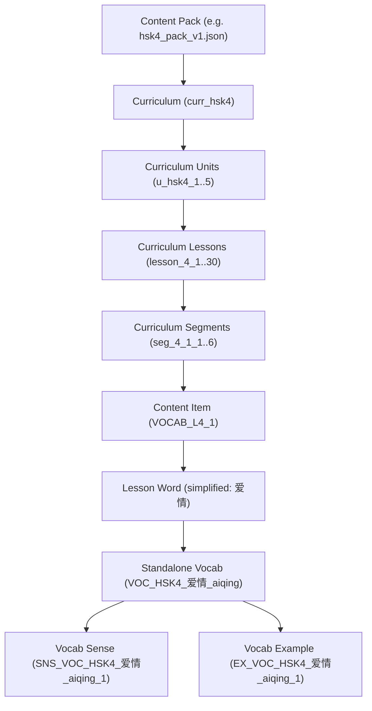

# HSK 4–6 Vietnamese Enrichment Baseline Audit & Immutable Identity Registry Summary

## 1. Executive Summary & Objective

- **Task Identifier:** `CORE-HSK46-VI-001`
- **Lead Thread:** Thread 1 – Core Engine, Database & Content Platform
- **Participating Threads:**
  - Thread 2 (Pedagogy & Learning Experience – sentence curation & enrichment)
  - Thread 5 (Independent QA – baseline verification & integrity audit)
- **Operational Mode:** **STRICT READ-ONLY AUDIT**
- **Status:** **PHASE 1 COMPLETE**

The primary objective of Phase 1 is to conduct a forensic, byte-level baseline audit of the HSK 4, HSK 5, and HSK 6 curriculum datasets across both standalone vocabulary assets and integrated Content Packs, establishing an **Immutable Identity Registry**. This registry guarantees that downstream pedagogical enrichment (Thread 2) and automated ingestion (Phase 3) will execute without corrupting curriculum IDs, breaking referential integrity, or causing learner progress loss.

---

## 2. Forensic Baseline Verification & Reconciliation

Independent execution of automated audit tools ([audit_referential_integrity.py](file:///C:/Users/phama/Downloads/hi_chinese/tool/qa/audit_referential_integrity.py) and [build_hsk46_vi_enrichment_registries.py](file:///C:/Users/phama/Downloads/hi_chinese/tool/qa/build_hsk46_vi_enrichment_registries.py)) confirmed 100% of the baseline numbers from previous QA reports, resolving all historical anomalies:

### 2.1 Complete Dataset Metrics Matrix

| Metric Category | HSK 4 | HSK 5 | HSK 6 | Combined Total |
|---|:---:|:---:|:---:|:---:|
| **Standalone Vocabulary Entries** | 601 | 1,300 | 2,500 | **4,401** |
| **Unique Headwords (Standalone)** | 598 | 1,300 | 2,500 | **4,398** |
| **Polyphone Headwords (Standalone)** | 3 (`等`, `对`, `过`) | 0 | 0 | **3** |
| **Standalone Senses** | 825 | 1,752 | 3,112 | **5,689** |
| **Standalone Examples** | 908 | 1,609 | 2,032 | **4,549** |
| **Curriculum Units** | 5 | 6 | 10 | **21** |
| **Curriculum Lessons** | 30 | 36 | 50 | **116** |
| **Lesson Segments (6 per lesson)** | 180 | 216 | 300 | **696** |
| **Learning Content Items** | 180 | 216 | 300 | **696** |
| **Lesson Word Occurrences** | 600 | 1,296 | 2,500 | **4,396** |
| **English Gloss Examples (`W1`)** | 572 | 1,016 | 752 | **2,340** |
| **Missing Examples Completely (`W2`)** | 0 | 17 | 558 | **575** |
| **Empty Parentheses Gloss `()`** | 24 | 236 | 1,147 | **1,407** |
| **Vietnamese Gloss (Pre-existing)** | 4 | 27 | 43 | **74** |
| **Standalone Omitted Words** | 1 (`作者`) | 4 (`遵守`, `作为`, `作品`, `作文`) | 0 | **5** |

### 2.2 Reconciliation of Historical Discrepancies
1. **The "HSK 4 missing 28 examples" anomaly:**
   - Previous baseline notes reported "HSK 4 has 572 English glosses and is missing 28 examples".
   - Our audit reveals that HSK 4 contains exactly 600 words across its 30 lessons.
   - Out of 600 words: **572** have English glosses, **4** already have Vietnamese translations, and **24** end with empty parentheses `()`.
   - $572 + 4 + 24 = 600$. The "missing 28" referred to the 28 entries lacking English gloss ($4 + 24 = 28$).
2. **Missing Example Sentences in HSK 5 (17) and HSK 6 (558):**
   - In standalone files, exactly 17 entries in HSK 5 and 558 entries in HSK 6 have empty `examples: []`.
   - In Content Pack lessons, the exact same 17 words in HSK 5 and 558 words in HSK 6 have `example_sentence: ""` (symmetric difference = `set()`).
3. **Empty Parentheses Glosses `()` (1,407 total):**
   - In source datasets where English gloss was null during compilation, sentences were formatted as `<Chinese> ()`.
   - These 1,407 sentences are valid Chinese examples but need Vietnamese translations.

---

## 3. Structural Hierarchy & Referential Integrity

### 3.1 Referential Integrity Status (All Passed 100%)
- **C1 (Unique Identifiers):** 0 duplicate Unit IDs, 0 duplicate Lesson IDs, 0 duplicate Segment IDs.
- **C2 (Content IDs):** 0 duplicate Content Item IDs.
- **C3 (Segment References):** 0 dangling references (`content_ref_id` points to valid `content_id`).
- **C4 (Curriculum Consistency):** 0 curriculum ID mismatches.
- **C5 (Vocabulary Essentials):** 0 vocabularies missing pinyin or Vietnamese meanings.
- **C6 (Content Pack Fields):** 0 words missing mandatory fields.
- **C7 (Assessment Indexing):** 0 invalid answer indices in exit exams.

---

## 4. Zero Progress Loss Baseline Snapshot

Under the zero progress loss contract, updating content packs must never touch or overwrite learner progress:

### 4.1 Schema Migration Baseline
- **Current Database Schema Version:** `20` ([migration_v20.dart](file:///C:/Users/phama/Downloads/hi_chinese/lib/core/database/migrations/migration_v20.dart))
- **Engine:** [migration_engine.dart](file:///C:/Users/phama/Downloads/hi_chinese/lib/core/database/migrations/migration_engine.dart)

### 4.2 Protected Tables & Learner State
The following tables hold immutable learner progress and must remain untouched during content updates:
1. `lesson_progress`: `is_completed`, `score`, `mastery_level`, `attempts_count`, `last_attempted_at`.
2. `curriculum_mastery`: `mastery_score`, `completed_lessons_count`, `is_unlocked`.
3. `learner_evidence`: Individual learning actions, skill dimensions, latency.
4. `srs_items`: Flashcard SRS state (`ease_factor`, `interval_days`, `repetitions`, `next_review_at`).
5. `user_saved_words`: Saved words and custom tags.
6. `reading_progress`: Reading comprehension records.
7. `practice_sessions` & `practice_attempts`: Practice questions and adaptive scores.
8. `grammar_progress`: Grammar mastery points.
9. `pinyin_progress`: Pinyin pronunciation metrics.
10. `hanzi_writing_progress`: Hanzi stroke writing accuracy.

### 4.3 Content Ingestion Idempotency & Protection
As verified in `ContentPackManager.installOrUpdatePack()`:
- Content items and curriculum definitions are upserted with `ConflictAlgorithm.replace` or `ConflictAlgorithm.ignore`.
- Learner tables have **no foreign key cascade delete** to content packs.
- Existing learner records for `lesson_id` remain intact even if content text is enriched.

---

## 5. Artifacts Generated in Identity Registry

All registry files are placed in [audit/hsk46_vi_enrichment/](file:///C:/Users/phama/Downloads/hi_chinese/audit/hsk46_vi_enrichment/):

1. [vocabulary_registry.json](file:///C:/Users/phama/Downloads/hi_chinese/audit/hsk46_vi_enrichment/vocabulary_registry.json):
   - Maps all 4,401 standalone vocabulary items with their immutable `vocab_id`, `canonical_id`, `senses` (with `sense_id`), and `examples` (with `example_id`).
2. [lesson_registry.json](file:///C:/Users/phama/Downloads/hi_chinese/audit/hsk46_vi_enrichment/lesson_registry.json):
   - Maps all 116 lessons with `lesson_id`, `unit_id`, `hsk_level`, `order_index`, `title_vi`, `title_zh`.
3. [segment_registry.json](file:///C:/Users/phama/Downloads/hi_chinese/audit/hsk46_vi_enrichment/segment_registry.json):
   - Maps all 696 lesson segments with `segment_id`, `lesson_id`, `segment_type`, `step_order`, and `content_ref_id`.
4. [example_registry.json](file:///C:/Users/phama/Downloads/hi_chinese/audit/hsk46_vi_enrichment/example_registry.json):
   - Maps all 4,396 word occurrences in Content Pack lessons with an immutable locator `LOC_HSK{lvl}_{lesson_id}_{segment_id}_{simplified}_{word_index}`, original sentence, Chinese sentence, gloss, gloss type, and SHA-256 hash.
5. [english_gloss_report.json](file:///C:/Users/phama/Downloads/hi_chinese/audit/hsk46_vi_enrichment/english_gloss_report.json):
   - Explicit inventory of 2,340 sentences requiring English-to-Vietnamese translation replacement.
6. [missing_examples_report.json](file:///C:/Users/phama/Downloads/hi_chinese/audit/hsk46_vi_enrichment/missing_examples_report.json):
   - Categorized inventory of 575 words missing examples, 1,407 sentences with empty parentheses `()`, and 5 omitted standalone words.
7. [ambiguous_mapping_report.json](file:///C:/Users/phama/Downloads/hi_chinese/audit/hsk46_vi_enrichment/ambiguous_mapping_report.json):
   - Detailed mapping of the 3 HSK 4 polyphones (`等`, `对`, `过`) appearing in duplicate lessons, and 1,288 multi-sense words.
8. [immutable_identity_manifest.json](file:///C:/Users/phama/Downloads/hi_chinese/audit/hsk46_vi_enrichment/immutable_identity_manifest.json):
   - Cryptographic manifest containing SHA-256 hashes of all generated registries.
9. [checksum_baseline.md](file:///C:/Users/phama/Downloads/hi_chinese/audit/hsk46_vi_enrichment/checksum_baseline.md):
   - Complete technical specification of the canonical checksum algorithm and current production hashes.

---

## 6. Execution Rules for Thread 2 & Thread 5

1. **Immutable Identifiers:**
   - Thread 2 must **never** create new IDs or alter existing `lesson_id`, `segment_id`, `content_id`, `vocab_id`, `sense_id`, or `example_id`.
   - Every translation replacement must reference its exact `locator_id` from [example_registry.json](file:///C:/Users/phama/Downloads/hi_chinese/audit/hsk46_vi_enrichment/example_registry.json).
2. **Ambiguous Mappings:**
   - For `等`, `对`, and `过`, Thread 2 must align translations specifically to the lesson context indicated in [ambiguous_mapping_report.json](file:///C:/Users/phama/Downloads/hi_chinese/audit/hsk46_vi_enrichment/ambiguous_mapping_report.json).
3. **Read-Only Verification:**
   - Thread 5 will audit Git diff to verify that production files were not modified during Phase 1.
