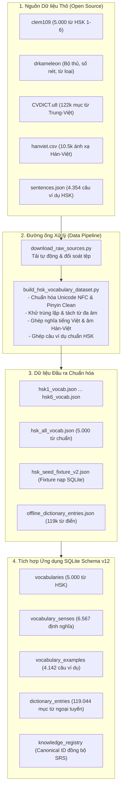

# TÀI LIỆU HƯỚNG DẪN VẬN HÀNH & CẬP NHẬT DỮ LIỆU TỪ VỰNG (DATA INGESTION GUIDE)
**Dự án: HI Chinese • Hệ thống Học liệu & Từ điển Ngoại tuyến**

---

## 1. MỤC TIÊU VÀ NGUYÊN TẮC BẢO TOÀN HỆ THỐNG

Tài liệu này hướng dẫn chi tiết quy trình:
1. Thu thập dữ liệu nguồn mở.
2. Chuẩn hóa và làm giàu dữ liệu từ điển.
3. Nhập dữ liệu vào cơ sở dữ liệu SQLite Schema v12.
4. Cập nhật các gói học liệu mới mà **hoàn toàn không làm ảnh hưởng đến tiến độ học tập của người dùng**.

---

## 2. KIẾN TRÚC ĐƯỜNG ỐNG DỮ LIỆU (DATA PIPELINE ARCHITECTURE)



---

## 3. QUY TRÌNH THỰC HIỆN TỪNG BƯỚC

### Bước 1: Tải về toàn bộ Nguồn Dữ liệu Thô
Chạy đoạn mã Python tải về để cập nhật các tệp mới nhất từ GitHub:
```powershell
python data_pipeline\download_raw_sources.py
```
*Kết quả:* Các tệp sẽ được lưu an toàn tại thư mục `data_pipeline/raw/`. Quá trình kiểm tra hash và không tải đè nếu tệp đã tồn tại đầy đủ.

### Bước 2: Chuẩn hóa, Khử trùng lặp và Xây dựng Bộ dữ liệu
Chạy kịch bản xử lý dữ liệu trung tâm:
```powershell
python data_pipeline\build_hsk_vocabulary_dataset.py
```
*Nhiệm vụ kịch bản:*
- Đọc `CVDICT.u8`, nạp 119.044 từ mục Trung - Việt.
- Nạp bảng đối soát chữ giản thể sang phồn thể và âm Hán - Việt.
- Bóc tách 5.000 từ HSK thành các thực thể độc lập theo cách đọc Pinyin.
- Ghép các câu ví dụ từ `sentences.json` vào từng từ vựng.
- Xuất các tệp JSON ra `data_pipeline/processed/`.

### Bước 3: Đồng bộ vào Fixture Ứng dụng
Sao chép bản fixture v2 vào thư mục assets của Flutter:
```powershell
Copy-Item "data_pipeline\processed\hsk_seed_fixture_v2.json" -Destination "assets\data\hsk_seed_fixture_v2.json"
```

### Bước 4: Nhập trực tiếp vào Cơ sở Dữ liệu SQLite (CLI Tool)
Ứng dụng cung cấp sẵn công cụ dòng lệnh Dart bằng `tool/import_vocabulary.dart`:
```powershell
# Nạp toàn bộ 5.000 từ vựng HSK, 6.567 định nghĩa và 4.142 ví dụ:
dart run tool/import_vocabulary.dart --all

# Hoặc nạp kèm từ điển ngoại tuyến tổng quát 119.000 từ:
dart run tool/import_vocabulary.dart --all --dict
```

---

## 4. BẢO VỆ TIẾN ĐỘ NGƯỜI HỌC KHI CẬP NHẬT HỌC LIỆU

Hệ thống tuân thủ nghiêm ngặt 3 nguyên tắc bất biến:
1. **Sử dụng lệnh `INSERT ... ON CONFLICT(id) DO UPDATE SET`:**
   - Khi cập nhật nghĩa tiếng Việt mới hoặc câu ví dụ mới, cơ sở dữ liệu chỉ cập nhật các trường học liệu (`meaning_vi`, `example_cn`, `hanviet`).
   - Tuyệt đối không xóa và tạo lại bản ghi.
2. **Không chạm vào bảng tiến độ:**
   - Các bảng `mastery_snapshots`, `mastery_progress`, `srs_items`, `learner_evidence` hoàn toàn nằm ngoài phạm vi thay đổi khi import từ vựng.
3. **Định danh chuẩn hóa ổn định (`KNOW_VOCAB_...`):**
   - Thẻ nhớ SRS lưu liên kết theo `KNOW_VOCAB_爱_ai`. Kể cả khi câu ví dụ hay định nghĩa bổ sung thay đổi, lịch ôn tập ngắt quãng (khoảng cách ngày, độ khó) của người dùng vẫn được giữ nguyên vẹn 100%.

---

## 5. LỆNH KIỂM THỬ XÁC MINH TOÀN BỘ HỆ THỐNG

Sau mỗi lần cập nhật dữ liệu, bắt buộc chạy các lệnh kiểm tra:

```powershell
# 1. Phân tích tĩnh (bảo đảm 0 lỗi, 0 cảnh báo)
dart analyze lib test

# 2. Kiểm thử Migration v12 và tìm kiếm từ vựng
flutter test test/features/dictionary/migration_v12_and_hsk_dataset_test.dart

# 3. Kiểm thử bộ test tìm kiếm từ điển toàn diện
flutter test test/features/dictionary/dictionary_search_test.dart
```
