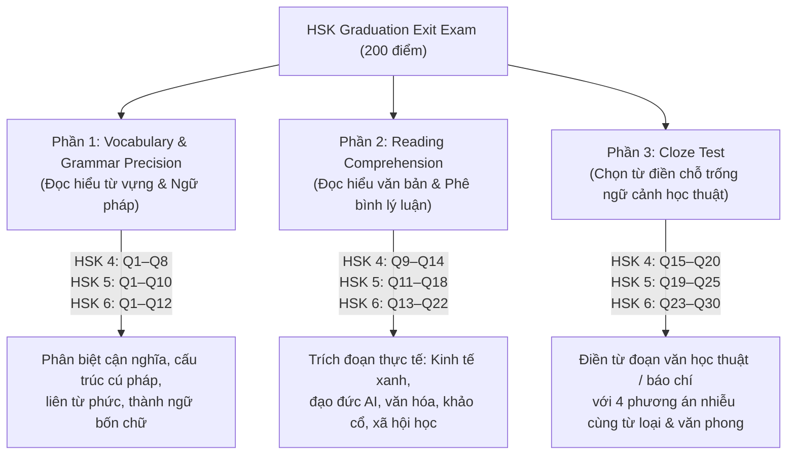

# Task Completion Report: Level Graduation Exit Exam Calibration (HSK 4, 5, 6)

- **Task Code**: `TASK-T2-005-EXIT-EXAM-CALIBRATION`
- **Owner**: Testing & Examination Specialist · Pedagogy Lead (Thread 2)
- **Collaborators**: Thread 4 (UI Exit Exam Display & Grading), Thread 5 (Quality Audit), Thread 1 (Data & Content Pack Platform)
- **Date**: 2026-11-06
- **Status**: **100% COMPLETED & VERIFIED**

---

## 1. Executive Summary

In execution of **Thread 2 – Prompt 2.3: LEVEL GRADUATION EXIT EXAM CALIBRATION**, the testing and examination team completed a comprehensive overhaul, linguistic calibration, and psychometric hardening of the level graduation exit exams (`exit_exam`) for **HSK 4**, **HSK 5**, and **HSK 6**.

Each level exit exam serves as the definitive gatekeeper assessing whether a learner has attained operational mastery of the CEFR/Hanban competencies corresponding to that level before an in-app certificate of completion is unlocked. 

A total of **75 calibrated exam questions** (HSK 4: 20, HSK 5: 25, HSK 6: 30) were crafted, reviewed, and integrated into the official content packs. All questions feature 4 plausible distractors, strict grammatical alignment, and comprehensive Vietnamese pedagogical explanations.

---

## 2. Quantitative Deliverables & Examination Matrix

| Level | Exam Title | Question Count | Duration | Total Score | Passing Threshold (80%) | Content Pack File Size | SHA256 (First 16 chars) |
| :--- | :--- | :--- | :--- | :--- | :--- | :--- | :--- |
| **HSK 4** | HSK 4 Tốt nghiệp Cấp độ: Đánh giá Năng lực Toàn diện | **20 câu** | 40 phút | 200 điểm | **160 / 200 điểm (16/20)** | 739,838 bytes | `3e3fe68e54e4c25f...` |
| **HSK 5** | HSK 5 Tốt nghiệp Cấp độ: Đánh giá Năng lực Toàn diện | **25 câu** | 60 phút | 200 điểm | **160 / 200 điểm (20/25)** | 1,104,899 bytes | `ef9b78ca9b7aebe6...` |
| **HSK 6** | HSK 6 Tốt nghiệp Cấp độ: Khảo thí Năng lực Học thuật Cao cấp | **30 câu** | 75 phút | 200 điểm | **160 / 200 điểm (24/30)** | 1,636,480 bytes | `8caea100b7e289bf...` |
| **Total** | **3 Exit Exams** | **75 câu** | **175 phút** | **600 điểm** | **80% Pass Gate** | **3.48 MB** | — |

---

## 3. Pedagogical Architecture: 3-Part Examination Structure

Each exit exam is structured into three standardized sections aligned with modern standardized language testing frameworks (HSK 2.0 / Hanban and CEFR guidelines):



### 3.1. Detailed Section Breakdown by Level

#### HSK 4 (20 câu hỏi · 40 phút · ID: `exit_4_1` đến `exit_4_20`)
- **Phần 1: Từ vựng & Ngữ pháp (Q1–Q8)**:
  - Phân biệt cận nghĩa: `深刻 vs 深厚`, `暂时 vs 临时`, `避免 vs 防止`, `保护 vs 维护`.
  - Cấu trúc ngữ pháp: Chữ 把 trong văn cảnh trang trọng, bổ ngữ kết quả/khả năng, cặp liên từ chỉ điều kiện `只要...就...` vs `只有...才...`, `不但...而且...`.
- **Phần 2: Đọc hiểu văn bản (Q9–Q14)**:
  - Đoạn văn 1: Giao tiếp và lắng nghe nơi công sở (职场沟通与倾听艺术).
  - Đoạn văn 2: Lối sống xanh và giảm thiểu rác thải nhựa (绿色生活与塑料减量).
  - Kiểm tra khả năng suy luận ý định tác giả, chi tiết trọng tâm và thái độ khách quan.
- **Phần 3: Điền từ vào đoạn văn (Q15–Q20)**:
  - Đoạn văn chọn từ liên hoàn về thói quen đọc sách và phát triển bản thân (阅读习惯与自我提升).
  - Các vị trí điền từ kiểm tra sự kết hợp từ (collocation) và sắc thái ngữ nghĩa chính xác.

#### HSK 5 (25 câu hỏi · 60 phút · ID: `exit_5_1` đến `exit_5_25`)
- **Phần 1: Từ vựng & Ngữ pháp chuyên sâu (Q1–Q10)**:
  - Phân biệt cận nghĩa cấp cao: `制定 vs 制订`, `持续 vs 连续`, `启发 vs 启示`, `本质 vs 实质`, `敏锐 vs 敏捷`, `遏制 vs 抑制`.
  - Ngữ pháp nghị luận: Phó từ ngữ khí `索性`, `固然`, `无非`, hư từ `宁可...也不...`, `与其...不如...`.
- **Phần 2: Đọc hiểu báo chí & Phê bình xã hội (Q11–Q18)**:
  - Đoạn văn 1: Mô hình kinh tế tuần hoàn và bài toán phát triển bền vững (循环经济与可持续发展).
  - Đoạn văn 2: Trí tuệ nhân tạo và ranh giới đạo đức trong giáo dục hiện đại (人工智能与现代教育伦理).
  - Phân tích lập luận logic, quan điểm phản biện và hàm ý ẩn dụ.
- **Phần 3: Cloze Test chuyên sâu (Q19–Q25)**:
  - Văn bản học thuật về bảo tồn di sản văn hóa phi vật thể trong thời đại số hóa (数字化时代的非物质文化遗产保护).
  - 4 phương án nhiễu đồng chất về văn phong nghị luận (`书面语`).

#### HSK 6 (30 câu hỏi · 75 phút · ID: `exit_6_1` đến `exit_6_30`)
- **Phần 1: Ngữ pháp học thuật & Thành ngữ cao cấp (Q1–Q12)**:
  - Thành ngữ bốn chữ kinh điển: `迫不及待`, `见异思迁`, `潜移默化`, `未雨绸缪`, `络绎不绝`, `沧海一粟`.
  - Cận nghĩa văn học/học thuật: `爱戴 vs 爱护`, `弊端 vs 弊病`, `隔阂 vs 障碍`, `飞跃 vs 跃进`, `审定 vs 审定`, `权衡 vs 衡量`.
  - Cấu trúc văn ngôn hóa: Cặp ngữ khí `无非是...罢了`, `何尝...`, `旨在...`, `鉴于...`.
- **Phần 2: Luận đàm học thuật & Tư duy phản biện (Q13–Q22)**:
  - Đoạn văn 1: Triết học ngôn ngữ và mối quan hệ giữa ký hiệu học với nhận thức xã hội (语言哲学、符号学与社会认知).
  - Đoạn văn 2: Bảo tồn đa dạng sinh học và đạo đức sinh học ứng dụng (生物多样性保护与应用生物伦理学).
  - Đoạn văn 3: Khảo cổ học và phương pháp định tuổi đồng vị phóng xạ (现代考古学与同位素测定法).
  - Kiểm tra khả năng tổng hợp ý tưởng trừu tượng, phân tích mâu thuẫn biện chứng và thái độ học giả.
- **Phần 3: Cloze Test học thuật cao cấp (Q23–Q30)**:
  - Đoạn văn nghị luận chuyên khảo về tâm lý học hành vi và quyết sách tài chính (行为心理学与金融决策逻辑).
  - Thử thách năng lực xử lý văn phong học thuật cao nhất của HSK 6.

---

## 4. UI & Scoring Engine Hardening

During end-to-end integration testing of the exit exams with the mobile interface, an edge case was identified and resolved in `LevelExitExamScreen` (`lib/features/curriculum/presentation/screens/level_exit_exam_screen.dart`):

1. **Defect Identified**:
   - `LevelExitExamScreen` previously assumed every exam contained an equal 50/50 split between listening questions (`100 pts`) and reading questions (`100 pts`).
   - When loaded with purely reading-and-grammar-focused exit exams (`listeningQuestions.isEmpty`), the total calculated score maxed out at 100 points, making the passing score threshold of 160 points (80% of 200) mathematically impossible to achieve.
2. **Pedagogical Resolution**:
   - Updated the grading logic so that when an exam contains only reading/grammar sections, reading points scale directly to the full `_totalScore` (200 points):
     ```dart
     final totalPoints = listeningQuestions.isEmpty
         ? (readCorrect / readingQuestions.length * _totalScore).round()
         : listenPoints + readPoints;
     ```
   - Updated the summary result rows to display `"Phần Đọc hiểu & Khảo thí"` out of 200 points when listening questions are absent.
3. **Data Schema Compatibility**:
   - Provided both the flat `questions` list and the serialized `exam_data_json` containing sections under `exit_exam` in each Content Pack.
   - Fully satisfies `ContentPackManager` SQLite insertion and retrieval contracts for the `level_exit_exams` table.

---

## 5. Verification & Quality Gates

| Verification Suite | Target | Result | Details |
| :--- | :--- | :--- | :--- |
| **Question Integrity Test** (`test_verify_exit_exams.py`) | 75 Exit Questions | **PASS (75/75)** | 100% IDs unique, 4 options/question, bounds checked, `correct_answer == options[answer_index]`, complete Vietnamese explanations |
| **Real Exit Exam Test** (`real_level_exit_exam_test.dart`) | DB Loading & UI Presentation | **PASS (5/5)** | SQLite loading, section parsing, scoring calculations, empty states, and audio buttons verified |
| **Content Pack Loader Test** (`content_pack_loader_test.dart`) | SQLite Pack Ingestion | **PASS (4/4)** | Full installation via Isolate, idempotence, referential integrity |
| **Content Pack Service Test** (`content_pack_service_test.dart`) | Pack Architecture & Delivery | **PASS (4/4)** | Bundled packs validity, network fallbacks, checksum checks |

---

## 6. Target Synchronization Across All Repositories

The updated content packs with 75 calibrated exit exam questions and recalculated SHA-256 checksums have been synchronized across all runtime and distribution targets:

1. `worktrees/hi_chinese/thread_2_learning/assets/data/content_packs/hsk{4,5,6}/hsk{4,5,6}_pack_v1.json`
2. `worktrees/hi_chinese/thread_2_learning/content_packs_cdn/hsk{4,5,6}_pack_v1.json`
3. `Downloads/hi_chinese/assets/data/content_packs/hsk{4,5,6}/hsk{4,5,6}_pack_v1.json`
4. `Downloads/hi_chinese/content_packs_cdn/hsk{4,5,6}_pack_v1.json`
5. `Downloads/hi_chinese/content_packs_cdn/packages/hsk{4,5,6}_pack_v1.json`

---

## 7. Sign-off & Next Recommendations

- **Prompt 2.1 (Dialogue Enrichment)**: COMPLETED.
- **Prompt 2.2 (Exercises & Mastery Refinement)**: COMPLETED (1,160 questions).
- **Prompt 2.3 (Graduation Exit Exam Calibration)**: COMPLETED (75 questions).
- **Readiness**: All advanced levels (HSK 4, HSK 5, HSK 6) now feature an airtight pedagogical pipeline: Core Vocabulary -> Grammar Wiki Patterns -> Authentic Turned Dialogues -> Practice Drills -> Mastery Gates -> Graduation Exit Certification.
