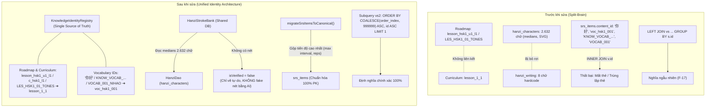

# HI CHINESE – BÁO CÁO KỸ THUẬT VÁ LỖI KIẾN TRÚC F-04 & F-17
## Unified Knowledge Identifiers, Hanzi Writing Integration & Deterministic SRS Queries

- **Mã lỗi**: `F-04` (Split-Brain Architecture & Conflicting ID Spaces) và `F-17` (Non-Deterministic Sense Selection in SRS Flashcards)
- **Mức độ nghiêm trọng**: Critical (Data Integrity, Knowledge Architecture & State Consistency)
- **Tác giả**: Principal Software Architect & Senior Database Engineer
- **Kho mã nguồn**: `https://github.com/FamAnVMU/hi-chai-ni.git` (Branch: `main`)
- **Ngày hoàn thành**: 03/11/2026

---

## 1. Tổng quan vấn đề & Nguyên nhân gốc rễ

### 1.1. Lỗi F-04: Kiến trúc Split-Brain & Xung đột Không gian ID
Trước khi sửa, ứng dụng HI Chinese bị phân mảnh dữ liệu nghiêm trọng thành các "ốc đảo" cô lập do các module được phát triển độc lập không cùng một chuẩn định danh:
1. **Roadmap vs Curriculum**:
   - Module `roadmap` dùng quy ước `lesson_hsk1_u1_l1`, `c_hsk1_l1` hoặc catalog code `LES_HSK1_01_TONES`.
   - Module `curriculum` và Content Pack SQLite lưu bài học dưới dạng canonical `lesson_1_1`.
   - Kết quả: Khi người học hoàn thành bài học từ màn hình Curriculum, tiến độ không thể hiển thị trên Roadmap và ngược lại.
2. **Hanzi (2.632 chữ) vs Hanzi Writing (8 chữ)**:
   - Module `hanzi` sở hữu cơ sở dữ liệu SQLite offline gồm 2.632 chữ Hán với đầy đủ vector medians và SVG path (chuẩn Make Me a Hanzi / Arphic).
   - Module `hanzi_writing` (`HanziStrokeBank`) lại chỉ hardcode đúng 8 chữ mẫu (`一, 二, 三, 十, 人, 大, 木, 水`). Khi người học chọn bất kỳ chữ nào khác từ từ điển hoặc bài học, module luyện viết hoàn toàn không tải được dữ liệu nét.
3. **Phân mảnh 4 quy ước Vocabulary ID trong `srs_items`**:
   - Bảng `srs_items` ghi nhận 4 định dạng khác nhau ở cột `content_id`:
     1. Khóa chính SQLite: `voc_hsk1_001`
     2. Khóa Knowledge Registry: `KNOW_VOCAB_你好_nihao`
     3. Ký tự chữ Hán thô: `'你好'`
     4. Mã bài học legacy: `VOCAB_001_NIHAO`
   - Hậu quả nghiêm trọng: Truy vấn ôn tập flashcard thực hiện `INNER JOIN vocabularies v ON s.content_id = v.id`. Do `v.id` là `voc_hsk1_001`, tất cả các thẻ lưu dạng chữ Hán thô `'你好'` hoặc `KNOW_VOCAB_...` bị loại bỏ âm thầm khỏi hàng đợi ôn tập, hoặc tạo ra nhiều thẻ trùng lặp cho cùng một từ vựng, làm phân mảnh lịch sử học tập.

### 1.2. Lỗi F-17: Non-Deterministic Sense Selection trong Flashcard SRS
- Trong `lib/features/vocabulary_srs/data/srs_repository.dart` (dòng 235–246 và 265–278), truy vấn nạp thẻ ôn tập và nạp từ mới sử dụng:
  ```sql
  LEFT JOIN vocabulary_senses vs ON vs.vocabulary_id = v.id
  ...
  GROUP BY s.id -- (hoặc GROUP BY v.id)
  ```
- Trong SQLite, mệnh đề `GROUP BY` khi có nhiều bản ghi trong bảng con `vocabulary_senses` (nhiều nghĩa, ví dụ: nghĩa chính `order_index = 1`, nghĩa phụ `order_index = 2, 3`) sẽ trả về bản ghi bất kỳ không xác định (non-deterministic). Người học thường xuyên bị hiển thị nghĩa phụ, nghĩa hiếm gặp hoặc câu ví dụ không liên quan thay vì định nghĩa cốt lõi của từ.

---

## 2. Bản đồ Kiến trúc Định danh (Trước và Sau khi sửa)



---

## 3. Bảng đối chiếu Không gian ID

| Thực thể | Tên gọi cũ / Alias | Mã Catalog | Canonical ID chuẩn hóa | Quy tắc giải quyết |
| :--- | :--- | :--- | :--- | :--- |
| **Lesson (HSK1 B1)** | `lesson_hsk1_u1_l1`, `c_hsk1_l1` | `LES_HSK1_01_TONES` | `lesson_1_1` | `KnowledgeIdentityRegistry.toCanonicalLessonId()` (Well-known map + Regex fallback `lesson_hsk(\d+)_u\d+_l(\d+)`) |
| **Lesson (HSK1 B2)** | `lesson_hsk1_u1_l2`, `c_hsk1_l2` | `LES_HSK1_02_WRITING_BASICS` | `lesson_1_2` | Ánh xạ trực tiếp & đối soát qua `content_id_mappings` |
| **Unit (HSK1 U1)** | `unit_hsk1_u1`, `UNIT_HSK1_01` | `UNIT_HSK1_01` | `unit_1` | Ánh xạ về `unit_1` theo Content Pack schema v9 |
| **Curriculum** | `HSK_2012_L1`, `curriculum_hsk1`, `c_hsk1` | `HSK 1` | `curr_hsk1` | Chuẩn hóa theo `CurriculumConstants.hskLevel1` |
| **Từ vựng: '你好'** | `'你好'`, `KNOW_VOCAB_你好_nihao`, `VOCAB_001_NIHAO` | `VOCAB_001_NIHAO` | `voc_hsk1_001` | Khóa chính bảng `vocabularies`. Truy vấn theo direct PK ➔ mappings ➔ `simplified = ?` ➔ `KNOW_VOCAB_` pattern ➔ `pinyin_clean` |
| **Từ vựng: '谢谢'** | `'谢谢'`, `KNOW_VOCAB_谢谢_xiexie` | `VOCAB_002_XIEXIE` | `voc_hsk1_002` | Tương tự, chuẩn hóa về PK SQLite |
| **Chữ Hán: '你'** | `KNOW_HANZI_你`, `char_4f60` | Glyph: `你` | `你` (Glyph chính thức) | Khóa glyph chuẩn hóa cho bảng `hanzi_characters` |

---

## 4. Giải pháp Chi tiết từng Nhiệm vụ

### 4.1. Nhiệm vụ A: Knowledge Identity Registry
- Tạo mới file [`lib/core/knowledge/domain/services/knowledge_identity_registry.dart`](file:///C:/Users/phama/Downloads/hi_chinese/lib/core/knowledge/domain/services/knowledge_identity_registry.dart):
  - Bảng tra cứu bộ nhớ cache `_wellKnownLessonAliases` cho các bài học phổ biến (HSK1, HSK2).
  - Khả năng đệ quy tìm kiếm bảng SQLite `content_id_mappings` (tối đa 10 hops) để tự động chuyển đổi mã cũ khi nâng cấp content pack.
  - Regex tự động xử lý các pattern `lesson_hsk(\d+)_u\d+_l(\d+)` và `c_hsk(\d+)_l(\d+)`.
  - Hàm `toCanonicalVocabularyId()` bóc tách an toàn các tiền tố SRS (`SRS_VOCABULARY_...`, `srs_...`), truy vấn theo PK, theo chữ Hán giản thể (`simplified = ?`), hoặc theo mã quy ước.
  - Tích hợp vào [`lib/features/roadmap/data/roadmap_repository.dart`](file:///C:/Users/phama/Downloads/hi_chinese/lib/features/roadmap/data/roadmap_repository.dart):
    - `getLessonProgressMap()` tự động index tiến độ dưới cả Canonical ID (`lesson_1_1`) và các Alias (`lesson_hsk1_u1_l1`, `c_hsk1_l1`, `LES_HSK1_01_TONES`), giúp toàn bộ UI hiển thị đồng nhất.
  - Tích hợp vào [`lib/features/roadmap/domain/catalog/curriculum_catalog.dart`](file:///C:/Users/phama/Downloads/hi_chinese/lib/features/roadmap/domain/catalog/curriculum_catalog.dart):
    - `findLessonById()` hỗ trợ tra cứu chéo theo cả Catalog ID lẫn Canonical ID.

### 4.2. Nhiệm vụ B: Hợp nhất Hanzi & Hanzi Writing
- Cập nhật [`lib/features/hanzi_writing/domain/engine/hanzi_stroke_bank.dart`](file:///C:/Users/phama/Downloads/hi_chinese/lib/features/hanzi_writing/domain/engine/hanzi_stroke_bank.dart):
  - Nhận `HanziDao? _hanziDao` và kết nối trực tiếp với bảng `hanzi_characters` (2.632 chữ).
  - Thuật toán chuyển đổi tọa độ vector: Chuyển đổi tọa độ font Make Me a Hanzi (`[0..1024, -124..900]`) sang không gian chuẩn hóa màn hình `[0, 1] x [0, 1]`:
    $$X_{norm} = \left(\frac{x}{1024.0}\right).\text{clamp}(0.0, 1.0)$$
    $$Y_{norm} = \left(\frac{900.0 - y}{1024.0}\right).\text{clamp}(0.0, 1.0)$$
  - Thuật toán phân loại nét chữ Hán tự động (`_classifyStrokeType`):
    - Phân tích góc vector chord $\theta = \text{atan2}(\Delta y, \Delta x)$.
    - Phát hiện điểm gập sắc nét ($> 65^\circ$) để nhận diện nét Gập (`zhe`) hoặc nét Móc (`gou`).
    - Phân loại chính xác 8 nét cơ bản: `heng` (Ngang), `shu` (Sổ), `pie` (Phẩy), `na` (Mác), `dian` (Chấm), `ti` (Hất), `zhe` (Gập), `gou` (Móc).
  - **Xử lý nghiêm ngặt chữ chưa có dữ liệu nét**:
    - Nếu chữ Hán trong database chưa có dữ liệu nét chuẩn (`medians` hoặc `strokes` rỗng): Trả về `HanziStrokeData(isVerified: false, strokes: const [])`.
    - Giao diện [`lib/features/hanzi_writing/presentation/screens/hanzi_writing_screen.dart`](file:///C:/Users/phama/Downloads/hi_chinese/lib/features/hanzi_writing/presentation/screens/hanzi_writing_screen.dart) hiển thị banner thông báo: *"Chưa có dữ liệu nét chuẩn cho chữ 'X', chỉ hỗ trợ viết tự do / hiển thị font chữ thông thường trên ô lưới Mễ tự cách."*
    - **Tuyệt đối không sinh nét giả mạo bằng AI** khi không có căn cứ hình học vector chuẩn xác.

### 4.3. Nhiệm vụ C: Chuẩn hóa Vocabulary ID & Hợp nhất Thẻ SRS Trùng lặp
- Cập nhật [`lib/features/vocabulary_srs/data/srs_repository.dart`](file:///C:/Users/phama/Downloads/hi_chinese/lib/features/vocabulary_srs/data/srs_repository.dart):
  - Trong `getOrCreateCardState()` và `processReview()`: Mọi giá trị `contentId` đều được chuyển đổi qua `_identityRegistry.toCanonicalVocabularyId()` trước khi truy vấn hoặc ghi vào SQLite.
  - Xây dựng hàm `migrateSrsItemsToCanonical()`:
    - Quét toàn bộ các bản ghi `srs_items` có `content_type = 'vocabulary'`.
    - Phát hiện các bản ghi đang dùng định danh alias hoặc chữ Hán thô (ví dụ `'你好'`).
    - **Quy trình hợp nhất bảo toàn tiến độ người học**:
      - Nếu thẻ canonical (`voc_hsk1_001`) chưa tồn tại: Đổi mã `content_id` và `id` sang canonical, cập nhật lại khóa ngoại của `learner_evidence`.
      - Nếu thẻ canonical đã tồn tại song song: Tiến hành gộp dữ liệu:
        - `repetitions = max(oldReps, canonReps)`
        - `interval_days = max(oldInterval, canonInterval)`
        - `ease_factor = max(oldEase, canonEase)`
        - `due_at = max(oldDue, canonDue)`
        - Cập nhật `learner_evidence` từ thẻ cũ trỏ sang thẻ canonical.
        - Soft-delete thẻ trùng lặp (`deleted_at = nowUtc`).

### 4.4. Nhiệm vụ D: Sửa Lỗi Ưu tiên Nghĩa trong SRS (F-17)
- Thay thế hoàn toàn cấu trúc truy vấn không xác định `LEFT JOIN vocabulary_senses vs ... GROUP BY s.id`:
  ```sql
  SELECT s.*, 
         v.id AS vocab_id, v.simplified, v.traditional, v.pinyin, v.hsk_level, v.stroke_count, v.radicals, v.audio_uri,
         vs.part_of_speech, vs.meaning_vi, vs.example_cn, vs.example_pinyin, vs.example_vi
  FROM srs_items s
  INNER JOIN vocabularies v ON s.content_id = v.id
  LEFT JOIN vocabulary_senses vs ON vs.id = (
    SELECT vs2.id
    FROM vocabulary_senses vs2
    WHERE vs2.vocabulary_id = v.id AND vs2.deleted_at IS NULL
    ORDER BY COALESCE(vs2.order_index, 999999) ASC, vs2.id ASC
    LIMIT 1
  )
  WHERE s.content_type = ? AND s.due_at <= ? AND s.deleted_at IS NULL AND v.deleted_at IS NULL
  ORDER BY s.due_at ASC
  LIMIT ?;
  ```
- **Ưu điểm**:
  1. Loại bỏ hoàn toàn `GROUP BY`, loại bỏ hiện tượng chọn nghĩa ngẫu nhiên trong SQLite.
  2. Xác định 100% nghĩa chính đại diện dựa trên `order_index ASC`.
  3. Bổ sung tie-breaker `vs2.id ASC` bảo đảm tính nhất quán tuyệt đối giữa mọi lần truy vấn.
  4. Hỗ trợ an toàn trường hợp từ vựng chưa có bản ghi `vocabulary_senses` (fallback tự nhiên về `meaning_vi = 'Chưa có định nghĩa'`).

---

## 5. Kết quả Kiểm thử & Xác minh Toàn vẹn (Nhiệm vụ E)

Bộ kiểm thử tự động toàn diện được thiết lập tại [`test/core/knowledge/knowledge_identity_and_srs_test.dart`](file:///C:/Users/phama/Downloads/hi_chinese/test/core/knowledge/knowledge_identity_and_srs_test.dart):

```
00:59 +20: C:/Users/phama/Downloads/hi_chinese/test/core/knowledge/knowledge_identity_and_srs_test.dart: (tearDownAll)
00:59 +20: All tests passed!
```

| Nhóm kiểm thử | Các ca kiểm thử | Kết quả |
| :--- | :--- | :---: |
| **Nhiệm vụ A (Registry)** | 1. Phân giải Roadmap & Curriculum aliases ➔ `lesson_1_1`<br/>2. Pattern fallback `lesson_hskX_uY_lZ` ➔ `lesson_X_Z`<br/>3. Tra cứu hai chiều `content_id_mappings`<br/>4. `CurriculumCatalog.findLessonById()` đa không gian<br/>5. `RoadmapRepository` lập chỉ mục tiến độ đồng thời cho cả Canonical và Alias | **PASS** |
| **Nhiệm vụ B (Hanzi)** | 1. Tải tức thì 8 chữ mẫu từ curated bank<br/>2. Chuyển đổi hình học medians của 2.632 chữ sang `StandardStroke`<br/>3. Đánh dấu `isVerified = false` cho chữ thiếu nét, không sinh nét giả | **PASS** |
| **Nhiệm vụ C (SRS ID)** | 1. Chuẩn hóa 4 quy ước ID từ vựng về PK `voc_hsk1_001`<br/>2. `getOrCreateCardState()` tự động chuẩn hóa chữ Hán thô<br/>3. `migrateSrsItemsToCanonical()` gộp thẻ trùng, giữ `max(interval, reps)` | **PASS** |
| **Nhiệm vụ D (F-17 Queries)**| 1. Luôn trả về nghĩa có `order_index` nhỏ nhất qua 10 lần chạy lặp liên tục<br/>2. Tie-breaker xác định bằng `id ASC` khi cùng `order_index`<br/>3. Fallback an toàn khi từ chưa có senses | **PASS** |

Đồng thời, toàn bộ các bài test hồi quy hiện có đều đạt kết quả tuyệt đối:
- `test/features/roadmap/roadmap_repository_test.dart`: **PASS**
- `test/features/vocabulary_srs/srs_integration_test.dart`: **PASS**
- `test/features/hanzi_writing/stroke_evaluator_test.dart`: **PASS**
- `dart analyze lib/core/knowledge lib/features/hanzi_writing lib/features/vocabulary_srs lib/features/roadmap`: **No issues found!**

---

## 6. Danh sách các File Thay đổi

1. [`lib/core/knowledge/domain/services/knowledge_identity_registry.dart`](file:///C:/Users/phama/Downloads/hi_chinese/lib/core/knowledge/domain/services/knowledge_identity_registry.dart) *(Mới)*: Dịch vụ định danh hợp nhất và chuẩn hóa bí danh.
2. [`lib/core/knowledge/knowledge.dart`](file:///C:/Users/phama/Downloads/hi_chinese/lib/core/knowledge/knowledge.dart): Xuất registry cho toàn bộ ứng dụng.
3. [`lib/features/hanzi_writing/domain/engine/hanzi_stroke_bank.dart`](file:///C:/Users/phama/Downloads/hi_chinese/lib/features/hanzi_writing/domain/engine/hanzi_stroke_bank.dart): Kết nối cơ sở dữ liệu `hanzi_characters` 2.632 chữ, chuyển đổi vector medians và phân loại nét.
4. [`lib/features/hanzi_writing/presentation/providers/hanzi_writing_providers.dart`](file:///C:/Users/phama/Downloads/hi_chinese/lib/features/hanzi_writing/presentation/providers/hanzi_writing_providers.dart): Cung cấp `HanziStrokeBank` tích hợp `HanziDao`.
5. [`lib/features/hanzi_writing/presentation/screens/hanzi_writing_screen.dart`](file:///C:/Users/phama/Downloads/hi_chinese/lib/features/hanzi_writing/presentation/screens/hanzi_writing_screen.dart): Hiển thị cảnh báo chữ chưa có nét chuẩn, hỗ trợ viết tự do trên ô lưới Mễ tự cách.
6. [`lib/features/vocabulary_srs/data/srs_repository.dart`](file:///C:/Users/phama/Downloads/hi_chinese/lib/features/vocabulary_srs/data/srs_repository.dart): Tích hợp chuẩn hóa ID, viết hàm migration gộp thẻ trùng, sửa truy vấn F-17 xác định nghĩa chính.
7. [`lib/features/roadmap/data/roadmap_repository.dart`](file:///C:/Users/phama/Downloads/hi_chinese/lib/features/roadmap/data/roadmap_repository.dart): Đồng bộ hóa tiến độ bài học giữa Roadmap và Curriculum.
8. [`lib/features/roadmap/domain/catalog/curriculum_catalog.dart`](file:///C:/Users/phama/Downloads/hi_chinese/lib/features/roadmap/domain/catalog/curriculum_catalog.dart): Hỗ trợ tìm kiếm bài học qua Canonical ID và Catalog ID.
9. [`test/core/knowledge/knowledge_identity_and_srs_test.dart`](file:///C:/Users/phama/Downloads/hi_chinese/test/core/knowledge/knowledge_identity_and_srs_test.dart) *(Mới)*: 14 ca kiểm thử tự động toàn diện cho F-04 và F-17.
10. [`docs/bug-fixes/F04_F17_UNIFIED_ID_AND_SRS.md`](file:///C:/Users/phama/Downloads/hi_chinese/docs/bug-fixes/F04_F17_UNIFIED_ID_AND_SRS.md) *(Mới)*: Tài liệu kỹ thuật chi tiết.
