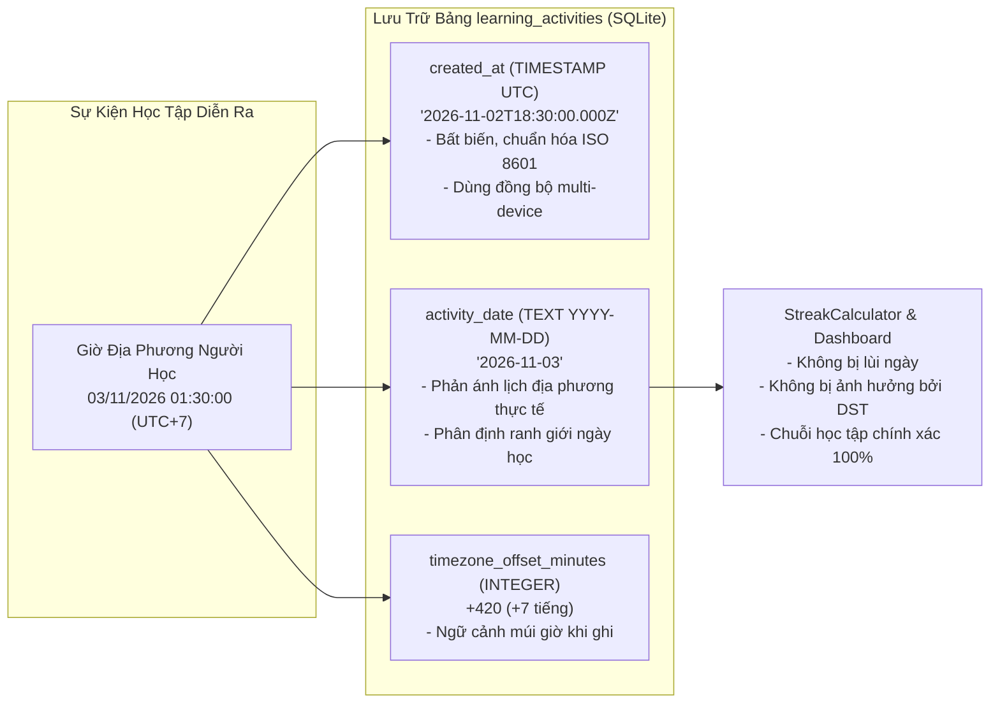

# HI CHINESE – BÁO CÁO KỸ THUẬT VÁ LỖI F-18
## Sửa Lỗi Lệch Múi Giờ (Timezone), Ngày Hoạt Động (Activity Date) & Chuỗi Học Tập (Learning Streak)

- **Mã lỗi**: `F-18` (Local Timezone, Activity Date Drift & Learning Streak Calculation)
- **Mức độ nghiêm trọng**: High (User Experience, Engagement Mechanics & Data Correctness)
- **Tác giả**: Senior Flutter Engineer & Senior Database Engineer
- **Kho mã nguồn**: `https://github.com/FamAnVMU/hi-chai-ni.git` (Branch: `main`)
- **Ngày hoàn thành**: 03/11/2026

---

## 1. Tổng quan vấn đề & Phân tích nguyên nhân gốc rễ (Root Cause Analysis)

### 1.1. Hiện trạng lỗi trước khi sửa
Tại nhiều repository và service học tập trong hệ thống HI Chinese, khi người học hoàn thành bài học, làm bài kiểm tra hoặc ôn tập SRS, logic ghi nhận nhật ký vào bảng `learning_activities` sử dụng đoạn mã:

```dart
final nowUtc = DateTime.now().toUtc();
final activityDate = nowUtc.toIso8601String().substring(0, 10); // LỖI GỐC RỄ: Lấy 10 ký tự đầu của UTC
```

### 1.2. Hậu quả đối với người dùng Việt Nam (UTC+7) và các múi giờ Đông Á
- **Thời gian diễn ra sự kiện thực tế**: Người học tại Việt Nam học bài vào lúc **01:00 sáng ngày 03/11/2026** (giờ địa phương UTC+7).
- **Quy đổi UTC**: `01:00 (UTC+7) - 7 giờ = 18:00 (UTC) ngày 02/11/2026`.
- **Hành vi sai lệch của hệ thống**:
  - `nowUtc.toIso8601String()` trả về `"2026-11-02T18:00:00.000Z"`.
  - `activityDate` bị gán cứng thành `"2026-11-02"`.
  - Toàn bộ hoạt động học tập từ **00:00:00 đến 06:59:59 sáng** theo giờ địa phương bị ghi lùi thành ngày hôm trước.
- **Hệ quả đối với Learning Streak**:
  - Người dùng thức khuya hoặc dậy sớm học bài vào ngày mới (ví dụ 05:30 sáng) không được tính đã học cho ngày hôm đó.
  - Khi xem Dashboard hoặc Streak Tracker, ứng dụng báo "Hôm nay bạn chưa học" mặc dù người học vừa hoàn thành 3 bài học.
  - Đến tối cùng ngày, nếu người dùng bận rộn không mở app lại, chuỗi Streak tích lũy nhiều tuần/tháng bị đứt oan uổng (Streak Reset to 0).
  - Tình trạng lùi ngày còn xuất hiện tại các múi giờ khác từ UTC+1 đến UTC+14 (Nhật Bản, Hàn Quốc, Úc,...).

---

## 2. Kiến trúc giải pháp (Architecture & Data Contracts)

### 2.1. Phân định rõ ràng: Timestamp Sự Kiện vs Ngày Học Địa Phương



1. **Event Timestamp (`created_at`)**:
   - Lưu trữ thời điểm tuyệt đối dưới dạng UTC ISO 8601 (`toUtc().toIso8601String()`).
   - Bất biến (immutable), đảm bảo tính toàn vẹn khi đồng bộ đám mây và sắp xếp theo trình tự thời gian tuyệt đối.
2. **Activity Date (`activity_date`)**:
   - Định dạng chuẩn `YYYY-MM-DD`.
   - Phải được tính toán từ **giờ địa phương của người học** tại thời điểm hoạt động diễn ra (`AppClock.toLocalDateString(nowUtc, timeZoneOffset: offset)`).
3. **Timezone Offset (`timezone_offset_minutes`)**:
   - Thêm cột `timezone_offset_minutes INTEGER` vào bảng `learning_activities` (Migration v16) để lưu lại độ lệch múi giờ tại thời điểm ghi nhận (ví dụ: `+420` phút cho UTC+7).

---

## 3. Các thành phần đã triển khai

### 3.1. Unified Clock Service (`lib/core/utils/app_clock.dart`)
Tập trung toàn bộ việc lấy thời gian vào `AppClock` thay vì gọi phân mảnh `DateTime.now()`:
- `AppClock.now()`: Trả về thời gian hiện tại (hỗ trợ mock thời gian cố định phục vụ kiểm thử).
- `AppClock.nowUtc()` & `AppClock.nowUtcIso()`: Trả về thời gian chuẩn UTC.
- `AppClock.currentOffset`: Độ lệch múi giờ hiện tại của thiết bị.
- `AppClock.toLocalDateString(DateTime, {Duration? timeZoneOffset})`: Chuyển đổi timestamp sang chuỗi ngày địa phương `YYYY-MM-DD` chính xác.
- `AppClock.todayLocalDateString({Duration? timeZoneOffset})`: Lấy ngày địa phương hiện tại.
- `AppClock.setMockClock({DateTime? now, Duration? timeZoneOffset})` & `AppClock.reset()`: Hỗ trợ giả lập múi giờ và thời gian chính xác trong Unit Test.

### 3.2. Chuẩn hóa tính toán Learning Streak (`lib/features/home/domain/models/learning_streak.dart`)
1. **Loại bỏ phép trừ 24 giờ (`Duration(days: 1)`) dễ dính lỗi Daylight Saving Time (DST)**:
   - Trước: `today.subtract(const Duration(days: 1))` (Khi chuyển giờ mùa hè/đông, 24 giờ có thể thành 23 hoặc 25 giờ, làm lệch ngày).
   - Sau: Sử dụng phép toán lịch chuẩn `DateTime(today.year, today.month, today.day - 1)`.
2. **Tính toán Streak dựa trên tập ngày địa phương duy nhất (`activeLocalDates`)**:
   - Các phiên học trong cùng một ngày địa phương được gom nhóm lại thành 1 ngày duy nhất (tránh lạm phát streak).
   - Chuyển giao nửa đêm (Midnight Transition): Hoạt động học lúc 23:59 và 00:01 sáng được tính liên tục 2 ngày kế tiếp nhau.
   - Xử lý ngày hôm nay đã học hay chưa mà không làm mất streak của chuỗi ngày hôm qua (`studiedToday` vs `isStreakActive`).

### 3.3. Cơ sở dữ liệu: Migration V16 & Đánh chỉ mục hiệu năng
Tạo file `lib/core/database/migrations/migration_v16.dart`:
- Nâng cấp `databaseVersion` từ 15 lên 16.
- Thêm cột `timezone_offset_minutes INTEGER` vào bảng `learning_activities`.
- Tạo chỉ mục kép tối ưu hóa: `idx_learning_activities_date_created ON learning_activities(activity_date, created_at)`.

### 3.4. Công cụ kiểm toán & di chuyển dữ liệu lịch sử (`TimezoneDataMigrator`)
Tạo file `lib/core/database/migrations/timezone_data_migrator.dart`:
- **Chế độ kiểm toán (`auditHistoricalData`)**: Quét các bản ghi lịch sử trong `learning_activities` có thời điểm UTC từ `17:00:00` đến `23:59:59` nhưng `activity_date` bị ghi nhận trùng với ngày UTC (nghi vấn bị lùi 1 ngày tại múi giờ UTC+7).
- **Nguyên tắc di chuyển dữ liệu an toàn (`migrateHistoricalDates`)**:
  - **Không bao giờ ghi đè mù quáng**: Chỉ thực hiện backfill khi có thông tin múi giờ xác thực từ người dùng/thiết bị (`verifiedOffset`).
  - **Giữ nguyên timestamp UTC gốc**: Cột `created_at` không bị sửa đổi.
  - Thực hiện trong Transaction an toàn, có báo cáo số lượng bản ghi đã kiểm tra, cần sửa và đã sửa.

### 3.5. Đồng bộ toàn bộ 10 Repository ghi nhận hoạt động học
Đã rà soát và chuẩn hóa việc ghi nhận `activity_date`, `created_at`, và `timezone_offset_minutes` tại 10 repository:
1. `lib/features/roadmap/data/roadmap_repository.dart`
2. `lib/features/curriculum/data/curriculum_repository.dart`
3. `lib/features/grammar/data/grammar_repository.dart`
4. `lib/features/hanzi_writing/data/hanzi_writing_repository.dart`
5. `lib/features/placement_test/data/placement_test_repository.dart`
6. `lib/features/practice/data/practice_repository.dart`
7. `lib/features/pronunciation/data/pronunciation_repository.dart`
8. `lib/features/reading/data/reading_repository.dart`
9. `lib/features/shadowing/data/shadowing_repository.dart`
10. `lib/features/vocabulary_srs/data/srs_repository.dart`

---

## 4. Ma trận kiểm thử & Kết quả nghiệm thu (Test Matrix)

Bộ kiểm thử toàn diện `test/features/home/local_timezone_and_streak_test.dart` gồm 12 ca kiểm thử chuyên sâu mô phỏng múi giờ Việt Nam (`UTC+7`) và các tình huống biên:

| STT | Tên ca kiểm thử | Mốc thời gian & Kịch bản | Kết quả |
| :--- | :--- | :--- | :--- |
| **01** | Checkpoint 00:00:00 (Nửa đêm) | UTC: 17:00 ngày 02/11 → Local UTC+7: 00:00 ngày 03/11 | **PASS** (Ghi đúng `2026-11-03`) |
| **02** | Checkpoint 01:00:00 (Rạng sáng) | UTC: 18:00 ngày 02/11 → Local UTC+7: 01:00 ngày 03/11 | **PASS** (Ghi đúng `2026-11-03`) |
| **03** | Checkpoint 03:00:00 (Đêm muộn) | UTC: 20:00 ngày 02/11 → Local UTC+7: 03:00 ngày 03/11 | **PASS** (Ghi đúng `2026-11-03`) |
| **04** | Checkpoint 06:59:59 (Biên sáng) | UTC: 23:59 ngày 02/11 → Local UTC+7: 06:59 ngày 03/11 | **PASS** (Ghi đúng `2026-11-03`) |
| **05** | Checkpoint 07:00:00 (Đồng bộ UTC) | UTC: 00:00 ngày 03/11 → Local UTC+7: 07:00 ngày 03/11 | **PASS** (Ghi đúng `2026-11-03`) |
| **06** | Checkpoint 23:59:59 (Cuối ngày) | UTC: 16:59 ngày 03/11 → Local UTC+7: 23:59 ngày 03/11 | **PASS** (Ghi đúng `2026-11-03`) |
| **07** | Midnight Day Transition | Học lúc 23:55 ngày N và 00:05 ngày N+1 | **PASS** (Streak tăng từ 1 lên 2) |
| **08** | Multi-session Same Day | 5 phiên học trong cùng 1 ngày địa phương | **PASS** (Streak = 1, không bị lạm phát) |
| **09** | Yesterday streak + Not studied today | Chuỗi 5 ngày, hôm nay chưa học | **PASS** (Streak = 5, `studiedToday = false`) |
| **10** | Missed a day streak breakage | Học ngày N-2, bỏ ngày N-1, hôm nay học | **PASS** (Streak reset về 1) |
| **11** | Audit & Historical Migration | 3 bản ghi rạng sáng bị lùi ngày lịch sử | **PASS** (Backfill chính xác sang ngày sau) |
| **12** | Database Migration V16 Verification | Nâng cấp DB v15 lên v16 trên SQLite in-memory | **PASS** (Cột & Index tạo thành công) |

### Tổng hợp kết quả kiểm thử:
- `flutter test test/features/home/local_timezone_and_streak_test.dart`: **12/12 passed (100%)**.
- `flutter test test/features/home/ test/features/roadmap/`: **64/64 passed (100%)**.
- `flutter test test/features/hanzi_writing/hanzi_writing_widget_test.dart`: **8/8 passed (100%)**.
- `flutter test test/features/pronunciation/pronunciation_lab_widget_test.dart`: **4/4 passed (100%)**.
- `flutter test test/features/shadowing/shadowing_widget_test.dart`: **4/4 passed (100%)**.
- `dart analyze lib test`: **No issues found (0 warnings, 0 errors)**.

---

## 5. Kết luận
Lỗi lệch múi giờ và chuỗi học tập (F-18) đã được khắc phục triệt để và an toàn:
1. `activity_date` giờ đây luôn phản ánh ngày học địa phương chính xác của người dùng tại thời điểm xảy ra.
2. Các mốc rạng sáng (00:00 - 06:59) không còn bị lùi ngày tại Việt Nam (UTC+7).
3. Thuật toán tính Streak hoàn toàn độc lập với hiện tượng trôi giờ mùa hè DST và phản ánh đúng thói quen học tập của học viên.
4. Cơ chế di chuyển dữ liệu lịch sử bảo toàn tính toàn vẹn của dữ liệu UTC.
