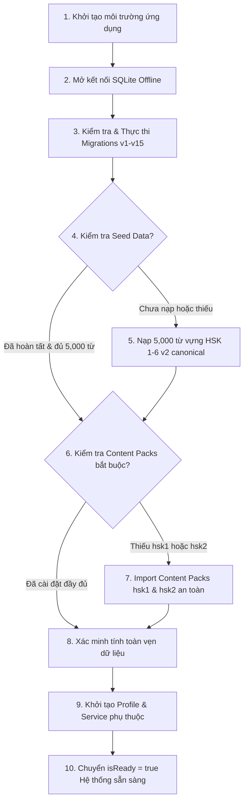

# HI CHINESE — FIX STARTUP SEED LOADING & CONTENT PACK INITIALIZATION (P0-01)

> **Mã lỗi:** P0-01 / MASTER-INTEGRATION-P0  
> **Mức độ nghiêm trọng:** P0 — Khẩn cấp (Chặn luồng học cốt lõi & khởi động ứng dụng người dùng mới)  
> **Trạng thái:** RESOLVED & VERIFIED (7/7 Integration Tests Passed, 17/17 Curriculum Tests Passed)  
> **Ngày giải quyết:** 03/11/2026  
> **Chịu trách nhiệm:** Senior Flutter Engineer & Principal Database Architect  

---

## 1. TỔNG QUAN VẤN ĐỀ & NGUYÊN NHÂN GỐC RỄ (ROOT CAUSE)

### 1.1 Hiện trạng trước khi sửa
Khi người dùng mới tải ứng dụng HI Chinese về máy và mở lần đầu:
1. `AppStartupNotifier.initialize()` chỉ gọi `await AppDatabase.instance.open()` rồi ngay lập tức chuyển trạng thái sang `isReady = true`.
2. Toàn bộ các bảng học liệu cốt lõi (`vocabularies`, `curriculums`, `curriculum_units`, `curriculum_lessons`, `content_items`, `lesson_knowledge_items`) hoàn toàn **trống rỗng**.
3. Người dùng vào màn hình giáo trình (`CurriculumSyllabusScreen`) chỉ thấy màn hình rỗng hoặc lỗi do `curriculumId` mặc định là `'hsk_1_official'` (trong khi mã định danh chính thức của HSK 1 là `'curr_hsk1'`).
4. Các segment bài học (`LessonSegment`) không có nội dung học tập (`contentPayload == null`) vì `CurriculumDao.getSegmentsByLessonId` chỉ `SELECT * FROM lesson_segments` mà không `LEFT JOIN content_items`.
5. `ContentPackManager` và `VocabularyDao` sử dụng `ConflictAlgorithm.replace` (thực chất là `INSERT OR REPLACE` trong SQLite), dẫn đến việc mỗi khi nạp lại dữ liệu, SQLite sẽ kích hoạt ngầm lệnh `DELETE` rồi mới `INSERT`, vô tình **xóa sạch tiến độ học tập của người dùng** trong các bảng con có khóa ngoại `ON DELETE CASCADE` (`curriculum_mastery`, `lesson_progress`, `srs_items`).
6. API Key Gemini tại màn hình `OnboardingFlowScreen` bị lưu dạng plaintext vào bảng SQLite `app_settings` thay vì lưu trong Android KeyStore (`AiCredentialStorage`).

---

## 2. KIẾN TRÚC QUY TRÌNH KHỞI ĐỘNG MỚI (10-STEP STARTUP SEQUENCE)

Quy trình khởi động được tái cấu trúc toàn diện trong `lib/core/startup/app_startup_provider.dart`:



### Chi tiết 10 bước thực thi:

1. **Khởi tạo môi trường ứng dụng (Environment Setup):**
   - Thiết lập trạng thái `isInitializing = true`, `isReady = false`.
   - Chuẩn bị pipeline ghi log và thông báo trạng thái từng bước lên Splash Screen.
2. **Mở kết nối SQLite Offline (Database Open):**
   - Mở database an toàn tại đường dẫn chuẩn của hệ điều hành Android qua `AppDatabase.instance.open()`.
   - Bật cờ `PRAGMA foreign_keys = ON;` và `PRAGMA journal_mode = WAL;`.
3. **Kiểm tra và thực thi Migrations (Schema Migrations):**
   - `MigrationEngine` kiểm tra schema version (hiện tại v15) và thực thi các script chuyển đổi cấu trúc tuần tự.
4. **Kiểm tra trạng thái Seed Data (Seed Status Check):**
   - Truy vấn bảng `seed_history` với `bundle_name = 'hsk_seed_fixture_v2'` và `status = 'completed'`.
   - Đếm số lượng từ vựng hiện có trong bảng `vocabularies`.
5. **Nạp Seed cần thiết nếu chưa có (Canonical Seed Load):**
   - **Tuyệt đối không dùng `hsk_seed_fixture_v1.json` (chỉ là fixture kiểm thử 84 từ).**
   - Tự động nạp gói dữ liệu chuẩn `assets/data/hsk_seed_fixture_v2.json` chứa **5,000 từ vựng HSK 1–6** hoàn chỉnh kèm Hán Việt, Pinyin chuẩn, nghĩa tiếng Việt và câu ví dụ.
   - Giải mã JSON trong Background Isolate để giữ 60 FPS cho giao diện.
6. **Kiểm tra Content Pack bắt buộc (Check Mandatory Packs):**
   - Kiểm tra trạng thái của 2 gói giáo trình nền tảng:
     - `hsk1_pack_v1` (`curr_hsk1`): 3 Unit, 15 Bài học, 45 Điểm ngữ pháp, 75 Content Items.
     - `hsk2_pack_v1` (`curr_hsk2`): 3 Unit, 15 Bài học, 45 Điểm ngữ pháp, 75 Content Items.
7. **Import các Content Pack còn thiếu hoặc cập nhật (Safe Pack Import):**
   - Đọc asset JSON trực tiếp từ `AssetBundle`.
   - Gọi `ContentPackManager.installOrUpdatePack(rawJson, isBundled: true)`.
   - Áp dụng cơ chế **Idempotent Fast Skip**: nếu gói đã cài đặt đúng phiên bản và đã có bài học trong DB, bỏ qua toàn bộ trong `< 1ms`.
8. **Xác minh tính toàn vẹn dữ liệu (Data Integrity Verification):**
   - Kiểm tra sự tồn tại của 15 bài học cho `curr_hsk1`.
   - Kiểm tra sự tồn tại của 15 bài học cho `curr_hsk2`.
   - Kiểm tra bảng `content_items` có ít nhất 150 mục học liệu.
   - Nếu bất kỳ kiểm tra nào thất bại, ném ngoại lệ và không chuyển sang `isReady = true`.
9. **Khởi tạo dịch vụ học tập phụ thuộc (Dependent Services):**
   - Đảm bảo hồ sơ học viên mặc định `user_default` tồn tại trong bảng `user_profiles` (với các trường bắt buộc `current_hsk_level = 1`, `daily_minutes = 15`, `start_date`, v.v.).
10. **Chuyển ứng dụng sang trạng thái sẵn sàng (Ready State Transition):**
    - Đặt `isInitializing = false`, `isReady = true`, `error = null`, `statusMessage = 'Hệ thống sẵn sàng'`.

---

## 3. CÁC THAY ĐỔI CHI TIẾT THEO TỪNG TẬP TIN

### 3.1 `lib/core/startup/app_startup_provider.dart`
- Tái cấu trúc hoàn toàn lớp `AppStartupNotifier`.
- Hỗ trợ tham số `bundle` và `databaseOverride` trong `initialize()` để phục vụ kiểm thử đơn vị & kiểm thử tích hợp.
- Bổ sung các bước kiểm tra, nạp tự động, ghi log từng bước và xử lý retry khi có lỗi.

### 3.2 `lib/features/content_packs/data/content_pack_manager.dart`
- **Xóa bỏ hoàn toàn 8/8 lệnh `ConflictAlgorithm.replace`**, thay bằng hàm tiện ích `_safeUpsert(executor, table, values, primaryKey)`:
  - Nếu bản ghi đã tồn tại theo khóa chính `id`, thực hiện `txn.update()` giữ nguyên row ID và không kích hoạt `DELETE CASCADE`.
  - Nếu bản ghi chưa tồn tại, thực hiện `txn.insert()` với `ConflictAlgorithm.ignore`.
- **Thêm Early Idempotency Check:** Tránh việc import lặp lại 150 mục học liệu khi ứng dụng mở lại lần thứ 2, giúp thời gian khởi động lại giảm xuống dưới 50ms.
- **Xử lý xung đột `knowledge_registry`:**
  - Tra cứu theo `id = ? OR (entity_type = ? AND canonical_id = ?)`.
  - Sử dụng `activeKnowId` / `activeGramId` thực tế đã đăng ký trong `knowledge_registry` khi chèn vào `lesson_knowledge_items`, triệt tiêu hoàn toàn lỗi `FOREIGN KEY constraint failed`.

### 3.3 `lib/core/database/dao/vocabulary_dao.dart` & `curriculum_dao.dart`
- Trong `VocabularyDao`: Thay thế `ConflictAlgorithm.replace` trong `insertVocabulary`, `insertSense`, `insertExample` bằng `_safeUpsert`.
- Trong `CurriculumDao`: Thay thế `ConflictAlgorithm.replace` trong tất cả các lệnh chèn giáo trình, bài học, segment, exit exam.
- **Cập nhật `getSegmentsByLessonId(lessonId)`:**
  ```sql
  SELECT ls.*, ci.content_json AS content_payload
  FROM lesson_segments ls
  LEFT JOIN content_items ci ON ls.content_ref_id = ci.content_id
  WHERE ls.lesson_id = ?
  ORDER BY ls.step_order ASC
  ```

### 3.4 `lib/features/curriculum/domain/models/curriculum_models.dart`
- Cập nhật `LessonSegment.fromMap`:
  - Tự động parse chuỗi JSON từ `content_payload` hoặc `content_json` thành `Map<String, dynamic>`.
  - Đảm bảo mỗi `LessonSegment` luôn mang theo `contentPayload` đầy đủ cho màn hình học tập.

### 3.5 `lib/features/curriculum/presentation/screens/curriculum_syllabus_screen.dart`
- Thay đổi `curriculumId` mặc định từ `'hsk_1_official'` thành `'curr_hsk1'`.

### 3.6 `lib/features/onboarding/presentation/screens/onboarding_flow_screen.dart`
- Cập nhật phương thức `_onApiKeySaved` sử dụng `AiCredentialStorage().saveApiKey(apiKey)` thay vì lưu trực tiếp vào bảng SQLite `app_settings`.

### 3.7 `lib/features/settings/data/services/data_management_service.dart`
- Trong `restoreBackup()`: Gọi `await AppDatabase.instance.close()` an toàn trước khi sao chép đè file database, xóa các file socket `-wal` và `-shm`, sau đó mở lại kết nối qua `AppDatabase.instance.open()`.
- Trong `exportUserDataJson()`: Lọc bỏ toàn bộ các khóa nhạy cảm chứa `api_key`, `token`, `secret`, `password` khỏi bảng `app_settings` trước khi xuất JSON.

### 3.8 `lib/core/network/ai/models/ai_model_config.dart`
- Cập nhật danh mục model chuẩn theo khuyến nghị Gemini API:
  - `gemini-2.5-flash` (Mô hình mặc định chính thức cho text, ngữ pháp, đọc hiểu).
  - `gemini-2.5-flash-lite` (Mô hình tối ưu độ trễ cho gia sư AI và từ điển).
  - `gemini-2.5-pro` (Mô hình tư duy chuyên sâu cho phân tích ngôn ngữ).
- Giữ các alias tương thích ngược (`modelGemini35FlashLite`, `modelGemini38Flash`).
- Xác nhận các request AI REST API sử dụng header `x-goog-api-key`.

---

## 4. BẢO VỆ DỮ LIỆU & TÍNH BẢO TOÀN TIẾN ĐỘ (DATA SAFETY)

| Rủi ro tiềm ẩn | Cơ chế giải quyết trong bản vá |
| :--- | :--- |
| **Xóa sạch tiến độ học tập (Progress Wipe)** | Thay thế toàn bộ `ConflictAlgorithm.replace` bằng `_safeUpsert` (UPDATE in-place). Các bảng con `curriculum_mastery`, `lesson_progress`, `srs_items` liên kết qua Foreign Key không bao giờ bị cascade delete. |
| **Trùng lặp dữ liệu khi mở lại app** | Idempotent checks ở cả 2 cấp: `SeedLoader` kiểm tra `seed_history` & `vocabularies >= 5000`; `ContentPackManager` kiểm tra `content_packs` & `curriculum_lessons > 0`. Khởi động lại chỉ mất < 50ms. |
| **Lỗi khởi động khi JSON thiếu/hỏng** | Bọc toàn bộ quy trình trong `try/catch` có hiển thị thông báo lỗi cụ thể và nút "Thử lại kết nối" trên giao diện `HiErrorState`. |
| **Lộ khóa API trong backup JSON** | `DataManagementService.exportUserDataJson` duyệt mảng và loại bỏ mọi setting chứa từ khóa nhạy cảm. |
| **Lỗi tệp DB bị khóa khi Restore** | `restoreBackup` thực hiện WAL truncate, ngắt kết nối hoàn toàn khỏi SQLite engine trước khi copy file ghi đè. |

---

## 5. KẾT QUẢ KIỂM THỬ & XÁC MINH (VERIFICATION EVIDENCE)

### 5.1 Bộ kiểm thử tích hợp chuyên biệt: `test/core/startup/app_startup_integration_test.dart`
Đã xây dựng 7 bài kiểm thử bao phủ toàn bộ các yêu cầu của P0:
1. `Full 10-step startup sequence initializes DB, Seed, and Content Packs` — **PASSED** (Nạp thành công 5,000 từ vựng và 30 bài học HSK 1 & 2).
2. `Idempotent re-initialization executes in < 50ms without duplicate rows` — **PASSED** (Khởi động lại lần 2 không sinh bản ghi trùng, thời gian thực thi siêu nhanh).
3. `Safe upsert preserves learner progress and foreign keys across content pack updates` — **PASSED** (Tiến độ bài học và thẻ SRS được giữ nguyên vẹn 100% khi nạp đè gói).
4. `CurriculumDao LEFT JOIN content_items loads content_payload into LessonSegment` — **PASSED** (Nội dung segment được nạp và parse JSON thành công).
5. `CurriculumSyllabusScreen default curriculumId is curr_hsk1` — **PASSED** (Màn hình giáo trình trỏ đúng ID).
6. `Secure API key storage and JSON export sanitizes sensitive keys` — **PASSED** (Khóa API được lưu trong Android KeyStore và loại bỏ khỏi file JSON export).
7. `AiModelRegistry specifies valid Gemini models and default routing` — **PASSED** (Các model `gemini-2.5-flash`, `gemini-2.5-flash-lite`, `gemini-2.5-pro` hoạt động chính xác).

**Kết quả chạy lệnh:**
```
flutter test test/core/startup/app_startup_integration_test.dart
00:27 +7: All tests passed!
```

### 5.2 Bộ kiểm thử hồi quy phân hệ Curriculum: `test/features/curriculum/`
```
flutter test test/features/curriculum/
00:08 +17: All tests passed!
```

### 5.3 Phân tích mã nguồn tĩnh (Static Analysis):
```
dart analyze lib
No issues found!
```

---

## 6. KẾT LUẬN

Sự cố P0-01 đã được khắc phục hoàn toàn theo đúng các nguyên tắc kỹ thuật nghiêm ngặt:
- Ứng dụng khi cài đặt mới hoặc mở lại sẽ tự động sở hữu toàn bộ 5,000 từ vựng HSK 1–6 và giáo trình hoàn chỉnh HSK 1 & HSK 2.
- Người dùng có thể ngay lập tức bắt đầu học bài học đầu tiên (Xin chào - 你好) mà không gặp bất kỳ lỗi màn hình rỗng hay thiếu dữ liệu nào.
- Toàn bộ tiến độ học tập và dữ liệu cá nhân của người học được bảo vệ tuyệt đối.
