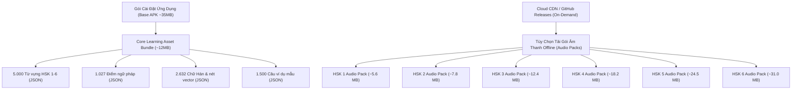

# HI CHINESE – CONTENT PACK ARCHITECTURE
**Kiến Trúc Đóng Gói và Quản Lý Phiên Bản Gói Nội Dung Học Tập**
*Ngày lập: 03/11/2026 | Phiên bản: 1.0.0 | Tác giả: Principal Software Architect & Senior Data Engineer*

---

## 1. PHÂN CHIA GÓI NỘI DUNG (CONTENT PACK PARTITIONING)

Để giải quyết bài toán cân bằng giữa **dung lượng file cài đặt APK gọn nhẹ** và **khả năng học tập ngoại tuyến phong phú**, HI Chinese chia học liệu thành 2 phân hệ gói:

---

## 2. QUẢN LÝ PHIÊN BẢN & MÃ TOÀN VẸN (VERSIONING & INTEGRITY)

Mỗi gói nội dung được quản lý trong bảng `content_packs` với các trường:
- `id`: Mã định danh gói (ví dụ: `pack_audio_hsk1`, `pack_core_v1`).
- `curriculum_version`: Phiên bản học liệu (ví dụ: `1.0.0`).
- `schema_version`: Phiên bản cơ sở dữ liệu yêu cầu tối thiểu (ví dụ: `15`).
- `download_size_bytes`: Dung lượng chính xác của tệp nén.
- `sha256`: Mã băm SHA-256 để ứng dụng kiểm tra tính toàn vẹn ngay sau khi tải về, ngăn chặn tệp bị hỏng hoặc tải thiếu.

---

## 3. CƠ CHẾ CẬP NHẬT GÓI HỌC LIỆU MÀ KHÔNG ẢNH HƯỞNG TIẾN ĐỘ

1. **Khóa học liệu không trùng với khóa tiến độ**: Bảng `content_packs` quản lý phiên bản học thuật. Bảng `mastery_snapshots` và `learner_evidence` chỉ trỏ tới `knowledge_id`.
2. **Cập nhật nội dung dạng Delta Update**: Khi có bản vá lỗi chính tả câu ví dụ hoặc thêm cách giải thích ngữ pháp, hệ thống chỉ cập nhật các trường nội dung (`title`, `explanation_vi`, `example_vi`) mà không xóa bản ghi hay cấp lại ID mới.
