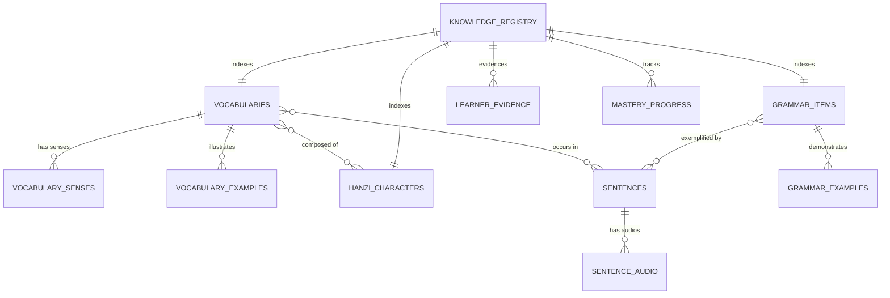

# HI CHINESE – MASTER DATA MAPPING & RECONCILIATION
**Đặc tả Ánh xạ Dữ liệu Đa Nguồn và Đối soát Quan hệ Thực thể**
*Ngày lập: 03/11/2026 | Phiên bản: 1.0.0 | Tác giả: Principal Software Architect & Senior Data Engineer*

---

## 1. BẢNG ÁNH XẠ NGUỒN DỮ LIỆU SANG CƠ SỞ DỮ LIỆU HI CHINESE

### 1.1. Từ Vựng & Từ Điển (Vocabulary Domain)
| Trường Nguồn (clem109 / CC-CEDICT) | Bảng SQLite đích (`vocabularies`, `senses`) | Kiểu dữ liệu | Quy tắc xử lý & Chuẩn hóa |
| :--- | :--- | :--- | :--- |
| `simplified` | `vocabularies.simplified` | `TEXT NOT NULL` | Giữ nguyên chữ Hán giản thể chuẩn UTF-8. |
| `traditional` | `vocabularies.traditional` | `TEXT` | Nếu thiếu, điền dạng giản thể. |
| `pinyin` | `vocabularies.pinyin` | `TEXT NOT NULL` | Pinyin có dấu thanh điệu chuẩn (`lǎo shī`). |
| *(computed)* | `vocabularies.pinyin_clean` | `TEXT` | Pinyin bỏ dấu thanh (`laoshi`) phục vụ tra cứu nhanh. |
| *(computed)* | `vocabularies.pinyin_numeric` | `TEXT` | Pinyin đánh số (`lao3shi1`) hỗ trợ bàn phím số. |
| `hanviet.csv` | `vocabularies.hanviet` | `TEXT` | Âm Hán-Việt tương ứng từng chữ (`lão sư`). |
| `hsk` (1–6) | `vocabularies.hsk_level` | `INTEGER` | Giữ nguyên cấp độ HSK 1–6 gốc. |
| `definitions` (array) | `vocabulary_senses.meaning_vi` | `TEXT` | Tách mỗi nghĩa thành 1 hàng `sense`, hỗ trợ từ nhiều nghĩa. |
| `pos` | `vocabulary_senses.partOfSpeech` | `TEXT` | Chuẩn hóa danh từ, động từ, tính từ... |
| `examples` | `vocabulary_examples` | `TEXT` | Lưu câu ví dụ minh họa từng nghĩa của từ. |

### 1.2. Ngữ Pháp (Grammar Domain)
| Trường Nguồn (AllSet Wiki / HSK 3.0 Gushi) | Bảng SQLite đích (`grammar_items`) | Kiểu dữ liệu | Quy tắc ánh xạ & Đối chiếu |
| :--- | :--- | :--- | :--- |
| `id` / `url` slug | `grammar_items.grammar_id` | `TEXT NOT NULL` | Mã định danh ổn định (ví dụ: `as_a1_001`, `gushi_hsk1_001`). |
| `title` | `grammar_items.title` | `TEXT NOT NULL` | Tiêu đề điểm ngữ pháp bằng tiếng Việt kèm Hán tự. |
| `pattern` / `structure` | `grammar_items.structure` | `TEXT NOT NULL` | Cấu trúc công thức ngữ pháp (ví dụ: `Subj. + 是 + Noun`). |
| `explanation` | `grammar_items.explanation_vi` | `TEXT NOT NULL` | Giải thích quy tắc sử dụng và lưu ý sư phạm. |
| `category` | `grammar_items.topic_category` | `TEXT` | Khóa ngoại sang `grammar_topics` (ví dụ: `particle`, `verb_predicate`). |
| `level` (A1–B2 / HSK 1–6) | `grammar_items.original_level` | `TEXT` | Cấp độ gốc của nguồn (không bị mất dấu vết). |
| *(mapped)* | `grammar_items.hsk_level_mapped` | `INTEGER` | Cấp độ HSK 1–6 sau khi đối chiếu đối sánh có căn cứ. |
| `examples` | `grammar_examples` | Table | Tách thành hàng quan hệ 1-N kèm phiên âm và dịch nghĩa. |

### 1.3. Chữ Hán & Thứ Tự Nét (Character Domain)
| Trường Nguồn (Make Me a Hanzi) | Bảng SQLite đích (`hanzi_characters`) | Kiểu dữ liệu | Quy tắc xử lý Vector & Metadata |
| :--- | :--- | :--- | :--- |
| `character` | `hanzi_characters.character` | `TEXT UNIQUE` | Chữ Hán đơn (1 ký tự UTF-16/UTF-32). |
| `strokes` (SVG d paths) | `hanzi_characters.strokes_json` | `TEXT NOT NULL` | Mảng chuỗi đường dẫn vector SVG từng nét. |
| `medians` (point coordinates) | `hanzi_characters.medians_json` | `TEXT NOT NULL` | Mảng tọa độ đường trung tuyến điều hướng bút vẽ. |
| *(computed)* | `hanzi_characters.stroke_count` | `INTEGER` | Tổng số nét của chữ Hán. |
| `pinyin` | `hanzi_characters.pinyin` | `TEXT` | Phiên âm Pinyin có dấu thanh. |
| `radical` | `hanzi_characters.radical` | `TEXT` | Bộ thủ chữ Hán. |
| `decomposition` | `hanzi_characters.decomposition` | `TEXT` | Cấu trúc chiết tự (ví dụ: `⿰亻尔`). |

### 1.4. Câu Ví Dụ & Âm Thanh (Sentence & Audio Domain)
| Trường Nguồn (Tatoeba / CMN Corpus) | Bảng SQLite đích (`sentences`, `sentence_audio`) | Kiểu dữ liệu | Quy tắc xử lý Âm thanh |
| :--- | :--- | :--- | :--- |
| `sentence_id` | `sentences.id` | `TEXT PRIMARY KEY` | Tiền tố ổn định `tat_{id}` hoặc `sent_hsk{lvl}_{idx}`. |
| `chinese_text` | `sentences.chinese` | `TEXT NOT NULL` | Câu chữ Hán giản thể chuẩn. |
| `pinyin` | `sentences.pinyin` | `TEXT NOT NULL` | Pinyin toàn câu có dấu thanh. |
| `tokens` | `sentences.tokens_json` | `TEXT (JSON)` | Mảng token từ vựng kèm nghĩa tiếng Việt và cấp độ. |
| `audio_id` | `sentence_audio.id` | `TEXT PRIMARY KEY` | Khóa định danh âm thanh duy nhất. |
| `speaker` | `sentence_audio.speaker_name` | `TEXT` | Tên người đọc bản ngữ (ví dụ: `LeviHighway`, `fucongcong`). |
| `audio_type` | `sentence_audio.audio_type` | `TEXT` | `humanRecording`, `nativeOsTts` hoặc `studioSimulation`. |
| `remote_url` | `sentence_audio.url_remote` | `TEXT` | URL tải về trực tiếp từ nguồn mở kiểm chứng. |

---

## 2. QUAN HỆ ĐỐI CHIẾU LIÊN MIỀN (CROSS-DOMAIN RELATIONS)

1. **Vocabulary ↔ Hanzi Characters**:
   - Một từ vựng (ví dụ: `医生`) bao gồm các chữ Hán cấu thành `['医', '生']`.
   - Quan hệ phân tích: Truy vấn `hanzi_characters` theo danh sách chữ trong `vocabularies.simplified`.
2. **Vocabulary ↔ Sentences**:
   - `sentences.tokens_json` lưu trữ danh sách từ khóa xuất hiện trong câu.
   - `sentences.matched_vocab_ids_json` ánh xạ trực tiếp đến `vocabularies.id`.
3. **Grammar ↔ Sentences**:
   - `sentences.grammar_tags_json` lưu các thẻ ngữ pháp xuất hiện trong câu.
   - Cung cấp kho câu nghe/shadowing minh họa sinh động cho quy tắc ngữ pháp.
4. **Knowledge Registry ↔ User Progress**:
   - Tiến độ học tập (`learner_evidence`, `mastery_progress`, `srs_items`) được neo vào `knowledge_registry.id` (ví dụ: `KNOW_VOCAB_你好`, `KNOW_GRAM_as_a1_001`, `KNOW_HANZI_你`).
   - Nhờ đó, việc cập nhật gói học liệu hoặc bổ sung ví dụ **hoàn toàn không làm ảnh hưởng hay reset tiến độ của người dùng**.
