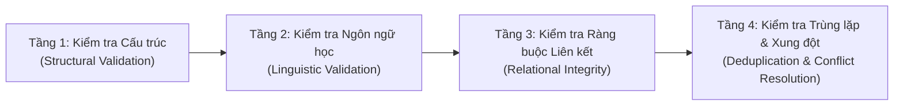

# HI CHINESE – DATA VALIDATION PIPELINE SPECIFICATION
**Quy Trình Kiểm Tra & Thẩm Định Chất Lượng Dữ Liệu 4 Tầng**
*Ngày lập: 03/11/2026 | Phiên bản: 1.0.0 | Tác giả: Principal Software Architect & Senior Data Engineer*

---

## 1. QUY TRÌNH THẨM ĐỊNH 4 TẦNG (FOUR-TIER VALIDATION PIPELINE)

---

## 2. CHI TIẾT TỪNG TẦNG THẨM ĐỊNH

### 2.1. Tầng 1: Kiểm Tra Cấu Trúc (Structural Validation)
- **Kiểm tra trường bắt buộc**: Không chấp nhận bản ghi thiếu các trường cốt lõi (`id`, `simplified`, `pinyin`, `hsk_level`).
- **Kiểm tra cú pháp JSON**: Toàn bộ các trường JSON (`tokens_json`, `strokes_json`, `medians_json`, `senses_json`) phải được `jsonDecode()` thành công.
- **Kiểm tra tính toàn vẹn khóa**: Không có ID trùng lặp trong cùng một bảng.

### 2.2. Tầng 2: Kiểm Tra Ngôn Ngữ Học (Linguistic Validation)
- **Kiểm tra mã ký tự Chữ Hán**: Chữ Hán phải thuộc khối Unicode `\u4e00` – `\u9fff` hoặc `\u3400` – `\u4dbf`.
- **Kiểm tra Pinyin & Dấu thanh**: Pinyin có dấu thanh hợp lệ (`ā, á, ǎ, à, ē, é, ě, è...`), không bị lỗi vỡ font mã hóa.
- **Tính nhất quán giữa Pinyin có dấu và Pinyin số**: Ví dụ `lǎo shī` phải ánh xạ chính xác với `lao3 shi1` và `laoshi`.
- **Kiểm tra câu dịch**: Không chấp nhận câu ví dụ có phần dịch nghĩa trống rỗng.

### 2.3. Tầng 3: Kiểm Tra Ràng Buộc Liên Kết (Relational Integrity)
- **Sentence ↔ Vocabulary**: Mọi ID trong `sentences.matched_vocab_ids_json` phải tồn tại trong bảng `vocabularies`.
- **Sentence ↔ Audio**: Khóa ngoại `sentence_audio.sentence_id` phải tồn tại trong bảng `sentences`.
- **Character ↔ Stroke Data**: Chữ Hán trong `hanzi_characters` phải có mảng nét `strokes_json` tương ứng với số nét `stroke_count`.
- **Grammar ↔ Examples**: Mọi hàng trong `grammar_examples` phải tham chiếu đến một `grammar_items.id` hợp lệ.

### 2.4. Tầng 4: Kiểm Tra Trùng Lặp & Xử Lý Xung Đột (Deduplication)
- **Phân biệt từ đa âm với từ trùng**: Cùng một chữ Hán nhưng khác Pinyin hoặc khác từ loại thì phân tách thành các `sense` hoặc đánh dấu `is_polyphone = 1`, không gộp mù quáng.
- **Xử lý xung đột khi import**: Áp dụng mệnh đề `INSERT OR REPLACE` hoặc `ON CONFLICT DO UPDATE` dựa trên Primary Key ổn định, đảm bảo script import có thể chạy lặp lại an toàn (idempotent).
