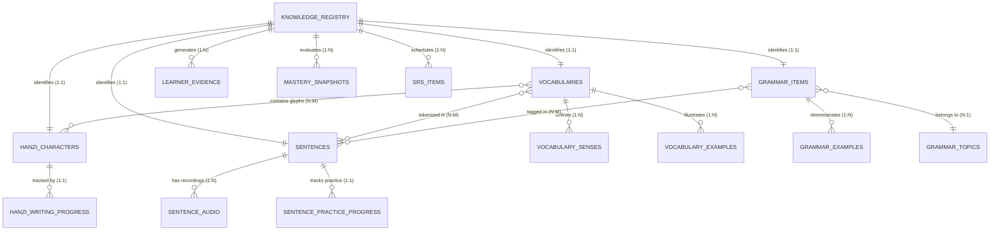

# HI CHINESE – ENTITY RELATIONSHIPS SPECIFICATION
**Đặc tả Quan hệ Thực thể & Ràng buộc Toàn vẹn Dữ liệu**
*Ngày lập: 03/11/2026 | Phiên bản: 1.0.0 | Tác giả: Principal Software Architect & Senior Data Engineer*

---

## 1. SƠ ĐỒ QUAN HỆ THỰC THỂ (ERD)

---

## 2. BẢNG QUY TẮC RÀNG BUỘC VÀ HÀNH VI CASCADE

| Bảng Cha (Parent) | Bảng Con (Child) | Khóa Ngoại (Foreign Key) | Ràng buộc Xóa (ON DELETE) | Ý nghĩa nghiệp vụ |
| :--- | :--- | :--- | :--- | :--- |
| `vocabularies` | `vocabulary_senses` | `vocabulary_id` | `CASCADE` | Xóa từ vựng thì xóa toàn bộ các nét nghĩa con. |
| `vocabularies` | `vocabulary_examples` | `vocabulary_id` | `CASCADE` | Xóa từ vựng thì xóa ví dụ minh họa của từ đó. |
| `grammar_items` | `grammar_examples` | `grammar_id` | `CASCADE` | Xóa điểm ngữ pháp thì xóa ví dụ đi kèm. |
| `sentences` | `sentence_audio` | `sentence_id` | `CASCADE` | Xóa câu thì xóa metadata audio của câu đó. |
| `sentences` | `sentence_practice_progress` | `sentence_id` | `CASCADE` | Xóa câu thì xóa tiến độ luyện tập của câu đó. |
| `knowledge_registry` | `learner_evidence` | `knowledge_id` | `RESTRICT / NO ACTION` | Bằng chứng học tập là bất biến (append-only), không xóa theo content. |
| `knowledge_registry` | `mastery_snapshots` | `knowledge_id` | `RESTRICT` | Bảo toàn điểm thuần thục của người học kể cả khi cập nhật phiên bản content pack. |

---

## 3. QUAN HỆ NHIỀU - NHIỀU (N:M) VÀ CƠ CHẾ NỘI SUY HIỆU NĂNG CAO

Thay vì tạo hàng chục bảng trung gian nối n-n làm chậm tốc độ truy vấn SQLite trên thiết bị di động tầm trung, HI Chinese áp dụng **kết hợp chỉ mục Text và mảng JSON định dạng chuẩn**:

1. **`vocabularies` ↔ `hanzi_characters`**:
   - Truy vấn giải mã chữ: Một từ dài $K$ ký tự ($K \le 4$) được phân rã thành danh sách ký tự Unicode và truy vấn trực tiếp qua `WHERE character IN (?, ?, ?)`. 
   - Với chỉ mục `UNIQUE` trên `hanzi_characters(character)`, tốc độ truy xuất đạt $O(1)$ chỉ trong **< 1ms**.
2. **`sentences` ↔ `vocabularies`**:
   - Trường `sentences.tokens_json` chứa mảng các token từ vựng đã được phân đoạn (tokenized) trong quá trình ETL.
   - Trường `sentences.matched_vocab_ids_json` chứa danh sách ID từ vựng tương ứng.
3. **`sentences` ↔ `grammar_items`**:
   - Trường `sentences.grammar_tags_json` chứa danh sách thẻ ngữ pháp minh họa.
