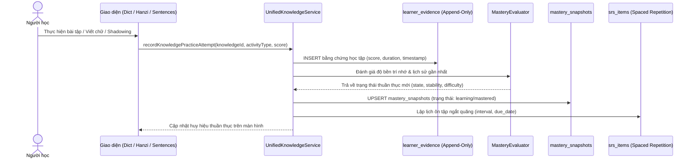

# HI CHINESE – LEARNING SYSTEM INTEGRATION
**Tích Hợp Hệ Tri Thức Hợp Nhất Với Hệ Thống Học Tập, SRS và Đánh Giá Thuần Thục**
*Ngày lập: 03/11/2026 | Phiên bản: 1.0.0 | Tác giả: Principal Software Architect & Senior Data Engineer*

---

## 1. LUỒNG ĐIỀU PHỐI DỮ LIỆU HỌC TẬP (LEARNING DATA FLOW)

---

## 2. NGUYÊN TẮC BẢO VỆ TIẾN ĐỘ NGƯỜI HỌC KHI CẬP NHẬT GIÁO TRÌNH

1. **Đơn vị neo giữ tiến độ (Anchor of Progress)**:
   - Điểm thuần thục (`mastery_snapshots`) và lịch ôn tập (`srs_items`) luôn được neo giữ bởi `knowledge_id` trong `knowledge_registry`.
   - Ví dụ: `KNOW_VOCAB_朋友` hay `KNOW_GRAM_as_a1_001`.
2. **Khi phiên bản học liệu thay đổi**:
   - Thêm ví dụ minh họa mới: Thêm hàng vào `vocabulary_examples` hoặc `grammar_examples`. Không chạm vào `mastery_snapshots`.
   - Tinh chỉnh bản dịch tiếng Việt: Cập nhật trường `meaning_vi` trong `vocabulary_senses`. Không chạm vào `srs_items`.
   - Bổ sung file âm thanh chất lượng cao: Tải thêm vào `sentence_audio`. Không làm mất lịch sử luyện nghe trong `sentence_practice_progress`.
3. **Khi điểm tri thức bị thay thế hoặc đổi tên**:
   - Bảng `content_id_mappings` ghi nhận ánh xạ `old_id -> new_id`.
   - Khi tính toán tiến độ, hệ thống tự động kế thừa lịch sử của `old_id` sang `new_id`. Không bao giờ đưa người học về vạch xuất phát 0%!
