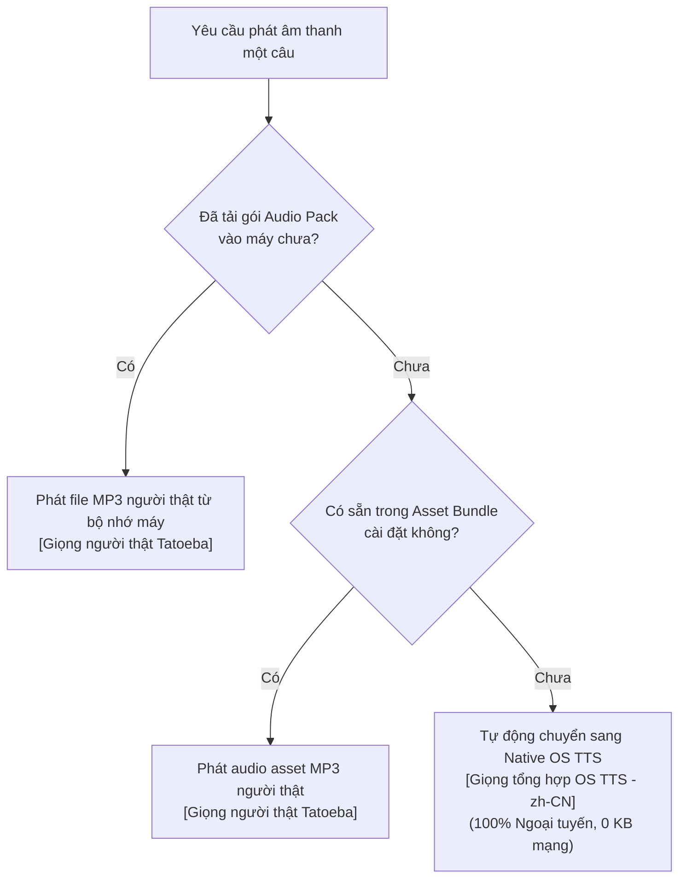

# HI CHINESE – OFFLINE DATA ARCHITECTURE
**Kiến Trúc Hoạt Động Ngoại Tuyến 100% & Cơ Chế Dự Phòng Đa Tầng**
*Ngày lập: 03/11/2026 | Phiên bản: 1.0.0 | Tác giả: Principal Software Architect & Senior Data Engineer*

---

## 1. NGUYÊN TẮC THIẾT KẾ OFFLINE-FIRST

Trong mọi trường hợp thiết bị mất kết nối Internet hoàn toàn (chế độ máy bay, vùng không có sóng), ứng dụng HI Chinese **vẫn đảm bảo 100% các chức năng cốt lõi**:
- Tra cứu từ vựng và xem nghĩa chi tiết.
- Xem lý thuyết và ví dụ của toàn bộ 1.027 điểm ngữ pháp HSK 1–6.
- Xem hoạt họa nét vẽ và tập viết 2.632 chữ Hán với thuật toán chấm điểm nét chữ trên máy.
- Nghe câu ví dụ với cơ chế phát âm đa tầng (Fallback Engine).
- Luyện nói và nhại giọng (Shadowing) bằng bộ thu âm và đo sóng âm cục bộ.
- Làm bài tập trắc nghiệm và ghi nhận tiến độ thuần thục vào cơ sở dữ liệu SQLite.

---

## 2. CƠ CHẾ DỰ PHÒNG ÂM THANH ĐA TẦNG (MULTI-TIER AUDIO FALLBACK)

Nhờ cơ chế này, người dùng **không bao giờ gặp lỗi im lặng hoặc thông báo mất kết nối** khi bấm nghe âm thanh tiếng Trung trong ứng dụng!
