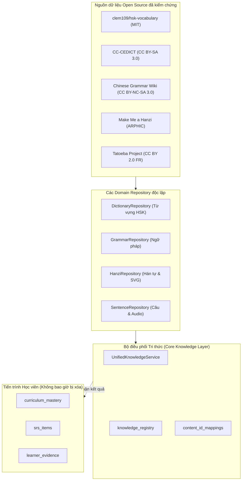

# Thư mục Tài liệu Hợp nhất Dữ liệu Học tập (Data Integration Documentation)

> **Dự án**: HI Chinese – Nền tảng học tiếng Trung độc lập, offline-first  
> **Thư mục lưu trữ**: `docs/data-integration/`  
> **Phiên bản Schema**: SQLite Schema v15  
> **Trạng thái**: Hoàn thiện toàn diện (Comprehensive & Production-Ready)

---

## 1. Mục đích và Phạm vi

Thư mục này chứa toàn bộ hệ thống tài liệu kiến trúc, kiểm toán, quy chuẩn định danh, ánh xạ thực thể, kiểm chứng bản quyền và báo cáo kiểm thử của đợt đại tu sửa và hợp nhất 4 miền tri thức học tập tiếng Trung trong HI Chinese:
1. **Từ vựng và Từ điển HSK 1–6** (clem109/hsk-vocabulary & CC-CEDICT).
2. **Ngữ pháp HSK 1–6** (AllSet Learning Chinese Grammar Wiki & HSK 3.0 Syllabus).
3. **Chữ Hán, Thứ tự nét và Luyện viết** (Make Me a Hanzi & Hanzi Writer).
4. **Kho câu ví dụ và Âm thanh bản xứ** (Tatoeba Project & Corpus Alignment).

Tất cả dữ liệu được thiết kế hoạt động hoàn toàn ngoại tuyến (100% offline-first), không sử dụng nội dung do AI bịa đặt, và bảo vệ tuyệt đối tiến trình học tập của người dùng.

---

## 2. Bản đồ Tài liệu (Documentation Sitemap)

Dưới đây là danh mục 15 tài liệu chuyên sâu được sắp xếp theo từng chủ đề:

### Nhóm 1: Báo cáo Kiểm toán và Đánh giá Hiện trạng
- **[`DATA_INTEGRATION_AUDIT.md`](./DATA_INTEGRATION_AUDIT.md)**: Khảo sát hiện trạng toàn diện trước khi sửa đổi, phân loại trạng thái từng module (`IMPLEMENTED`, `PARTIALLY_IMPLEMENTED`, `BROKEN`, v.v.).
- **[`DATA_PROVENANCE.md`](./DATA_PROVENANCE.md)**: Nguồn gốc và gia phả dữ liệu (Data Lineage), phân định rõ ràng giữa dữ liệu nguyên bản (Raw), chuẩn hóa (Normalized), đối soát (Verified) và suy luận hỗ trợ (AI-Assisted).
- **[`LICENSE_COMPLIANCE.md`](./LICENSE_COMPLIANCE.md)**: Ma trận kiểm tra tính tương thích bản quyền nguồn mở (MIT, CC BY-SA 3.0, CC BY-NC-SA 3.0, CC BY-SA 4.0, ARPHIC, CC BY 2.0 FR) và nội dung ghi nhận công khai trong ứng dụng.

### Nhóm 2: Kiến trúc và Lược đồ Cơ sở Dữ liệu
- **[`UNIFIED_DATA_ARCHITECTURE.md`](./UNIFIED_DATA_ARCHITECTURE.md)**: Kiến trúc hệ thống dữ liệu 5 tầng từ Nguồn mở đến Tầng giao diện người dùng, nguyên tắc thiết kế Facade Service.
- **[`UNIFIED_SCHEMA.md`](./UNIFIED_SCHEMA.md)**: Toàn văn định nghĩa cấu trúc cơ sở dữ liệu SQLite qua 15 phiên bản Migration, các chỉ mục tối ưu hiệu năng và quy tắc bảo toàn dữ liệu người dùng.
- **[`ENTITY_RELATIONSHIPS.md`](./ENTITY_RELATIONSHIPS.md)**: Sơ đồ thực thể liên kết (ERD), ma trận quan hệ N:M giữa Từ vựng, Ngữ pháp, Hán tự, Câu mẫu và Chỉ mục hóa tăng tốc.
- **[`ID_STRATEGY.md`](./ID_STRATEGY.md)**: Chiến lược định danh thống nhất, quy chuẩn format ID từng miền tri thức, cơ chế phân giải từ đa âm đa nghĩa (Polyphones) qua bảng `content_id_mappings`.

### Nhóm 3: Quy trình Chuẩn hóa và Vận hành Dữ liệu
- **[`DATA_MAPPING.md`](./DATA_MAPPING.md)**: Bảng ánh xạ đa nguồn, liên kết giữa các trường dữ liệu gốc sang cấu trúc thực thể SQLite chuẩn.
- **[`DATA_VALIDATION.md`](./DATA_VALIDATION.md)**: Quy trình xác thực dữ liệu 4 cấp (Cấu trúc, Ngôn ngữ học, Tính toàn vẹn quan hệ, Khử trùng lặp).
- **[`IMPORT_UPDATE_PIPELINE.md`](./IMPORT_UPDATE_PIPELINE.md)**: Kịch bản nạp và cập nhật dữ liệu lũy thừa (Idempotency), xử lý an toàn giao dịch (Transaction safety).

### Nhóm 4: Đóng gói và Ngoại tuyến (Offline Delivery)
- **[`CONTENT_PACK_ARCHITECTURE.md`](./CONTENT_PACK_ARCHITECTURE.md)**: Cấu trúc phân tầng giữa gói Asset tích hợp sẵn (Core Pack 28.5 MB) và các gói âm thanh mở rộng (Audio Packs on GitHub Releases).
- **[`OFFLINE_DATA_ARCHITECTURE.md`](./OFFLINE_DATA_ARCHITECTURE.md)**: Cơ chế phát âm đa nấc tự động fallback (Tệp tải về -> Tệp Asset bundle -> Hệ thống Text-To-Speech gốc của thiết bị).
- **[`LEARNING_SYSTEM_INTEGRATION.md`](./LEARNING_SYSTEM_INTEGRATION.md)**: Tích hợp giữa tri thức chuẩn và hệ thống học tập cá nhân hóa: Không bao giờ reset SRS, không xóa điểm Mastery khi cập nhật bài học mới.

### Nhóm 5: Báo cáo Kiểm thử và Bàn giao Master
- **[`TEST_REPORT.md`](./TEST_REPORT.md)**: Kết quả chạy tự động bộ 6 bài kiểm tra then chốt (Tests A – F) và 67 unit/integration test cases (100% Passed).
- **[`DATA_INTEGRATION_FINAL_REPORT.md`](./DATA_INTEGRATION_FINAL_REPORT.md)**: Báo cáo tổng thể trình bày các Mục A đến G theo yêu cầu bàn giao của kiến trúc sư trưởng.

---

## 3. Sơ đồ Kiến trúc Tổng thể (Master Architecture Diagram)



---

## 4. Hướng dẫn Dành cho Kỹ sư và AI Agent tiếp nhận dự án

1. **Vị trí Workspace độc lập**:
   - Thư mục dự án: `C:\Users\phama\Downloads\hi_chinese`.
   - **Tuyệt đối không đụng vào thư mục khác** (đặc biệt là `halo_chinese`).
2. **Truy vấn Dữ liệu Tri thức**:
   - Không truy vấn trực tiếp từng bảng cơ sở dữ liệu nếu cần liên kết chéo. Hãy luôn sử dụng Facade `UnifiedKnowledgeService` đặt tại `lib/core/knowledge/domain/services/unified_knowledge_service.dart`.
3. **Bảo toàn Dữ liệu Học viên**:
   - Khi viết migration mới trong `lib/core/database/migrations/`, luôn tuân thủ nguyên tắc chỉ thêm bảng/cột mới hoặc tạo chỉ mục, tuyệt đối không được dùng lệnh `DROP TABLE` đối với `curriculum_mastery`, `learner_evidence`, hoặc `srs_items`.
4. **Quy tắc Kiểm thử**:
   - Mọi thay đổi về dữ liệu phải chạy qua bộ kiểm thử tích hợp:
     ```powershell
     flutter test test/core/knowledge/unified_knowledge_system_test.dart
     ```
