# HI CHINESE – UNIFIED DATA ARCHITECTURE
**Kiến Trúc Dữ Liệu Học Tập Hợp Nhất & Hệ Thống Tri Thức Đa Tầng**
*Ngày lập: 03/11/2026 | Phiên bản: 1.0.0 | Tác giả: Principal Software Architect & Senior Data Engineer*

---

## 1. TỔNG QUAN KIẾN TRÚC HỢP NHẤT

Hệ thống dữ liệu học tập HI Chinese được tổ chức theo mô hình **5 tầng kiến trúc độc lập và hướng tới tính bền vững ngoại tuyến (Offline-First)**:

```mermaid
flowchart TD
    subgraph S1["Tầng 1: Open Source Raw Sources"]
        Clem["clem109 (HSK 1-6 Vocab)"]
        CEDICT["CC-CEDICT & Hanviet"]
        AllSet["AllSet Grammar Wiki (A1-B2)"]
        Gushi["HSK 3.0 Grammar Syllabus"]
        MMH["Make Me a Hanzi (SVG Strokes)"]
        Tat["Tatoeba Project (Sentences & Audio)"]
    end

    subgraph S2["Tầng 2: Data Processing & Normalization"]
        ETL["Python ETL Pipeline & Validators"]
        Dedupe["Deduplication & Cross-Referencing"]
        Fixtures["Asset JSON Fixtures (hsk_seed, grammar, hanzi, sentences)"]
    end

    subgraph S3["Tầng 3: Unified Knowledge Base (SQLite)"]
        KR["Canonical Knowledge Registry (knowledge_registry)"]
        VTable["vocabularies & senses"]
        GTable["grammar_items & examples"]
        HTable["hanzi_characters (Vector paths)"]
        STable["sentences & sentence_audio"]
    end

    subgraph S4["Tầng 4: Unified Learning Engine"]
        UKS["UnifiedKnowledgeService (Facade)"]
        Coordinator["LearningPipelineCoordinator"]
        Mastery["Mastery Engine & Learner Evidence"]
        SRS["Spaced Repetition Engine (SRS)"]
        AudioMngr["SentenceAudioManager (TTS + Human)"]
    end

    subgraph S5["Tầng 5: Presentation & Offline Learning"]
        DictUI["Smart Dictionary Screen"]
        GrammarUI["Grammar Catalog & Exercise Screen"]
        HanziUI["Hanzi Writing Practice Screen"]
        SentenceUI["Sentence Listening & Shadowing Screen"]
        PackUI["Audio & Content Pack Manager"]
    end

    S1 --> S2
    S2 --> S3
    S3 --> S4
    S4 --> S5
```

---

## 2. NGUYÊN TẮC THIẾT KẾ CỐT LÕI

1. **Phân tách Tri thức & Tiến độ (Knowledge-Progress Decoupling)**:
   - Toàn bộ dữ liệu học thuật (Từ vựng, Ngữ pháp, Chữ Hán, Câu ví dụ, Audio) nằm ở các bảng Content tĩnh.
   - Toàn bộ hành vi học tập của người dùng được lưu trữ độc lập ở các bảng Progress (`learner_evidence`, `mastery_progress`, `sentence_practice_progress`, `hanzi_writing_progress`).
   - Cập nhật giáo trình hoặc tải thêm Audio Pack **tuyệt đối không làm thay đổi hay reset tiến độ**.
2. **Khả năng hoạt động 100% Offline**:
   - Mọi dữ liệu cơ sở đều có sẵn trong gói cài đặt (bộ SQLite nén và Asset bundle JSON).
   - Thiết bị không cần kết nối mạng vẫn tra từ điển, học ngữ pháp, xem hoạt họa thứ tự nét, luyện nghe với Native OS TTS và lưu lại tiến độ đầy đủ.
3. **Minh bạch Nguồn gốc và Giấy phép**:
   - Mọi thực thể đều lưu vết `source` và `license`.
   - Giọng người thật và giọng TTS được dán nhãn phân biệt rõ ràng trên giao diện người dùng.

---

## 3. THIẾT KẾ UNIFIED KNOWLEDGE SERVICE (FACADE)

Nhằm xóa bỏ sự rời rạc giữa 4 Repository hiện tại, hệ thống bổ sung **`UnifiedKnowledgeService`** tại `lib/core/knowledge/unified_knowledge_service.dart`. 

Dịch vụ này đóng vai trò Facade duy nhất:
- `getVocabularyWithFullRelations(String wordOrId)`:
  - Trả về đối tượng `UnifiedVocabularyDetails`:
    - Dữ liệu từ vựng `VocabularyItem` và các `Sense`
    - Danh sách chữ Hán cấu thành `List<HanziCharacter>` (kèm dữ liệu nét vẽ từ `hanzi_characters`)
    - Danh sách câu ví dụ chứa từ `List<SentenceItem>` (kèm audio phát âm từ `sentences`)
    - Danh sách các cấu trúc ngữ pháp liên quan `List<GrammarItem>`
    - Trạng thái SRS và Mastery hiện tại
- `getGrammarWithFullRelations(String grammarId)`:
  - Trả về cấu trúc ngữ pháp, ví dụ mẫu, câu ví dụ tương ứng từ corpus và các bài tập thực hành.
- `getSentenceWithFullRelations(String sentenceId)`:
  - Trả về câu hoàn chỉnh, danh sách token từ vựng (nhấn vào xem chi tiết), điểm ngữ pháp xuất hiện trong câu, và danh sách audio người thật / TTS.
- `recordKnowledgePracticeAttempt(...)`:
  - Ghi nhận nỗ lực thực hành (nghe, nói, viết, đọc) vào `learner_evidence`, tự động cập nhật SRS và Mastery.
