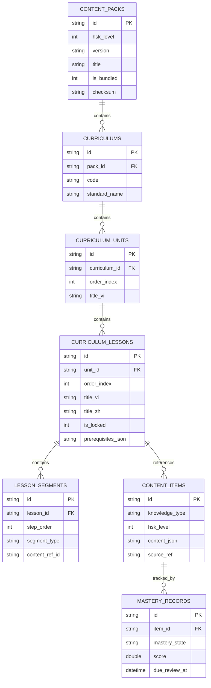

# Thiết Kế Kiến Trúc: Nền Tảng Tự Học Tiếng Trung HSK Hoàn Chỉnh (HI Chinese)

- **Ngày ban hành:** 2026-11-02 (Cập nhật sau Builder Review)
- **Tác giả:** Antigravity (AI Pair Programmer) & Project Owner
- **Trạng thái:** Sẵn sàng phê duyệt (Approved Design Spec)
- **Tài liệu tham chiếu:** User Requirement Specification (Task: Chuyển định hướng sang nền tảng tự học HSK hoàn chỉnh)

---

## 1. Mục Tiêu & Bối Cảnh (Intent & The Why)

### 1.1. Bối Cảnh Chuyển Đổi
HI Chinese chuyển đổi từ một ứng dụng AI Chat hỗ trợ học tập sang một **Nền Tảng Tự Học HSK Hoàn Chỉnh**, có tính hệ thống cao, cấu trúc thứ bậc sư phạm chặt chẽ, học liệu được biên soạn chuẩn xác và có khả năng vận hành độc lập ngoại tuyến $100\%$ không phụ thuộc Internet hay API.

### 1.2. Định Hướng Cốt Lõi
- **Tự Học Ngoại Tuyến Toàn Diện:** Toàn bộ quá trình học tập cốt lõi (xem giáo trình, học từ vựng, ngữ pháp, tập viết nét chữ Hán, nghe hội thoại, làm bài tập, chấm điểm và ôn tập SRS) hoạt động hoàn hảo khi không có mạng.
- **AI Đóng Vai Trò Trợ Giảng Bổ Trợ (Auxiliary Assistant):** AI không thay thế giáo trình và không tạo đáp án chính thức, chỉ hỗ trợ giải thích sâu, tạo ngữ cảnh đàm thoại tự do hoặc phân tích lỗi sai theo yêu cầu của người học.

---

## 2. Mục Tiêu, Phi Mục Tiêu & Chống Mục Tiêu (Goals, Non-Goals, Anti-Goals)

### 2.1. Mục Tiêu (Goals)
1. **Content Management System (CMS / Content Catalog) Ngoại Tuyến:**
   - Quản lý học liệu bằng cơ sở dữ liệu SQLite có cấu trúc, tách rời hoàn toàn nội dung học tập khỏi giao diện hiển thị (UI). Không viết cứng (hardcode) nội dung vào Flutter widgets.
   - Quản lý 9 nhóm học liệu: *Từ vựng (Vocabulary), Ngữ pháp (Grammar), Chữ Hán (Chinese Characters), Nghe hiểu (Listening), Nói/Ngữ âm (Speaking), Đọc hiểu (Reading), Viết (Writing), Bài tập (Exercises), Đề thi mô phỏng (Mock Exams)*.
   - Mỗi đơn vị học liệu có `content_id` duy nhất, `curriculum_id`, cấp độ HSK, bài học liên kết, loại kiến thức, mục tiêu sư phạm, nguồn tham khảo đã kiểm định và metadata liên kết kiến thức tiên quyết.
2. **Giáo Trình Có Trình Tự Sư Phạm Chuẩn Mực:**
   - Cấu trúc thứ bậc: **Giai đoạn (Stage) $\to$ Chương (Unit) $\to$ Bài học (Lesson) $\to$ Phần kiến thức (Knowledge Segment) $\to$ Luyện tập (Practice) $\to$ Kiểm tra chương (Unit Exam) $\to$ Ôn tập (SRS Review) $\to$ Kiểm tra tổng kết cấp độ (Level Exit Exam)**.
3. **Ngân Hàng Bài Tập Tự Động Định Lượng (Deterministic Exercise Bank):**
   - Bài tập được biên soạn sẵn kèm đáp án chuẩn và rubric chấm điểm tất định.
   - Chấm điểm và phản hồi giải thích ngay lập tức trên máy cục bộ mà không gọi API bên ngoài.
4. **Hệ Thống Đánh Giá Năng Lực & Cơ Chế Mở Khóa Bài Học:**
   - Quản lý 5 trạng thái chủ quyền kiến thức: `Chưa học` (not_started) $\to$ `Đang học` (in_progress) $\to$ `Đã hoàn thành bài` (completed) $\to$ `Cần ôn tập` (needs_review) $\to$ `Đã thành thạo` (mastered).
   - Mở khóa bài học kế tiếp dựa trên điều kiện tiên quyết và điểm số kiểm tra ($\ge 80\%$). Tự động phát hiện điểm yếu để đề xuất bài ôn tập bổ trợ.
5. **Cơ Chế Gói Học Liệu Độc Lập (Modular Content Packs):**
   - Đóng gói học liệu thành các Content Pack độc lập theo từng cấp HSK.
   - **Gói HSK 1 được đóng gói sẵn (pre-bundled)** trong ứng dụng ngay khi cài đặt, cho phép học ngay không cần Internet.
   - **Các gói tiếp theo (HSK 2, 3...) được tải theo nhu cầu (on-demand download)**, lưu cục bộ vào SQLite/file storage để học hoàn toàn offline. Tránh làm phình dung lượng APK cơ sở.
6. **Luồng Khởi Đầu Người Dùng Chuẩn Sư Phạm (Onboarding Flow):**
   - Bước 1: Cấu hình AI API Key (tùy chọn, có thể bỏ qua).
   - Bước 2: Đánh giá năng lực đầu vào (Placement Test - bắt buộc đối với người dùng mới để phân cấp chính xác).
   - Bước 3: Thiết lập cá nhân hóa (Thời gian học cam kết mỗi ngày/tuần và kỹ năng trọng điểm ưu tiên nâng cao).
7. **Cấu Trúc Bài Học 6 Chặng Với Trọng Tâm Thích Ứng:**
   - Dẫn nhập (Warm-up) $\to$ Từ vựng mới (Vocab) $\to$ Ngữ pháp trọng điểm (Grammar) $\to$ Hội thoại/Văn bản thực tế (Text) $\to$ Thực hành thích ứng theo kỹ năng trọng tâm (Adaptive Skill Practice) $\to$ Kiểm tra hoàn thành & Nạp vào SRS (Mastery Check).

### 2.2. Phi Mục Tiêu (Non-Goals)
- Không bắt buộc đăng ký tài khoản đám mây để học tập (Local SQLite là nguồn chân lý duy nhất).
- Không nhồi toàn bộ tài nguyên audio và hình ảnh của toàn bộ 6 cấp HSK vào trong bản cài đặt APK ban đầu.

### 2.3. Chống Mục Tiêu (Anti-Goals)
- Tuyệt đối không để quá trình học cốt lõi phụ thuộc vào Gemini API hoặc kết nối Internet.
- Tuyệt đối không dùng AI làm nguồn tạo đáp án chính thức cho các bài tập đã có đáp án chuẩn.
- Không ghi nhận trạng thái hoàn thành hay thành thạo chỉ vì người dùng lướt qua hay mở màn hình.
- Không tự ý mở khóa toàn bộ bài học mà bỏ qua điều kiện tiên quyết.

---

## 3. Các Quyết Định Thiết Kế Đã Thống Nhất (Agreed Technical & Pedagogical Decisions)

### 3.1. Tiêu Chuẩn Giáo Trình HSK 1 (User Decision)
- **Áp dụng Tiêu Chuẩn HSK 2.0 (Phương án A):**
  - Bao gồm 150 từ vựng cốt lõi phân bổ chuẩn vào **15 bài học** (mỗi bài ~10 từ vựng mới), 45 điểm ngữ pháp căn bản, 15 đoạn hội thoại/bài đọc thực tế, 150 chữ Hán cơ bản.
  - Phù hợp tối ưu cho người tự học từ con số không, tạo động lực hoàn thành cấp độ đầu tiên rõ ràng và thực tế.

### 3.2. Chiến Lược Âm Thanh (Audio Strategy - User Decision)
- **Áp dụng Âm Thanh Thu Âm Người Bản Xứ (Phương án A):**
  - Tệp âm thanh nén chuẩn MP3/AAC chất lượng cao (giọng phát âm chuẩn Bắc Kinh, ngữ điệu tự nhiên, tốc độ chuẩn sư phạm cho sơ cấp).
  - Đóng gói trực tiếp trong asset của gói học liệu `hsk1_pack_v1` (tổng dung lượng audio nén ~15MB), đảm bảo chất lượng nghe hiểu tốt nhất khi học ngoại tuyến.

### 3.3. Cơ Chế Mở Khóa Khi Xếp Lớp Đầu Vào (Placement Unlocking - User Decision)
- **Áp dụng Cơ Chế Tự Động Ghi Nhận Đạt Chuẩn (Phương án B):**
  - Khi người học hoàn thành bài đánh giá năng lực đầu vào (Placement Test) và được xếp vào một vị trí cụ thể (ví dụ: Bài 6 HSK 1 hoặc HSK 2):
  - Hệ thống tự động ghi nhận trạng thái `completed` (kèm cờ ghi chú `credited_by_placement_test`) cho các bài học trước đó, mở khóa trực tiếp bài học được xếp lớp, đồng thời người học vẫn có thể bấm xem lại các bài trước bất cứ lúc nào.

### 3.4. Các Quyết Định Kỹ Thuật Đã Xử Lý Bởi Kỹ Sư (Builder Calls)
1. **Luyện Viết Chữ Hán (Hanzi Writing):** Sử dụng thuật toán vector matching thời gian thực (`StrokeEvaluator`) sẵn có trong app (kiểm tra thứ tự nét bút thuận, hướng vẽ, góc sai số và điểm đặt bút) trên Canvas Flutter thuần túy, không dùng WebView hay phụ thuộc bên thứ ba.
2. **Luyện Phát Âm & Nghe Nói:** Tích hợp mô hình Pronunciation Lab sẵn có (nghe mẫu bản xứ $\to$ ghi âm microphone $\to$ hiển thị dạng sóng amplitude $\to$ so sánh âm thanh trực quan), không cần nạp mô hình neural STT cồng kềnh.
3. **Quy Chuẩn Bài Tập Thích Ứng (Adaptive Quota):** Mỗi bài học có đúng 10 bài tập định lượng: 4 bài thuộc kỹ năng trọng điểm của người học, 6 bài phân bổ cho các kỹ năng còn lại. Với các bài sơ khai (Bài 1–2) khi chưa đủ bài viết câu phức tạp, hệ thống tự động bù bằng bài nhận diện pinyin/thanh điệu tương đương.
4. **Phân Phối Content Packs:** HSK 1 nằm tại `assets/data/content_packs/hsk1/`. HSK 2 trở lên được quản lý qua giao diện `ContentPackDownloader` hỗ trợ kiểm tra mã băm SHA-256 và giải nén vào thư mục cục bộ.

---

## 4. Kiến Trúc Dữ Liệu SQLite (Lược Đồ v9)

---

## 5. Tiêu Chí Nghiệm Thu Cấp Độ HSK 1

Cấp độ HSK 1 được nghiệm thu hoàn tất khi:
1. **Onboarding chuẩn:** Nhập/Bỏ qua API Key $\to$ Làm Placement Test bắt buộc $\to$ Chọn thời gian học và kỹ năng trọng điểm.
2. **Khởi chạy ngoại tuyến:** Không có Internet vẫn học trọn vẹn toàn bộ 15 bài học của HSK 1.
3. **Tuân thủ trình tự sư phạm:** Học theo 6 chặng liên hoàn: Dẫn nhập $\to$ Từ vựng $\to$ Ngữ pháp $\to$ Hội thoại $\to$ Bài tập thích ứng $\to$ Kiểm tra Mastery.
4. **Chấm điểm tất định:** $100\%$ bài tập được chấm điểm bằng đáp án và rubric lưu sẵn, có giải thích ngữ cảnh chi tiết.
5. **Luyện viết Hán tự:** Kiểm tra đúng thứ tự nét bút thuận (Vĩnh tự bát pháp) trên khung lưới.
6. **Ôn tập SRS:** Tự động đưa kiến thức vào thuật toán SM-2 Spaced Repetition để nhắc nhở ôn bài.
7. **Đề thi tổng kết cấp HSK 1:** Hoàn thành bài thi tốt nghiệp cấp độ với đầy đủ phần Nghe hiểu và Đọc hiểu chuẩn HSK 1.
8. **Độc lập hoàn toàn với AI:** Tắt Wi-Fi/4G và không có Gemini API, toàn bộ ứng dụng vẫn vận hành trơn tru không có bất kỳ lỗi gián đoạn nào.
