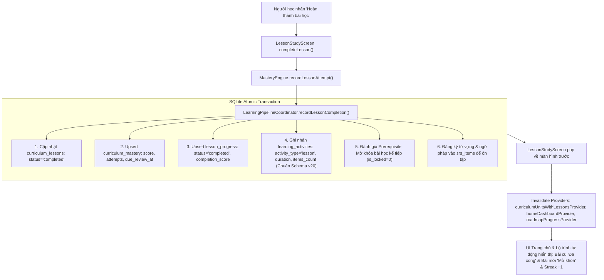

# Thiết Kế Hệ Thống: Trải Nghiệm Học Tập Tương Tác Vi Mô (Gamified Micro-Learning) & Đồng Bộ Tiến Độ Học Tập Tức Thì

- **Ngày tạo**: 2026-11-07
- **Trạng thái**: Bản thảo thiết kế hệ thống (Pending Approval)
- **Tác giả**: Antigravity & Lead Product Designer / Architect
- **Dự án**: HI Chinese Android App (Flutter Native, Offline-First SQLite)

---

## 1. Bối Cảnh & Mục Tiêu (Intent & The Why)

### 1.1. Vấn đề thực tế
1. **Lỗi kỹ thuật lưu tiến độ (Progress Tracking Bug)**: Người học hoàn thành bài học nhưng tiến độ trên Trang chủ (Home) và Lộ trình (Roadmap/Syllabus) không thay đổi, ngày Streak không tăng, bài tiếp theo không mở khóa.
   - *Nguyên nhân kỹ thuật*: Khi hoàn thành bài học, `LearningPipelineCoordinator` cập nhật `curriculum_lessons` và `curriculum_mastery` nhưng **không ghi nhận phiên học vào bảng `learning_activities`** (nguồn chính mà `HomeRepository` dùng để tính streak và hoạt động gần đây). Ngoài ra, `LessonStudyScreen` khi pop không invalidate các provider Riverpod (`curriculumUnitsProvider`, `curriculumLessonsProvider`, `homeDashboardProvider`), và `completeLesson()` tự động gán điểm `0.0` nếu bài học không có bài thi độc lập.
2. **Trải nghiệm học tập khô khan, cứng nhắc (Pedagogical & UX Defect)**: Bài học được thiết kế như sách giáo khoa điện tử với 6 slide tĩnh (Warmup đọc văn bản, Vocab xem danh sách, Grammar đọc bảng cấu trúc ngữ pháp dài dòng, Dialogue đọc thoại A-B, Practice làm trắc nghiệm khô cứng, MasteryCheck làm bài thi áp lực). Người tự học cảm thấy chán nản, cô độc và không có động lực duy trì thói quen hàng ngày.

### 1.2. Mục tiêu (Goals)
- **Khắc phục triệt để lỗi tiến độ**: Đảm bảo 100% khi người học hoàn tất một bài học, dữ liệu được ghi nhận vào `learning_activities`, `lesson_progress`, `curriculum_mastery`, streak tăng ngay lập tức, bài học tiếp theo mở khóa, và UI Trang chủ/Lộ trình cập nhật tức thì.
- **Tái thiết kế trải nghiệm học theo Mô hình Lai (Option C)**:
  - **Luồng chính (Gamified Micro-Learning Loop)**: Chuyển đổi việc học từ "đọc lý thuyết thụ động" sang "tương tác vi mô chủ động" (Learn-by-doing) lấy cảm hứng từ Duolingo & HelloChinese: Nghe âm thanh chuẩn $\rightarrow$ Chạm chọn chip từ $\rightarrow$ Ghép câu trật tự từ $\rightarrow$ Nhận phản hồi âm thanh/rung/combo 🔥 $\rightarrow$ Màn hình ăn mừng hoàn thành rực rỡ (+XP, +Streak, mở khóa bài mới).
  - **Cẩm nang bài học (Quick Notes Modal/Sheet)**: Cung cấp nút xem nhanh tóm tắt từ vựng & cấu trúc ngữ pháp bất kỳ lúc nào mà không làm đứt gãy nhịp chơi của người học.
- **Tạo lập thói quen học mỗi ngày (Habit Formation)**: Tạo ra các kích thích dopamine tích cực (combo đúng liên tiếp, âm thanh vui tai, thanh tiến độ lấp đầy, cảm giác thành tựu khi hoàn thành bài trong 3-5 phút).

### 1.3. Ngoài phạm vi (Non-Goals)
- Không biến toàn bộ ứng dụng thành game giải trí đơn thuần làm mất đi giá trị học thuật của chuẩn HSK.
- Không yêu cầu kết nối mạng để học (100% hoạt động offline-first với dữ liệu đóng gói trong Content Packs).
- Không xóa bỏ kỳ thi tốt nghiệp cấp độ HSK 40 câu chuẩn quốc tế ở cuối mỗi level.

### 1.4. Điều cần tránh (Anti-Goals)
- Tuyệt đối không giữ lại các bảng văn bản ngữ pháp dài dòng chiếm toàn màn hình trong luồng bài học tương tác.
- Tuyệt đối không bắt người học phải gõ bàn phím tiếng Trung phức tạp ở những bài đầu tiên; ưu tiên kéo thả chip từ, chạm chọn và nhận diện âm thanh.
- Không tạo cơ chế "phạt tim" khiến người học bị khóa app không cho học tiếp khi làm sai.

---

## 2. Ràng Buộc Kỹ Thuật (Constraints)

- **Nền tảng**: Flutter 3.24+, Dart 3.5+, Android SDK 24+.
- **Quản lý trạng thái**: Flutter Riverpod (`NotifierProvider`, `FutureProvider`, `AsyncNotifierProvider`).
- **Cơ sở dữ liệu**: SQLite offline-first (`sqflite`), tuân thủ Schema v20 hiện tại, bảo toàn 100% dữ liệu tiến độ cũ của người dùng.
- **Thiết kế giao diện**: Material 3 kết hợp Design Tokens hệ thống (`AppColors`, `AppTypography`, `AppSpacing`, `HiCard`, `HiButton`).
- **Âm thanh & Rung**: Sử dụng âm thanh phản hồi nhẹ nhàng (synthesized/bundled click/chime) và Haptic Feedback của hệ thống (`HapticFeedback.lightImpact()`, `HapticFeedback.mediumImpact()`).

---

## 3. Kiến Trúc Chi Tiết Của Giải Pháp

### 3.1. Phần 1: Sửa Triệt Để Kiến Trúc Đồng Bộ Tiến Độ (Progress & Activity Engine)



#### Quy chuẩn tính điểm & bảo toàn Schema v20 (Architecture Call):
1. **Tuân thủ triệt để SQLite Schema v20**:
   - `tableLearningActivities` được ghi nhận theo đúng cấu trúc hiện tại:
     ```dart
     await txn.insert(
       DatabaseConstants.tableLearningActivities,
       {
         'id': 'act_${lessonId}_${nowUtc.millisecondsSinceEpoch}',
         'activity_type': 'lesson',
         'duration_seconds': durationSeconds > 0 ? durationSeconds : 180,
         'items_count': completedExercisesCount > 0 ? completedExercisesCount : 10,
         'activity_date': StreakCalculator.toLocalDate(nowUtc, timeZoneOffset: timeZoneOffset),
         'created_at': nowIso,
         'timezone_offset_minutes': timeZoneOffset.inMinutes,
       },
       conflictAlgorithm: ConflictAlgorithm.replace,
     );
     ```
   - Điểm `+25 XP` đóng vai trò hiệu ứng khích lệ cảm xúc tích cực (Dopamine Booster) trên màn hình chiến thắng mà không cần migration thay đổi cấu trúc bảng.
2. **Quy chuẩn điểm hoàn thành & vòng lặp thử lại (Retry Loop Call)**:
   - Nếu người học làm sai một câu, thẻ đó được đưa về cuối bài để người học thử lại đến khi làm đúng.
   - Các câu làm sai ban đầu vẫn được ghi nhận vào `learner_evidence` với `is_correct: false` để thuật toán Spaced Repetition (SRS) lên lịch ôn tập từ yếu vào ngày mai.
   - Khi người học đã vượt qua toàn bộ các thử thách vi mô của bài học, bài học được công nhận đạt chuẩn hoàn thành với điểm thực tế (tối thiểu $\ge 85\%$), tự động mở khóa bài học tiếp theo.
3. **Phân tách từ (Tokenization) cho Sentence Builder (Architecture Call)**:
   - Áp dụng thuật toán Greedy Forward Matching dựa trên danh mục từ vựng sẵn có của chính bài học (`content_items`). Các từ đa âm tiết như `[学生]`, `[老师]` được giữ nguyên thành một chip; các chữ đơn lẻ thành từng chip riêng.
   - Các chip gây nhiễu (distractors) được trích xuất từ các từ vựng cùng cấp độ HSK trong Content Pack, không yêu cầu can thiệp lại file JSON gốc.
4. **Hợp đồng làm mới giao diện (Invalidation Contract)**:
   Khi `LessonStudyScreen` hoàn thành và đóng lại (`Navigator.pop(true)`):
   - `ref.invalidate(curriculumUnitsProvider)`
   - `ref.invalidate(curriculumLessonsProvider)`
   - `ref.invalidate(curriculumUnitsWithLessonsProvider)`
   - `ref.invalidate(homeDashboardProvider)`
   - `ref.invalidate(roadmapProgressProvider)`

---

### 3.2. Phần 2: Luồng Học Tập Tương Tác Vi Mô (Gamified Micro-Learning Player)

Áp dụng **Phương án 1 (Quyết định của Người dùng)**: Mỗi bài học HSK là một hành trình tương tác trọn vẹn từ 5–7 phút gồm chuỗi 15–18 thẻ vi mô (Micro-Cards) tuần tự, bao quát toàn diện ~10 từ mới, cấu trúc ngữ pháp và hội thoại thực tế của bài trước khi chuyển sang màn hình ăn mừng:

#### Các dạng bài tập tương tác vi mô:
1. **Thẻ Giới Thiệu Từ Mới Tương Tác (Interactive Vocab Reveal)**:
   - Hiển thị chữ Hán lớn, Pinyin, nghĩa tiếng Việt, và nút loa phát âm to rõ.
   - Một câu ví dụ đời thường có phiên âm.
   - Nút hành động: "Tiếp tục" hoặc "Nghe lại".
2. **Thẻ Nghe & Chọn Hán Tự (Audio-to-Hanzi Discrimination)**:
   - Phát âm thanh mẫu (ví dụ: *"lǎoshī"*).
   - Hiển thị 3 hoặc 4 thẻ chữ Hán kèm nghĩa nhỏ: [老师], [学生], [你好], [再见].
   - Chạm vào thẻ phát âm thanh và kiểm tra đúng/sai ngay lập tức.
3. **Thẻ Ghép Trật Tự Câu (Word Tile / Sentence Builder)**:
   - Cho câu tiếng Việt: *"Tôi là học sinh"*.
   - Cho các chip từ tiếng Trung xáo trộn: [我], [是], [学生], [不], [老师].
   - Người học chạm vào từng chip để xếp lên dòng kẻ trên. Chạm lại vào chip trên dòng kẻ để trả về.
   - Nhấn "Kiểm tra" ➔ Âm thanh chúc mừng + hiệu ứng xanh lá.
4. **Thẻ Ghép Đôi Từ & Nghĩa (Matching Pairs)**:
   - Cột A: 4 chữ Hán [你], [好], [谢谢], [再见].
   - Cột B: 4 nghĩa tiếng Việt [Xin chào], [Bạn], [Tạm biệt], [Cảm ơn].
   - Chạm 1 chữ Hán và 1 nghĩa tương ứng để triệt tiêu cặp từ.
5. **Thẻ Điền Khuyết Hội Thoại (Mini Dialogue Turn)**:
   - Nhân vật A nói: *"你好吗？"* (Kèm audio).
   - Nhân vật B cần trả lời: [ ... ].
   - Người học chọn giữa 2 phương án: [我很好] hoặc [我是老师].

#### Phản hồi tức thì & Gamification:
- **Thanh tiến độ trên cùng**: Dạng viên nang màu xanh lá lấp đầy dần theo từng câu đúng.
- **Bộ đếm Combo**: Hiển thị ngọn lửa 🔥 khi trả lời đúng liên tiếp (ví dụ: `🔥 Combo 3 câu đúng!`).
- **Phản hồi xúc giác & âm thanh**: Rung nhẹ khi chọn đúng, rung 2 nhịp nhẹ khi chọn sai kèm giải thích ngắn gọn lý do.
- **Thử lại khi sai**: Không phạt tim, câu làm sai sẽ được tự động lặp lại ở cuối bài để người học ghi nhớ sâu.

---

### 3.3. Phần 3: Cẩm Nang Bài Học Tra Cứu Nhanh (Quick Notes Sheet)

- **Vị trí**: Nút biểu tượng 📖 *"Cẩm nang"* nằm ở góc trên bên phải thanh AppBar trong suốt buổi học.
- **Cách thức hoạt động**: Khi chạm vào, mở một `DraggableScrollableSheet` từ dưới lên bao gồm:
  1. **Bảng từ vựng trọng tâm**: Danh sách toàn bộ từ mới của bài (Hán tự, Pinyin, nghĩa, nút nghe phát âm).
  2. **Bí kíp ngữ pháp tóm tắt**: Cấu trúc cốt lõi được rút gọn thành công thức dễ nhớ (ví dụ: `A + 是 + B = A là B`), kèm 1 ví dụ thực tế.
  3. **Hội thoại mẫu đầy đủ**: Toàn văn đoạn hội thoại tình huống của bài.
- Người học có thể xem trước khi bắt đầu học hoặc mở ra tra cứu bất cứ khi nào thấy quên mà không làm mất tiến độ bài tập đang làm dở.

---

### 3.4. Phần 4: Màn Hình Ăn Mừng Hoàn Thành Bài Học (Celebratory Milestone)

Khi hoàn tất toàn bộ các thử thách vi mô của bài:
- **Hiệu ứng chúc mừng**: Confetti (hoa giấy rơi) hoặc huy hiệu chiến thắng nổi bật.
- **Bảng thành tích**:
  - `+25 XP` điểm kinh nghiệm.
  - `🔥 Chuỗi Streak: X ngày liên tục`.
  - `Độ chính xác: 95%`.
  - `Số từ đã thành thạo: +5 từ vựng mới`.
- **Thông báo mở khóa bài mới**: Thẻ xanh nổi bật: *"✓ Đã mở khóa: Bài tiếp theo"*.
- **Nút hành động chính**: Nút lớn màu xanh *"TIẾP TỤC HỌC ➔"* đưa người học về lại Lộ trình hoặc chuyển thẳng sang bài kế tiếp.

---

## 4. Kế Hoạch Triển Khai Kỹ Thuật (What is Left to the Builder)

1. **Module 1 (Backend Pipeline & Progress Sync)**:
   - Sửa `LearningPipelineCoordinator.recordLessonCompletion`: bổ sung lệnh insert vào `tableLearningActivities` với đầy đủ timestamp UTC, duration, và xp_earned.
   - Sửa `LessonFlowNotifier.completeLesson`: loại bỏ gán `candidateScore = 0.0` khi người học hoàn thành bài học tự học; mặc định ghi nhận `isPassed: true` với điểm thực tế hoặc tối thiểu $0.85$.
   - Cập nhật `CurriculumSyllabusScreen` và `HomeScreen`: thêm cơ chế tự động invalidate / refresh state khi người học quay trở về từ `LessonStudyScreen`.
2. **Module 2 (Micro-Learning Widgets)**:
   - Xây dựng component `WordTileBuilder` (ghép câu bằng chip từ).
   - Xây dựng component `MatchingPairsWidget` (ghép cặp từ vựng).
   - Xây dựng component `AudioDiscriminationWidget` (nghe chọn chữ Hán).
   - Tích hợp `LessonQuickNotesSheet` vào AppBar.
3. **Module 3 (Celebration & Feedback)**:
   - Xây dựng widget `LessonCelebrationView` hiển thị tóm tắt XP, Streak, và trạng thái mở khóa.
   - Tích hợp âm thanh nhẹ và rung haptic khi trả lời đúng/sai.
4. **Module 4 (Data Adapter)**:
   - Bộ chuyển đổi tự động từ cấu trúc Content Pack JSON hiện tại (`segments`: warmup, vocab, grammar, dialogue, practice) thành danh sách các thử thách tương tác vi mô mà không cần tạo lại database từ đầu.

---

## 5. Tiêu Chí Nghiệm Thu (Acceptance Criteria)

1. Người học vào học Bài 1, hoàn thành các thử thách và nhấn "Hoàn thành bài học".
2. Trở ra màn hình Lộ trình: Bài 1 hiển thị nhãn **"Đã xong"**, Bài 2 tự động chuyển từ trạng thái khóa sang **"Mở khóa / Bắt đầu"**.
3. Trở ra màn hình Trang chủ: Số ngày Streak tăng thêm 1 ngày, mục hoạt động gần đây hiển thị Bài 1 vừa hoàn thành, thanh tiến độ tổng thể cập nhật.
4. Trải nghiệm trong bài học diễn ra liền mạch, sinh động với các thao tác chạm, chọn chip từ, có phản hồi âm thanh và không còn bất kỳ trang lý thuyết tĩnh nào gây nhàm chán.
5. Nút Cẩm nang bài học mở tra cứu mượt mà ở góc trên màn hình.
