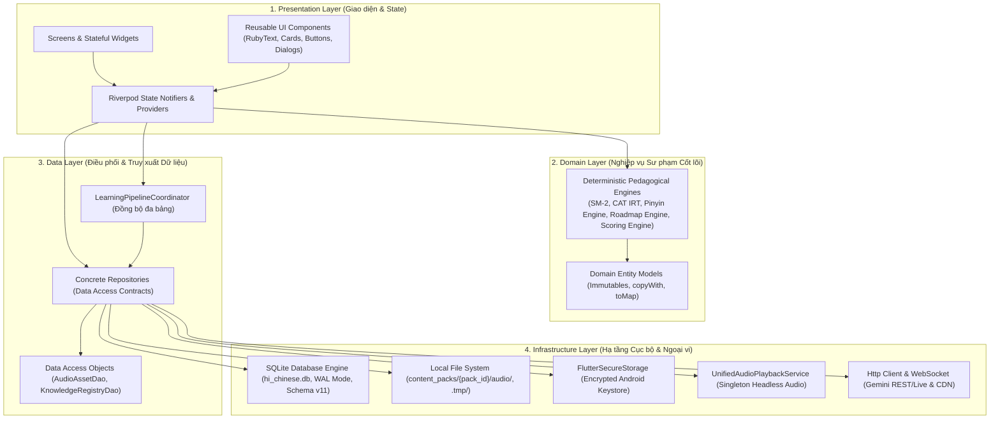

# 02. KIẾN TRÚC TỔNG THỂ & VÒNG ĐỜI KHỞI ĐỘNG

---

## 1. MÔ HÌNH KIẾN TRÚC TỔNG THỂ

HI Chinese áp dụng mô hình kiến trúc phân tầng kết hợp **Feature-First** (tổ chức thư mục theo tính năng) và **Layered Architecture** (tách biệt Presentation, Domain, Data và Infrastructure).



---

## 2. QUY TẮC PHÂN TẦNG VÀ GIỚI HẠN TRÁCH NHIỆM

1. **Presentation Layer (`features/*/presentation/`):**
   - Chỉ chịu trách nhiệm hiển thị giao diện, tiếp nhận sự kiện cử chỉ của người dùng và gọi các phương thức từ Riverpod Provider.
   - **Tuyệt đối không:** Ghi dữ liệu trực tiếp vào SQLite hoặc tự ý tạo SQL câu lệnh trong giao diện.
2. **Domain Layer (`features/*/domain/`):**
   - Chứa các Model dữ liệu thuần túy (Plain Dart Data Classes) và các động cơ thuật toán toán học/sư phạm (Pure Functions hoặc Stateful Engines).
   - Động cơ trong Domain Layer hoạt động hoàn toàn độc lập với giao diện, có thể kiểm thử đơn vị độc lập 100% bằng mock data.
3. **Data Layer (`features/*/data/`):**
   - Hiện thực hóa các interface Repository.
   - Quản lý các giao dịch cơ sở dữ liệu (`db.transaction`), đảm bảo tính nguyên tử (Atomicity) khi một thao tác tác động lên nhiều bảng.
4. **Infrastructure Layer (`core/database/`, `core/audio/`, `core/network/`):**
   - Giao tiếp trực tiếp với hệ điều hành và phần cứng (SQLite binary, Android Keystore, Microphone, Tệp cục bộ).

---

## 3. LUỒNG KHỞI ĐỘNG ỨNG DỤNG (APPLICATION BOOTSTRAP LIFECYCLE)

Khi người dùng mở ứng dụng HI Chinese, chuỗi khởi động diễn ra tuần tự và an toàn theo 9 bước:

```mermaid
sequenceDiagram
    autonumber
    actor User as Người dùng
    participant Main as main()
    participant AppShell as AppShell Widget
    participant Startup as AppStartupNotifier
    participant DB as AppDatabase
    participant MigEngine as MigrationEngine
    participant Lifecycle as AppLifecycleManager

    User->>Main: Mở ứng dụng HI Chinese
    Main->>Main: WidgetsFlutterBinding.ensureInitialized()
    Main->>Main: SystemChrome (Edge-to-edge layout & Portrait Lock)
    Main->>Lifecycle: AppLifecycleManager.instance.initialize()
    Main->>Main: imageCache ceiling = 50MB (Chống tràn RAM Android)
    Main->>AppShell: runApp(ProviderScope(child: HiChineseApp()))
    
    AppShell->>Startup: watch(appStartupProvider)
    Startup->>AppShell: State: isInitializing = true
    AppShell->>User: Hiển thị Splash Screen & HiLoadingIndicator

    Startup->>DB: AppDatabase.instance.open()
    DB->>DB: sqflite.openDatabase(hi_chinese.db)
    DB->>DB: PRAGMA journal_mode = WAL; PRAGMA cache_size = -8000;
    
    alt Database Version < 11
        DB->>MigEngine: executeMigrations(db, oldVersion, 11)
        Note over MigEngine: Thực thi tuần tự từ MigrationV1 đến MigrationV11 trong Transaction
        MigEngine-->>DB: Hoàn thành nâng cấp Schema an toàn
    end
    
    DB-->>Startup: Cơ sở dữ liệu sẵn sàng
    Startup->>AppShell: State: isReady = true, isInitializing = false
    AppShell->>User: Hiển thị màn hình chính (AppShell với 5 Tab)
```

### Xử lý lỗi trong chuỗi khởi động:
- Nếu cơ sở dữ liệu bị khóa hoặc file bị hỏng, `AppStartupNotifier` bắt ngoại lệ `catch(e, stackTrace)`, chuyển `state.error` thành thông điệp lỗi tiếng Việt dễ hiểu.
- Giao diện chuyển sang `HiErrorState` hiển thị nút **"Thử lại kết nối"**, cho phép người học bấm thử lại mà không bị treo hay văng ứng dụng đột ngột (Crash-proof).

---

## 4. QUẢN LÝ VÒNG ĐỜI VÀ GIẢI PHÓNG TÀI NGUYÊN (ANDROID COMPLIANCE)

- **`AppLifecycleManager` (`lib/core/utils/app_lifecycle_manager.dart`):**
  - Đăng ký `WidgetsBindingObserver` toàn cục.
  - Khi ứng dụng chuyển sang trạng thái `paused`, `inactive` hoặc `detached`, hệ thống tự động gọi chuỗi hooks đăng ký:
    1. Ngắt micro ngay lập tức để bảo vệ quyền riêng tư người dùng.
    2. Tạm dừng phát âm thanh để không chạy ngầm gây hao pin hoặc vi phạm chính sách Google Play.
- **Giới hạn bộ nhớ đệm hình ảnh (`PaintingBinding.imageCache`):**
  - Đặt trần bộ nhớ `maximumSizeBytes = 50MB` và `maximumSize = 100 images`.
  - Đảm bảo các thiết bị Android tầm trung và giá rẻ không bị hệ điều hành tắt vì tràn bộ nhớ (Out-Of-Memory kill).
