# 04. KIẾN TRÚC CƠ SỞ DỮ LIỆU SQLITE SCHEMA V11

---

## 1. THÔNG SỐ VÀ CẤU HÌNH HỆ THỐNG

- **Database Engine:** SQLite 3 (Chạy qua plugin `sqflite` trên Android và `sqflite_common_ffi` trên môi trường Desktop/Test).
- **Tên tệp cơ sở dữ liệu:** `hi_chinese.db`.
- **Phiên bản Schema hiện hành:** **11** (`DatabaseConstants.currentDatabaseVersion = 11`).
- **Vị trí lưu trữ mặc định:** Thư mục Database riêng tư của ứng dụng Android (`/data/user/0/com.hichinese.hi_chinese/databases/hi_chinese.db`).
- **Cấu hình hiệu năng bắt buộc khi mở kết nối:**
  ```sql
  PRAGMA journal_mode = WAL;
  PRAGMA synchronous = NORMAL;
  PRAGMA cache_size = -8000; -- Cấp phát 8MB RAM cho bộ nhớ đệm trang
  PRAGMA foreign_keys = ON;  -- Kích hoạt ràng buộc toàn vẹn khóa ngoại
  ```

---

## 2. LỊCH SỬ NÂNG CẤP VÀ MIGRATION ENGINE (V1 -> V11)

Động cơ di chuyển dữ liệu `MigrationEngine` (`lib/core/database/migrations/migration_engine.dart`) quản lý việc nâng cấp schema tuần tự. Mọi nâng cấp đều được bọc trong một **Database Transaction**. Nếu một migration con bị lỗi cú pháp hoặc crash, toàn bộ giao dịch sẽ tự động rollback, bảo toàn nguyên vẹn dữ liệu người dùng.

```mermaid
graph LR
    v1["v1: Core Schema<br/>(Vocab, Senses, Grammar, Reading, SRS, Evidence, Mastery, Chat, Activity)"] --> v2["v2: Seed Tracking<br/>(seed_history)"]
    v2 --> v3["v3: Placement Test<br/>(CAT sessions & responses)"]
    v3 --> v4["v4: User Progress<br/>(Dict history, Saved words, Reading progress)"]
    v4 --> v5["v5: Adaptive Roadmap<br/>(Goals, Lesson progress, Snapshots)"]
    v5 --> v6["v6: Enhanced Grammar<br/>(Contrastive examples & grammar_progress)"]
    v6 --> v7["v7: Practice Subsystem<br/>(Exercises, Sessions, Attempts)"]
    v7 --> v8["v8: User Profile & Settings<br/>(Profiles, Goal history, App settings)"]
    v8 --> v9["v9: Content Catalog<br/>(Packs, Curriculums, Units, Lessons, Segments, ContentItems, ExitExams)"]
    v9 --> v10["v10: Normalized Knowledge<br/>(knowledge_registry, lesson_knowledge_items, content_id_mappings)"]
    v10 --> v11["v11: Audio & Pinyin<br/>(audio_assets, pinyin_progress)"]
```



### Chi tiết các phiên bản Migration:
1. **Migration v1 (`migration_v1.dart`):** Thiết lập nền tảng cốt lõi với 10 bảng cơ sở dữ liệu: từ điển từ vựng, ngữ nghĩa, ngữ pháp, đoạn văn đọc hiểu, thẻ nhớ SRS, nhật ký bằng chứng `learner_evidence`, trạng thái thành thạo `mastery_snapshots`, tin nhắn chat AI và hoạt động học tập theo ngày.
2. **Migration v2 (`migration_v2.dart`):** Bổ sung bảng `seed_history` để ghi nhận các tệp fixture JSON đã nạp vào SQLite, bảo đảm tính idempotent (chạy lại app không nạp trùng dữ liệu).
3. **Migration v3 (`migration_v3.dart`):** Bổ sung các bảng phục vụ bài kiểm tra trình độ thích ứng máy tính (CAT): `placement_test_sessions` và `placement_test_responses`.
4. **Migration v4 (`migration_v4.dart`):** Bổ sung bảng theo dõi tương tác từ điển và bài đọc: `dictionary_history`, `user_saved_words`, `reading_progress`.
5. **Migration v5 (`migration_v5.dart`):** Bổ sung bảng phục vụ Lộ trình học tập thích ứng: `learner_goals`, `lesson_progress`, `roadmap_snapshots`.
6. **Migration v6 (`migration_v6.dart`):** Bổ sung bảng `grammar_progress` và mở rộng các cột quy tắc, ví dụ đối sánh (positive/contrastive examples) trong bảng `grammar_items`.
7. **Migration v7 (`migration_v7.dart`):** Bổ sung hệ thống ngân hàng câu hỏi và bài tập: `practice_exercises`, `practice_sessions`, `practice_attempts` (chống nộp lặp).
8. **Migration v8 (`migration_v8.dart`):** Bổ sung thông tin người dùng cục bộ, cấu hình ứng dụng và lịch sử thay đổi mục tiêu học tập: `user_profiles`, `goal_history`, `app_settings`.
9. **Migration v9 (`migration_v9.dart`):** Xây dựng kiến trúc cây giáo trình phân cấp: `content_packs`, `curriculums`, `curriculum_units`, `curriculum_lessons`, `lesson_segments`, `content_items`, `curriculum_mastery`, `level_exit_exams`.
10. **Migration v10 (`migration_v10.dart`):** Chuẩn hóa cơ sở dữ liệu học liệu, giải phóng tri thức khỏi trường JSON thô, tạo danh bạ tri thức kinh điển `knowledge_registry` (ID ổn định: `KNOW_VOCAB_...`, `KNOW_GRAMMAR_...`), bảng quan hệ nhiều-nhiều `lesson_knowledge_items` và bảng tương thích ngược `content_id_mappings`.
11. **Migration v11 (`migration_v11.dart`):** Bổ sung hệ thống quản lý tài nguyên âm thanh ngoại tuyến và theo dõi tiến độ khóa học Pinyin nền tảng: bảng `audio_assets` (quản trị tệp âm thanh ngoại tuyến, mã băm SHA-256, dung lượng) và bảng `pinyin_progress` (theo dõi độ chính xác từng âm vị).

---

## 3. RÀNG BUỘC TOÀN VẸN & CHÍNH SÁCH BẢO TỒN DỮ LIỆU

1. **Bảo tồn Tuyệt đối Tiến độ Người học (Zero Data Loss Policy):**
   - Khi cài đặt gói học liệu mới (ví dụ từ HSK 1 lên HSK 2) hoặc nâng cấp phiên bản học liệu (`v1.0.0 -> v1.1.0`), các bảng tiến độ người dùng (`lesson_progress`, `mastery_snapshots`, `learner_evidence`, `srs_items`, `user_saved_words`) **tuyệt đối không bị xóa hoặc làm mới**.
   - Các bản ghi `mastery_snapshots` liên kết với `knowledge_item_id` chứ không gắn chết vào ID bài học tạm thời, cho phép giáo trình cấu trúc lại mà người học vẫn giữ nguyên mức độ thành thạo từ vựng.
2. **Khóa Ngoại và Ràng buộc Xóa (Foreign Key Cascades):**
   - Bảng bài học `curriculum_lessons` liên kết với đơn vị bài `curriculum_units` qua `ON DELETE CASCADE`.
   - Bảng phân đoạn bài học `lesson_segments` liên kết với bài học qua `ON DELETE CASCADE`.
   - Bảng liên kết tri thức `lesson_knowledge_items` liên kết với cả bài học và `knowledge_registry` qua `ON DELETE CASCADE`.
   - Tuy nhiên, bảng nhật ký `learner_evidence` độc lập, **không bao giờ bị xóa theo cascade** để đảm bảo tính bất biến của lịch sử học tập.

---

## 4. CHIẾN LƯỢC SAO LƯU VÀ KHÔI PHỤC (BACKUP & INTEGRITY)

- **Sao lưu Nguyên tử Không Khóa Ứng dụng (`DataManagementService.createBackup`):**
  - Sử dụng lệnh SQLite chuẩn: `VACUUM INTO 'backup_path.db'`.
  - Trước khi sao lưu, hệ thống thực thi `PRAGMA wal_checkpoint(FULL)` để đẩy toàn bộ trang ghi tạm từ tệp WAL vào tệp dữ liệu chính, bảo đảm tệp backup hoàn chỉnh 100% mà không gây lag hay chặn giao diện người dùng.
- **Kiểm tra Toàn vẹn Dữ liệu (`PRAGMA integrity_check`):**
  - Chức năng tự kiểm tra được tích hợp trong giao diện Cài đặt. Nếu phát hiện tệp hỏng, ứng dụng cảnh báo người dùng phục hồi từ bản sao lưu gần nhất.
- **Xóa Dữ liệu An toàn Có Xác nhận (Protected Data Reset):**
  - Muốn xóa tiến độ học tập, người dùng bắt buộc phải nhập mã xác nhận ngẫu nhiên hiển thị trên màn hình.
  - Trước khi thực hiện lệnh xóa, hệ thống **tự động tạo một bản sao lưu an toàn** (Safety Backup) lưu vào đĩa để phòng ngừa trường hợp bấm nhầm.
