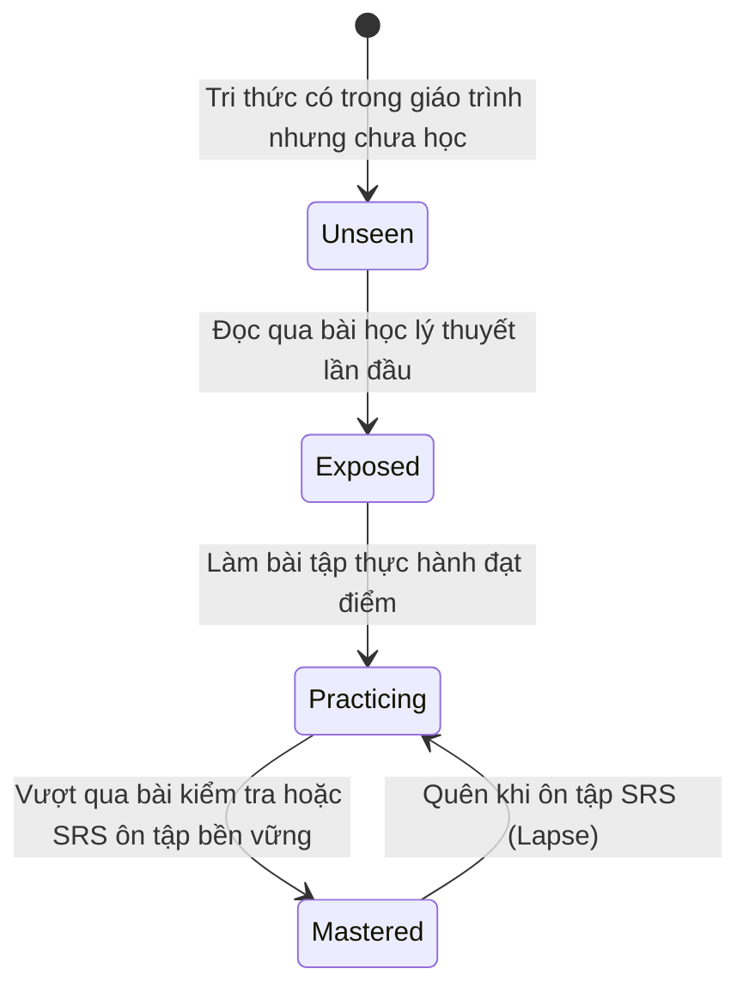

# 05. KIẾN TRÚC HỆ THỐNG SƯ PHẠM & HỌC LIỆU

HI Chinese không phải là một ứng dụng CRUD dữ liệu thông thường, mà được thiết kế như một **Hệ điều hành Sư phạm (Pedagogical Operating System)** hoàn chỉnh dành cho người tự học tiếng Trung.

---

## 1. CẤU TRÚC HỌC LIỆU CHUẨN HSK (CURRICULUM SYLLABUS)

Học liệu trong HI Chinese được phân cấp theo 4 cấp bậc nghiêm ngặt:

```text
Content Pack (Gói cấp độ, ví dụ: hsk1_pack_v1)
  └── Curriculum (Giáo trình chuẩn, ví dụ: curr_hsk1)
        └── Unit (Chủ đề lớn, gồm 5 bài học)
              └── Lesson (Bài học cụ thể, 15 bài/cấp độ)
                    ├── Segment 1: Khởi động (Warmup)
                    ├── Segment 2: Từ vựng mới (Vocabulary)
                    ├── Segment 3: Ngữ pháp trọng điểm (Grammar)
                    ├── Segment 4: Hội thoại thực tế (Dialogue)
                    ├── Segment 5: Luyện tập thích ứng (Practice)
                    └── Segment 6: Kiểm tra hoàn thành (Mastery Check)
```

- **Mở khóa bài học dựa trên điều kiện tiên quyết (`prerequisites`):** Mỗi bài học tiếp theo (ví dụ Bài 2) đòi hỏi bài học trước đó (Bài 1) phải đạt điểm thành thạo tối thiểu từ 80% trở lên (`unlock_score_threshold >= 0.8`).
- **Đề thi tốt nghiệp cấp độ (`LevelExitExam`):** Sau khi hoàn thành toàn bộ 15 bài học của một cấp độ HSK, học viên phải vượt qua đề thi tổng hợp 4 kỹ năng (Nghe, Đọc, Ngữ pháp, Từ vựng) để chính thức tốt nghiệp và mở khóa cấp độ kế tiếp.

---

## 2. DANH BẠ TRI THỨC KINH ĐIỂN (KNOWLEDGE REGISTRY)

Trước Schema v10, tri thức bị gom chung vào trường JSON của bảng `content_items`. Từ Schema v10, toàn bộ tri thức được chuẩn hóa thành thực thể độc lập trong bảng `knowledge_registry`:

- **Cấu trúc ID Kinh điển (Canonical IDs):**
  - Từ vựng: `KNOW_VOCAB_{simplified}` (ví dụ: `KNOW_VOCAB_咖啡`, `KNOW_VOCAB_懂`).
  - Ngữ pháp: `KNOW_GRAMMAR_{code}` (ví dụ: `KNOW_GRAMMAR_ba_structure`, `KNOW_GRAMMAR_dong_usage`).
  - Chữ Hán: `KNOW_HANZI_{char}` (ví dụ: `KNOW_HANZI_你`).
  - Âm vị Pinyin: `KNOW_PINYIN_{phoneme}` (ví dụ: `KNOW_PINYIN_b`, `KNOW_PINYIN_tone_1`).
- **Bảng liên kết `lesson_knowledge_items`:**
  - Định rõ vai trò của từng tri thức trong bài học: `instruction` (giảng dạy chính), `reinforcement` (củng cố ôn lại), `assessment` (dùng để kiểm tra).
  - Cho phép một từ vựng xuất hiện ở nhiều bài học khác nhau mà không bị nhân bản dữ liệu (Zero Duplicate Knowledge).

---

## 3. NHẬT KÝ BẰNG CHỨNG TIẾP THU (LEARNER EVIDENCE)

Bảng `learner_evidence` đóng vai trò là sổ cái bất biến (Append-Only Immutable Ledger) ghi lại mọi hành vi học tập của học viên:

- **Các trường dữ liệu:**
  - `knowledge_item_id`: Tri thức được tác động.
  - `lesson_id`: Ngữ cảnh bài học phát sinh (nếu có).
  - `evidence_type`: Loại bằng chứng (`lesson_reading`, `quiz_correct`, `quiz_incorrect`, `srs_recall_good`, `srs_lapse`, `pronunciation_accurate`, `hanzi_stroke_pass`).
  - `score`: Điểm định lượng từ 0.0 đến 1.0.
  - `activity_context`: Thông tin chi tiết (ví dụ: thời gian phản hồi, từ khóa).
  - `created_at`: Mốc thời gian UTC không thể sửa đổi.
- **Bảo vệ Trung thực Học thuật (Academic Honesty):**
  - Hệ thống **tuyệt đối không bao giờ tạo bằng chứng giả** nếu học viên chỉ mở màn hình rồi thoát ra mà không làm bài tập hoặc nghe giảng.
  - Nếu số lượng câu hỏi được đánh giá bằng 0, không có bản ghi nào được thêm vào `learner_evidence`.

---

## 4. MA TRẬN MỨC ĐỘ THÀNH THẠO (MASTERY PROGRESS)

Mức độ thành thạo tri thức của học viên được quản lý qua máy trạng thái 4 cấp độ trong `mastery_snapshots`:



- **`unseen` (Chưa tiếp xúc):** Học viên chưa bao giờ mở bài học có chứa từ hoặc ngữ pháp này.
- **`exposed` (Đã tiếp xúc):** Đã hoàn thành phân đoạn Từ vựng hoặc Ngữ pháp trong bài học.
- **`practicing` (Đang luyện tập):** Đã làm bài tập kiểm tra nhưng điểm số hoặc số lần lặp lại chưa đạt ngưỡng bền vững.
- **`mastered` (Đã làm chủ):** Đạt điểm trắc nghiệm >= 85% và đã vượt qua ít nhất 3 chu kỳ ôn tập thành công trên flashcard SRS.

---

## 5. THUẬT TOÁN ÔN TẬP NGẮT QUÃNG SM-2 (SPACED REPETITION SYSTEM)

Động cơ `Sm2Engine` (`lib/features/vocabulary_srs/domain/sm2_engine.dart`) hiện thực hóa thuật toán SuperMemo-2 kinh điển nhưng được tinh chỉnh cho việc học tiếng Trung:

- **4 Mức đánh giá của học viên:**
  1. **Again (Quên hoàn toàn):** Đặt lại khoảng cách `interval = 1` ngày, tăng số lần quên `lapses += 1`, giảm Ease Factor (\(EF' = EF - 0.2\)).
  2. **Hard (Nhớ khó khăn):** Tăng nhẹ khoảng cách (\(I' = I \times 1.2\)), giảm Ease Factor (\(EF' = EF - 0.15\)).
  3. **Good (Nhớ tốt):** Nhân khoảng cách theo hệ số chuẩn (\(I' = I \times EF\)), giữ nguyên hoặc điều chỉnh nhẹ Ease Factor.
  4. **Easy (Nhớ xuất sắc):** Thưởng thêm hệ số nhân (\(I' = I \times EF \times 1.3\)), tăng Ease Factor (\(EF' = EF + 0.15\)).
- **Giới hạn an toàn:**
  - \(EF \in [1.3, 3.2]\) để tránh hiện tượng "đóng băng thẻ" (Ease Hell).
  - Tích hợp bộ lọc chống chạm đúp (Debounce Threshold 500ms) để ngăn chặn việc người học bấm quá nhanh làm nhảy cóc ngày ôn tập.

---

## 6. ĐÁNH GIÁ THÍCH ỨNG CAT (COMPUTERIZED ADAPTIVE TESTING)

Hệ thống đánh giá trình độ đầu vào (Placement Test) sử dụng mô hình **Item Response Theory 2 tham số (2PL IRT)**:

- **Mô hình toán học xác suất trả lời đúng:**
  \[
  P(\theta) = \frac{1}{1 + e^{-a(\theta - b)}}
  \]
  Trong đó:
  - \(\theta\): Năng lực hiện tại của thí sinh (Thang đo chuẩn hóa từ -3.0 đến +3.0).
  - \(a\): Độ phân biệt của câu hỏi (Discrimination parameter).
  - \(b\): Độ khó của câu hỏi (Difficulty parameter).
- **Hàm thông tin Fisher và Lựa chọn câu hỏi tiếp theo:**
  - Sau mỗi câu trả lời, thuật toán cập nhật lại ước lượng \(\theta\) và sai số chuẩn \(SE(\theta)\).
  - Động cơ quét ngân hàng câu hỏi `CatItemBank` để chọn câu hỏi chưa làm có giá trị thông tin Fisher \(I(\theta)\) cao nhất tại mức năng lực hiện tại của người học.
  - Khi \(SE(\theta) \le 0.35\) hoặc đạt tối đa 20 câu hỏi, bài thi tự động dừng và quy đổi \(\theta\) ra cấp độ HSK tương ứng (HSK 1 đến HSK 6).

---

## 7. KHÓA HỌC NGỮ ÂM PINYIN NỀN TẢNG (PINYIN FOUNDATION)

Mô-đun `pinyin_foundation` được thiết kế dành riêng cho người bắt đầu từ con số 0:

- **6 Unit có trình tự chặt chẽ:**
  1. *Tổng quan:* Cấu trúc âm tiết (Thanh mẫu + Vận mẫu + Thanh điệu).
  2. *Thanh mẫu:* 21 phụ âm mở đầu (âm môi, âm đầu lưỡi, âm uốn lưỡi zh/ch/sh/r).
  3. *Vận mẫu:* 36 nguyên âm đơn, kép, mũi (a, o, e, ai, ei, an, ang, ong...).
  4. *Thanh điệu:* 4 thanh điệu chuẩn + thanh nhẹ, minh họa bằng **Biểu đồ cao độ 5 bậc (55, 35, 214, 51)**.
  5. *Quy tắc ghi âm & Biến điệu:* Quy tắc đặt dấu, biến điệu hai thanh 3 liên tiếp (`3+3 -> 2+3`), quy tắc biến điệu của "不" và "一".
  6. *Ghép vần liên hoàn:* Đọc các từ vựng và câu giao tiếp cơ bản.
- **Cơ chế Vượt cấp Thích ứng (Placement Bypass):**
  - Nếu học viên làm bài kiểm tra Placement Test đạt điểm phát âm và ngữ âm >= 75%, hệ thống tự động kích hoạt cờ `shouldBypassPinyinFoundation = true`, cho phép học viên bắt đầu ngay từ HSK 1 mà **không làm sai lệch điểm số từ vựng**.

---

## 8. CÁC PHÒNG LAB KỸ NĂNG CHUYÊN SÂU

1. **Luyện viết chữ Hán (`hanzi_writing`):**
   - Vẽ trực tiếp trên canvas mễ tự `Mǐzìgé`.
   - Động cơ `StrokeEvaluator` so khớp quỹ đạo nét bút, kiểm tra hướng nét từ trái sang phải, từ trên xuống dưới và số nét bút.
2. **Luyện nói đuổi (`shadowing`):**
   - Học viên nghe câu nói mẫu từ người bản xứ với thanh hiển thị `RubyText` có highlight từng từ theo tiến độ phát âm.
3. **Phòng lab phát âm (`pronunciation`):**
   - Thu âm giọng nói của học viên và đánh giá độ chính xác ngữ âm so với bản mẫu.
4. **Đọc hiểu tương tác (`reading`):**
   - Học viên chạm vào bất kỳ từ vựng nào trong đoạn văn để tra nhanh từ điển, xem câu ví dụ hoặc hỏi Gia sư AI bình giảng ngữ nghĩa.
