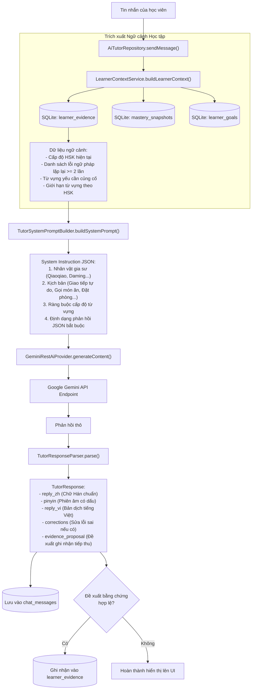

# 06. KIẾN TRÚC TRÍ TUỆ NHÂN TẠO (AI ARCHITECTURE & LIVE API)

Trong HI Chinese, Trí tuệ Nhân tạo được định vị như một **Gia sư Sư phạm Bổ trợ (Auxiliary Pedagogical Tutor)**. AI không bao giờ được coi là nguồn dữ liệu chân lý tuyệt đối và không có quyền tự ý ghi đè tiến độ học tập của học viên.

---

## 1. MÔ HÌNH VÀ NHÀ CUNG CẤP AI (AI PROVIDERS & MODELS)

Toàn bộ kết nối AI được quản lý tập trung tại `lib/core/network/ai/models/ai_model_config.dart` thông qua danh mục mô hình chuẩn hóa `AiModelRegistry`:

| Tên hiển thị | Model ID Chính xác | Giao thức | Năng lực hỗ trợ | Mục đích sử dụng thực tế |
| :--- | :--- | :---: | :--- | :--- |
| **Gemini 3.5 Flash Lite** | `gemini-3.5-flash-lite` | REST (HTTPS) | Text, Streaming, Multimodal | **Mặc định:** Gia sư đàm thoại nhanh, tra từ điển, độ trễ cực thấp. |
| **Gemini 3.8 Flash** | `gemini-3.8-flash` | REST (HTTPS) | Text, Vision, Audio Input | Phân tích bài văn, bình giảng ngữ pháp chuyên sâu, giải nghĩa câu dài. |
| **Gemini 3.1 Pro Preview**| `gemini-3.1-pro-preview`| REST (HTTPS) | Deep Reasoning | Suy luận sư phạm phức tạp, phân tích lỗi sai tư duy ngôn ngữ. |
| **Gemini 3.8 Live** | `gemini-3.8-live` | WebSocket | Bidirectional Audio/Text | Đàm thoại trực tiếp thời gian thực bằng giọng nói (Voice Conversation). |

- **Bảo mật API Key:**
  - Khóa API của người dùng được lưu trữ độc quyền trong `FlutterSecureStorage` (sử dụng Android Keystore).
  - Khóa API **tuyệt đối không bao giờ được hardcode trong mã nguồn** hoặc ghi vào log hệ thống.

---

## 2. QUY TRÌNH ĐIỀU PHỐI VÀ XÂY DỰNG NGỮ CẢNH (AI ORCHESTRATION & CONTEXT)

Khi học viên nhắn tin hoặc trò chuyện với Gia sư AI, yêu cầu không được gửi đi một cách ngây thơ (naive prompt) mà đi qua quy trình xây dựng ngữ cảnh sư phạm nhiều tầng:



---

## 3. CƠ CHẾ SỬA LỖI VÀ ĐỀ XUẤT BẰNG CHỨNG TIẾP THU (EVIDENCE PROPOSALS)

Phản hồi từ Gemini API bắt buộc phải tuân thủ nghiêm ngặt Schema JSON do hệ thống quy định:

```json
{
  "reply_zh": "非常好！你学得很快。",
  "pinyin": "Fēicháng hǎo! Nǐ xué de hěn kuài.",
  "reply_vi": "Rất tốt! Bạn học rất nhanh.",
  "corrections": [
    {
      "original": "我昨天去商店买药了。",
      "corrected": "我昨天去药店买药了。",
      "explanation_vi": "Nên dùng '药店' (hiệu thuốc) thay vì '商店' (cửa hàng tổng hợp) để câu văn tự nhiên hơn."
    }
  ],
  "evidence_proposal": {
    "knowledge_item_id": "KNOW_VOCAB_药店",
    "evidence_type": "ai_conversation_applied",
    "score": 0.9,
    "context": "Áp dụng chính xác từ vựng trong ngữ cảnh mua thuốc"
  }
}
```

- **Hàng rào bảo vệ (Guardrails):**
  - Nếu AI trả về chuỗi văn bản tự do không khớp JSON, `TutorResponseParser` sẽ trích xuất phần văn bản hữu ích và từ chối mọi đề xuất ghi nhận bằng chứng không có căn cứ.
  - Đề xuất bằng chứng chỉ được chấp nhận nếu `knowledge_item_id` tồn tại thực tế trong bảng `knowledge_registry`.

---

## 4. ĐÀM THOẠI THỜI GIAN THỰC BẰNG GIỌNG NÓI (VOICE CONVERSATION & LIVE API)

Hệ thống đàm thoại giọng nói được quản lý bởi `DefaultVoiceConversationService` (`lib/features/ai_tutor/domain/voice/voice_conversation_service.dart`):

1. **Kiểm tra Phân quyền Micro theo Ngữ cảnh:**
   - Ứng dụng **không bao giờ xin quyền ghi âm lúc vừa mở app**.
   - Chỉ khi học viên nhấn vào nút **"Bắt đầu đàm thoại giọng nói"**, hộp thoại giải thích lý do sư phạm (`PermissionHelper.requestMicrophoneWithRationale`) mới xuất hiện.
2. **Máy trạng thái Đàm thoại (Voice State Machine):**
   - Trạng thái luân chuyển: `idle` -> `listening` -> `processing` -> `speaking` -> `interrupted`.
   - **Voice Activity Detection (VAD):** Tự động phát hiện khi học viên dừng nói để gửi dữ liệu lên xử lý.
   - **Bảo vệ ngắt lời (Barge-in / Interruption):** Nếu học viên cất tiếng nói trong khi gia sư AI đang phát âm thanh, hệ thống lập tức ngắt tiếng của AI và quay lại trạng thái lắng nghe `listening`.
3. **An toàn khi chuyển ứng dụng:**
   - Khi ứng dụng chuyển sang nền (background), micro bị đóng ngay lập tức để bảo đảm tính riêng tư tuyệt đối cho học viên.
