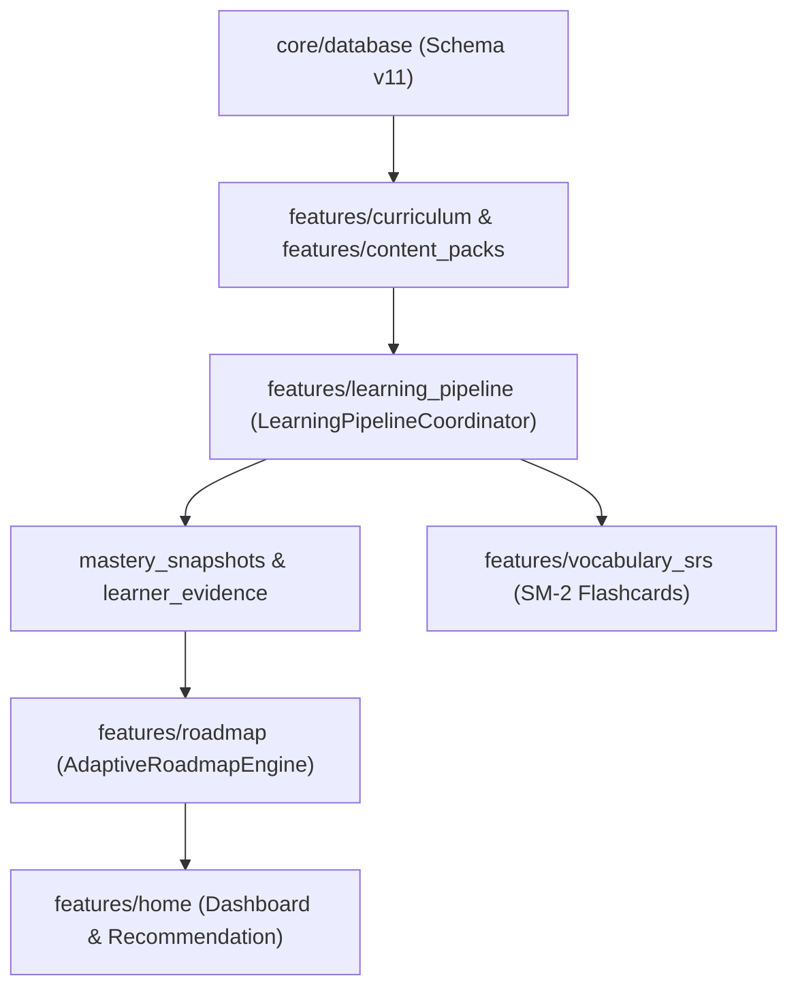

# 13. MA TRẬN PHỤ THUỘC & LUỒNG NGHIỆP VỤ LIÊN MODULE

---

## 1. MA TRẬN PHỤ THUỘC GIỮA CÁC MODULE (MODULE DEPENDENCY MATRIX)

Bảng dưới đây thể hiện mức độ phụ thuộc giữa các module tính năng trong HI Chinese. Hàng ngang là Module nguồn, Cột dọc là Module bị phụ thuộc:

| Module nguồn \ Module bị phụ thuộc | Core DB | Core Audio | Core Network | Learning Pipeline | Curriculum | Content Packs | Audio Mgmt | Roadmap | Vocabulary SRS | AI Tutor |
| :--- | :---: | :---: | :---: | :---: | :---: | :---: | :---: | :---: | :---: | :---: |
| **`learning_pipeline`** | **X** | | | — | **X** | | | | **X** | |
| **`curriculum`** | **X** | | | **X** | — | **X** | **X** | | | |
| **`content_packs`** | **X** | | | | **X** | — | | | | |
| **`audio_management`**| **X** | **X** | | | | **X** | — | | | |
| **`pinyin_foundation`**| **X** | **X** | | | | | **X** | | | |
| **`roadmap`** | **X** | | | | **X** | | | — | | |
| **`placement_test`** | **X** | | | | | | | **X** | | |
| **`vocabulary_srs`** | **X** | | | **X** | | | | | — | |
| **`practice`** | **X** | | | **X** | | | | | | |
| **`ai_tutor`** | **X** | **X** | **X** | **X** | | | | | | — |
| **`home`** | **X** | | | | | | | **X** | **X** | **X** |
| **`profile`** | **X** | | | | | | | **X** | | |
| **`settings`** | **X** | | | | | | **X** | | | |
| **`app_shell`** | **X** | | | | | | | **X** | **X** | **X** |

---

## 2. MA TRẬN SỞ HỮU VÀ QUYỀN TRUY CẬP DỮ LIỆU (DATA OWNERSHIP & READ/WRITE)

Để ngăn chặn việc nhiều module tự ý định nghĩa lại quy tắc ghi dữ liệu (gây đứt gãy luồng học tập), hệ thống phân định quyền ghi dữ liệu nghiêm ngặt:

| Bảng Cơ sở dữ liệu | Module Sở hữu Quyền Ghi (Write Owner) | Các Module chỉ Đọc (Read-Only Consumers) |
| :--- | :--- | :--- |
| `vocabularies`, `vocabulary_senses` | `content_packs`, `curriculum` (khi nạp giáo trình) | `dictionary`, `vocabulary_srs`, `reading`, `practice`, `ai_tutor` |
| `grammar_items` | `content_packs`, `curriculum` | `grammar`, `practice`, `reading`, `ai_tutor` |
| `content_packs`, `curriculums`, `curriculum_lessons` | `content_packs` (`ContentPackManager`) | `curriculum`, `roadmap`, `home` |
| `knowledge_registry`, `lesson_knowledge_items` | `content_packs` (`ContentPackManager`) | `learning_pipeline`, `curriculum`, `ai_tutor` |
| `lesson_progress` | `learning_pipeline` (`LearningPipelineCoordinator`) | `roadmap`, `curriculum`, `home` |
| `learner_evidence` | `learning_pipeline` (`LearningPipelineCoordinator`) | `ai_tutor` (`LearnerContextService`), `roadmap` |
| `mastery_snapshots` | `learning_pipeline` (`LearningPipelineCoordinator`) | `roadmap`, `home`, `curriculum` |
| `srs_items` | `vocabulary_srs` (`SrsRepository`), `learning_pipeline` | `home`, `review` |
| `practice_attempts` | `practice` (`PracticeRepository`), `learning_pipeline` | `practice`, `learning_pipeline` |
| `audio_assets` | `audio_management` (`AudioAssetDao`, `Downloader`) | `unified_audio_playback_service`, `curriculum`, `pinyin_foundation` |
| `pinyin_progress` | `pinyin_foundation` (`PinyinRepository`) | `roadmap`, `home` |
| `user_profiles`, `goal_history` | `profile` (`ProfileRepository`) | `home`, `settings`, `roadmap` |
| `app_settings` | `settings` (`AppSettingsDao`) | Toàn bộ ứng dụng |

---

## 3. ĐƯỜNG GĂNG NGHIỆP VỤ SƯ PHẠM (CRITICAL PATH)

Các thay đổi trong các module sau đây sẽ tạo ra ảnh hưởng dây chuyền (ripple effect) lớn nhất trên toàn bộ dự án:

- **Vùng nguy hiểm cấp 1:** Bất kỳ thay đổi nào tại `core/database` (thay đổi kiểu cột, tên bảng) bắt buộc phải tạo file `Migration` mới, không được sửa đè các file migration cũ (từ v1 đến v11).
- **Vùng nguy hiểm cấp 2:** Bất kỳ thao tác hoàn thành bài tập nào bắt buộc phải thông qua `LearningPipelineCoordinator`, không được ghi trực tiếp vào `lesson_progress` mà bỏ quên `learner_evidence` và `srs_items`.

---

## 4. KIỂM TOÁN PHỤ THUỘC VÒNG (CIRCULAR DEPENDENCY AUDIT)

Kết quả kiểm toán mã nguồn xác nhận:
- **Không có phụ thuộc vòng trực tiếp (Zero Circular Dependencies):** Các tầng tuân thủ nguyên tắc một chiều từ Presentation -> Domain -> Data -> Infrastructure.
- Giao tiếp giữa `curriculum` và `learning_pipeline` được phân tách thông qua interface và models trong Domain Layer (`LessonPipelineResult`, `MasteryState`).
