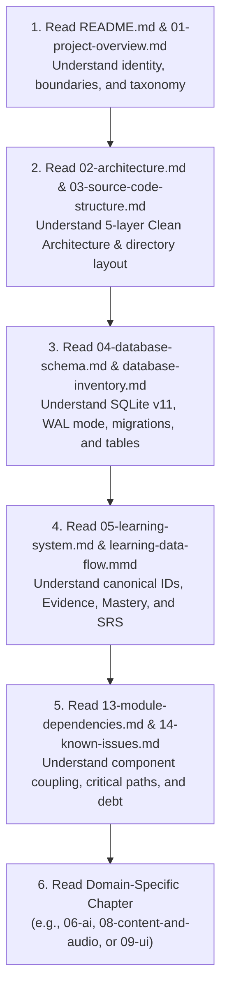

# 15. AI Agent Handover Guide & Operating Protocol

## 1. Mission & Orientation for the Incoming AI Agent

Welcome, AI Agent. If you are reading this document, you have been tasked with maintaining, debugging, extending, or refactoring the **HI Chinese** Flutter application.

HI Chinese is a production-grade, offline-first mobile learning application designed for Vietnamese learners studying Mandarin Chinese (from absolute beginner Pinyin up to HSK 6).

Before writing a single line of code, understand these fundamental project realities:
1. **This is an independent Flutter Android repository** strictly located at `c:\Users\phama\Downloads\hi_chinese`. You must **NEVER** reference, import, search, or access any Halo Chinese files or concepts.
2. **Offline-First & Local-First**: The application operates autonomously without a remote user account database or custom backend API. User profiles, goal history, evidence trails, and mastery snapshots live 100% locally in SQLite (`Schema v11`).
3. **Pedagogical Integrity**: Learning algorithms (SM-2 SRS, CAT 2PL IRT, Rule-based Hanzi stroke checking, Pinyin phoneme validation) run deterministically via local Dart engines. Gemini AI is **auxiliary only** (tutor chat, practice scenario feedback) and is strictly sandboxed.

---

## 2. Reading Order & Ramp-Up Sequence

Follow this strict sequential reading checklist before attempting non-trivial changes:



1. **Step 1: System Identity & Boundaries**
   - Read [`README.md`](./README.md) and [`01-project-overview.md`](./01-project-overview.md).
   - Check the functional status in [`inventories/module-inventory.md`](./inventories/module-inventory.md).
2. **Step 2: Architecture & Layout**
   - Read [`02-architecture.md`](./02-architecture.md) and [`03-source-code-structure.md`](./03-source-code-structure.md).
   - Review [`diagrams/system-architecture.mmd`](./diagrams/system-architecture.mmd).
3. **Step 3: Database & State Storage**
   - Read [`04-database-schema.md`](./04-database-schema.md) and [`inventories/database-inventory.md`](./inventories/database-inventory.md).
   - Review [`diagrams/database-er.mmd`](./diagrams/database-er.mmd).
4. **Step 4: The Learning Pipeline (The Heart of the System)**
   - Read [`05-learning-system.md`](./05-learning-system.md) and examine [`diagrams/learning-data-flow.mmd`](./diagrams/learning-data-flow.mmd).
   - Trace how `LearningPipelineCoordinator` processes `LearnerEvidence` into `MasteryProgress` and `SrsFlashcard`.
5. **Step 5: Dependencies & Technical Debt**
   - Read [`13-module-dependencies.md`](./13-module-dependencies.md) and [`14-known-issues-and-technical-debt.md`](./14-known-issues-and-technical-debt.md).
6. **Step 6: Contextual Deep Dive**
   - If touching AI: read [`06-ai-architecture.md`](./06-ai-architecture.md).
   - If touching Audio or Content Packs: read [`08-content-and-audio.md`](./08-content-and-audio.md).
   - If touching UI: read [`09-ui-and-navigation.md`](./09-ui-and-navigation.md) and [`inventories/screen-inventory.md`](./inventories/screen-inventory.md).

---

## 3. Mandatory Golden Rules (Non-Negotiable Constraints)

When you make modifications to this codebase, you **MUST** uphold these 8 Golden Rules:

### Rule 1: Never Bypass the Database Migration Engine
- **Constraint**: Never modify `onCreate` in `DatabaseHelper` to fix a migration bug for existing databases. Never alter table definitions without writing a new forward migration.
- **Protocol**: 
  - If a schema change is required, increment `AppConstants.databaseVersion` and `DatabaseConstants.databaseVersion` in tandem.
  - Implement a dedicated migration method `_migrateV{N}ToV{N+1}(db)` in `DatabaseHelper`.
  - Add integration tests verifying migration from `V{N}` to `V{N+1}` without data loss.

### Rule 2: Never Write Directly to Mastery or SRS from UI Screens
- **Constraint**: UI screens, widgets, and controllers must **never** execute direct SQL `UPDATE` or `INSERT` statements on `mastery_snapshots`, `mastery_progress`, or `srs_flashcards`.
- **Protocol**: 
  - All learning events must emit a `LearnerEvidence` object.
  - Dispatch the evidence via `LearningPipelineCoordinator.recordEvidence(evidence)`.
  - Let the coordinator atomically update mastery, adjust SRS intervals via SM-2, and notify Riverpod providers.

### Rule 3: Never Hardcode API Keys or Secrets
- **Constraint**: Never commit Gemini API keys, Cloudflare access tokens, or third-party credentials in Dart source code or configuration files.
- **Protocol**:
  - Gemini API keys must only be loaded via `--dart-define=GEMINI_API_KEY=...` or entered by the user via `ApiKeySettingsScreen` and saved securely in `flutter_secure_storage`.
  - Always read credentials through `SecureStorageService`.

### Rule 4: Decouple Knowledge Identity from Content Packs
- **Constraint**: Never create learning content with arbitrary, transient IDs (e.g., `item_1`, `question_4`).
- **Protocol**:
  - Always register or reference stable Canonical Knowledge IDs formatted as `KNOW_VOCAB_{HANZI}_{PINYIN}`, `KNOW_GRAMMAR_{LEVEL}_{CODE}`, or `KNOW_RADICAL_{CHAR}`.
  - User progress tracks canonical IDs; content packs may update texts, audio URLs, or examples without resetting user learning mastery.

### Rule 5: Keep the Audio Pipeline Resilient and Non-Blocking
- **Constraint**: Audio playback or download failures must never freeze the UI or crash a quiz session.
- **Protocol**:
  - Audio files must be downloaded staged (`.tmp/` suffix), verified by SHA-256 / Content-Length, and atomically renamed.
  - `UnifiedAudioPlaybackService` must gracefully fall back from Local File -> Network URL -> System TTS -> Silent failure with user snackbar.

### Rule 6: Respect the 5-Layer Clean Architecture & Riverpod Encapsulation
- **Constraint**: Presentation layer widgets must not import SQLite DAOs or raw HTTP clients.
- **Protocol**:
  - `Presentation` -> watches `StateNotifier / Notifier Providers` -> calls `Domain Repositories / Coordinators` -> uses `Data Sources / Network Clients`.
  - Maintain 0 circular dependencies across features.

### Rule 7: Do Not Fabricate Unimplemented Systems
- **Constraint**: If an issue or prompt asks you to interact with a remote authentication server, Cloudflare tunnel, or remote user sync server, verify reality first.
- **Protocol**:
  - Refer to [`07-server-and-sync.md`](./07-server-and-sync.md). These remote systems do **NOT** exist.
  - Explain the offline-first architecture clearly rather than introducing fake stubs or broken network clients.

### Rule 8: Preserve Clean Modern White & Light Blue Design Language
- **Constraint**: Never introduce dark themes, neon gradients, high-contrast dark cards, or random accent colors.
- **Protocol**:
  - Use tokens from `AppTheme`: `surface` (`#F8FAFC`), `surfaceCard` (`#FFFFFF`), `primaryBlue` (`#2563EB`), `accentLightBlue` (`#E0F2FE`), `textPrimary` (`#0F172A`).
  - Follow the 4px/8px grid system and keep elevations minimal (0 to 2dp).

---

## 4. Step-by-Step Operating Workflows

### 4.1. Workflow A: Implementing a New Learning Activity / Quiz Type
1. **Model the Evidence**:
   - Locate `lib/features/learning_pipeline/domain/entities/learner_evidence.dart`.
   - Ensure your activity type is supported in `ActivityType` enum.
2. **Implement Presentation & State**:
   - Create screen/widgets under `lib/features/<feature_name>/presentation/`.
   - On completion of an item, construct `LearnerEvidence`:
     ```dart
     final evidence = LearnerEvidence(
       id: const Uuid().v4(),
       userId: currentUserId,
       canonicalId: item.canonicalId,
       hskLevel: item.hskLevel,
       activityType: ActivityType.quiz,
       score: isCorrect ? 1.0 : 0.0,
       isCorrect: isCorrect,
       timeSpentMs: stopwatch.elapsedMilliseconds,
       timestamp: DateTime.now(),
     );
     ```
3. **Dispatch to Pipeline**:
   - Read `learningPipelineCoordinatorProvider`:
     ```dart
     await ref.read(learningPipelineCoordinatorProvider).recordEvidence(evidence);
     ```
4. **Write Tests**:
   - Write a widget test in `test/features/<feature_name>/` verifying that answering fires the coordinator.
   - Run `flutter test test/features/<feature_name>/`.

### 4.2. Workflow B: Adding a New Database Table or Column
1. **Define Table Constants**:
   - Open `lib/core/constants/database_constants.dart`.
   - Add table name, column names, and index names.
2. **Update DatabaseHelper**:
   - Open `lib/core/database/database_helper.dart`.
   - Increment `_databaseVersion` (and sync `AppConstants.databaseVersion`).
   - Add table DDL to `_onCreate` (for fresh installs).
   - Add migration case in `_onUpgrade` (e.g., `if (oldVersion < 12) await _migrateV11ToV12(db);`).
3. **Write Migration Test**:
   - Open `test/core/database/migration_test.dart` or create a new migration test suite.
   - Test upgrading from an actual V11 schema file/mock to V12, verifying data retention.
4. **Update Documentation**:
   - Add the table/column definition to [`docs/system-documentation/04-database-schema.md`](./04-database-schema.md) and [`docs/system-documentation/inventories/database-inventory.md`](./inventories/database-inventory.md).

### 4.3. Workflow C: Adding a New Content Pack (e.g., HSK 4)
1. **Structure Content JSON**:
   - Follow Schema v2 specified in [`08-content-and-audio.md`](./08-content-and-audio.md).
   - Include `schema_version: 2`, `pack_id: "hsk4_v1"`, and explicit `knowledge_items` with canonical IDs.
2. **Validate Manifest**:
   - Add entry to `assets/content_packs/manifest.json`.
   - Include SHA-256 checksum and total byte size.
3. **Test Atomic Ingestion**:
   - Verify `ContentPackManager.installPack()` successfully inserts all items within an atomic transaction.
   - Run `flutter test test/features/curriculum/content_pack_manager_test.dart`.

---

## 5. Build, Test, and Verification Checklist

Every pull request or modification by an incoming agent must pass this 4-step verification gate:

```bash
# Step 1: Static Analysis (Zero warnings, zero errors)
dart analyze lib test

# Step 2: Format Check
dart format --output=none --set-exit-if-changed lib test

# Step 3: Run Full Test Suite (All 64+ test suites must pass)
flutter test

# Step 4: Verification Build (Android APK ARM64 release)
flutter build apk --release --target-platform android-arm64
```

> [!WARNING]
> If any test in `test/regression/master_regression_test.dart` fails, the build is considered broken. Revert your changes immediately and investigate why the learning data pipeline or database invariants were violated.

---

## 6. Where to Find Things: Quick Symbol Lookup Table

| If you need to... | Go to File | Key Class / Method |
| :--- | :--- | :--- |
| Initialize or migrate database | `lib/core/database/database_helper.dart` | `DatabaseHelper.database`, `_onUpgrade` |
| Record learning evidence | `lib/features/learning_pipeline/domain/services/learning_pipeline_coordinator.dart` | `recordEvidence()`, `recordSessionEvidence()` |
| Calculate flashcard intervals | `lib/features/spaced_repetition/domain/services/sm2_algorithm.dart` | `SM2Algorithm.calculateNextReview()` |
| Administer CAT placement quiz | `lib/features/placement_test/domain/services/cat_engine.dart` | `CATEngine.selectNextItem()`, `estimateTheta()` |
| Call Google Gemini AI | `lib/features/ai_chat/data/datasources/gemini_rest_client.dart` | `GeminiRestClient.generateContent()` |
| Manage content packs | `lib/features/curriculum/data/services/content_pack_manager.dart` | `installPack()`, `validateManifest()` |
| Download offline audio files | `lib/features/audio_management/data/services/audio_storage_manager.dart` | `downloadAndStore()`, `getAudioPath()` |
| Play pronunciation / audio | `lib/core/services/unified_audio_playback_service.dart` | `play()`, `stop()` |
| Access active user profile | `lib/features/user_profile/presentation/providers/user_profile_providers.dart` | `activeUserProfileProvider` |
| Render Pinyin Tone Contour | `lib/features/pinyin_foundation/presentation/widgets/pinyin_tone_contour_chart.dart` | `PinyinToneContourChart` |
| Render Hanzi Grid | `lib/features/hanzi/presentation/widgets/mizige_painter.dart` | `MizigePainter` |
| Backup or Reset Data | `lib/features/settings/data/services/data_management_service.dart` | `backupUserData()`, `resetDatabaseSafely()` |

---

## 7. Emergency Protocol: When Something Breaks

If you encounter unexpected regressions or crashes:
1. **Database Lock / SQLite Exception**:
   - Check if you opened a raw database instance without using `DatabaseHelper.instance.database`.
   - Check if an asynchronous transaction was not awaited properly.
2. **Audio File 404 / Missing Audio**:
   - Check `audio_assets` table via `AudioStorageManager.getAudioPath(audioId)`.
   - Inspect whether the file exists in application storage or if fallback to TTS triggered.
3. **Riverpod State Inconsistency**:
   - Check if you forgot to invalidate or update family providers (`masteryProgressStreamProvider`, `srsDueCardsProvider`) after dispatching evidence.
4. **Stuck Background Isolate**:
   - Ingesting packs larger than 5MB must run through `compute(parseAndValidatePack, jsonString)` to avoid dropping UI frames.

*Document authored and verified for incoming AI Agents. Maintain this standard with discipline.*
